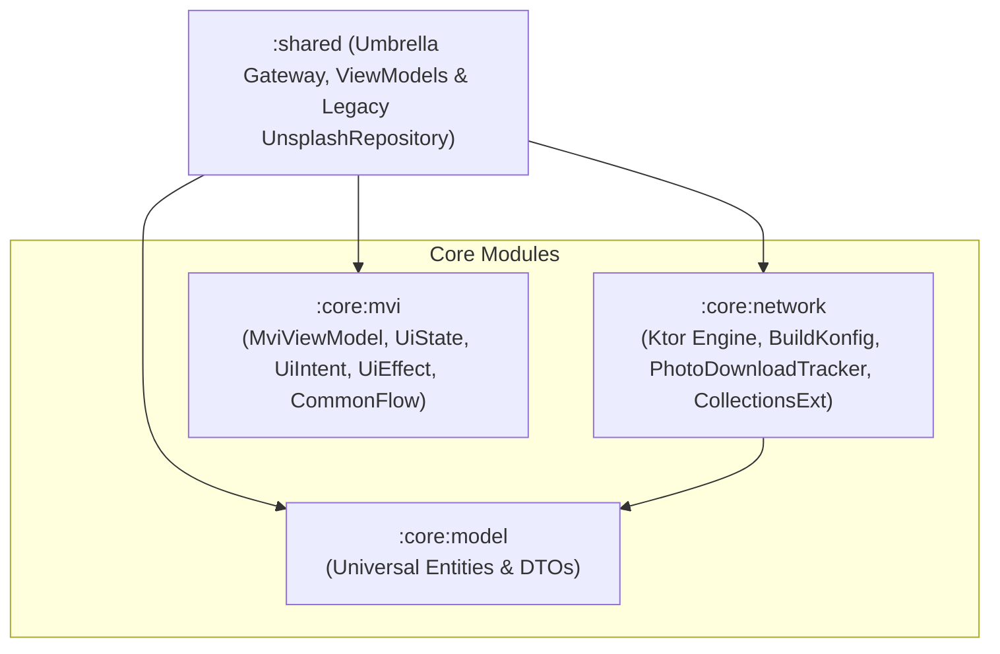

# Specification 46: Modularization Phase 1 - Foundation & Core Extraction

**Status:** Implemented

## 1. Overview & Problem Statement

As established in the architectural research evaluation ([`specs/researches/modularization_evaluation.md`](file:///Users/davidtiagoconceicao/Developer/image-feed-app/specs/researches/modularization_evaluation.md#L412-L600)), the current codebase concentrates all business logic, networking, models, repositories, and MVI ViewModels in a single monolithic `:shared` module.

While this monolith provided rapid velocity during early development, any minor modification to low-level entities (such as [`Photo.kt`](file:///Users/davidtiagoconceicao/Developer/image-feed-app/shared/src/commonMain/kotlin/com/example/imagefeed/model/Photo.kt) or [`UnsplashApiClient.kt`](file:///Users/davidtiagoconceicao/Developer/image-feed-app/shared/src/commonMain/kotlin/com/example/imagefeed/api/UnsplashApiClient.kt)) triggers a full cascading rebuild of all presentation ViewModels, platform bindings, and test suites. Furthermore, an audit of the codebase revealed key architectural smells: a monolithic repository god-interface with 17+ methods, duplicated "god fakes" across all unit tests, coupled download tracking, and misplaced feature models.

Under **Option B (Vertical Feature Ownership)**, data access will be vertically owned by individual feature modules rather than segregated into a centralized, monolithic `:core:data` layer. Consequently, **Phase 1** extracts strictly foundational core infrastructure into isolated, highly cacheable Gradle modules:
- [`:core:model`](file:///Users/davidtiagoconceicao/Developer/image-feed-app/specs/researches/modularization_evaluation.md#L533-L536) (universal domain entities and serialization DTOs)
- [`:core:mvi`](file:///Users/davidtiagoconceicao/Developer/image-feed-app/specs/researches/modularization_evaluation.md#L537-L539) (presentation primitives)
- [`:core:network`](file:///Users/davidtiagoconceicao/Developer/image-feed-app/specs/researches/modularization_evaluation.md#L540-L543) (HTTP engine, `BuildKonfig`, `PhotoDownloadTracker`, and `CollectionsExt`)

Legacy [`UnsplashRepository`](file:///Users/davidtiagoconceicao/Developer/image-feed-app/shared/src/commonMain/kotlin/com/example/imagefeed/repository/UnsplashRepository.kt) and [`UnsplashApiClient`](file:///Users/davidtiagoconceicao/Developer/image-feed-app/shared/src/commonMain/kotlin/com/example/imagefeed/api/UnsplashApiClient.kt) remain temporarily in `:shared` during Phase 1 to service un-migrated ViewModels without creating an intermediate `:core:data` module that would need to be dismantled later.

This extraction leaves `:shared` intact as an assembly and umbrella gateway for the platform UI shells (`androidApp`, `iosApp`, and `macosApp`), ensuring zero disruption to existing UI screens during the transition.

---

## 2. Technical Architecture & Module Specifications

### A. `:core:model`
* **Purpose**: Pure Kotlin data entities and serialization DTOs with zero dependencies on network engines or UI lifecycles.
* **Contents**:
  - [`Photo.kt`](file:///Users/davidtiagoconceicao/Developer/image-feed-app/shared/src/commonMain/kotlin/com/example/imagefeed/model/Photo.kt), `PhotoUrls`, `Exif`, `Location`, `Tag`
  - [`Topic.kt`](file:///Users/davidtiagoconceicao/Developer/image-feed-app/shared/src/commonMain/kotlin/com/example/imagefeed/model/Topic.kt)
  - [`PhotoCollection.kt`](file:///Users/davidtiagoconceicao/Developer/image-feed-app/shared/src/commonMain/kotlin/com/example/imagefeed/model/PhotoCollection.kt), `PreviewPhoto`
  - [`CollectionSummary.kt`](file:///Users/davidtiagoconceicao/Developer/image-feed-app/shared/src/commonMain/kotlin/com/example/imagefeed/model/CollectionSummary.kt), `CollectionLinks`
  - `User`, `ProfileImage`, `UserLinks`, `Social`
  - `SearchResponse` (search result containers)
* **Domain Model Scoping Note**: Feature-specific models (`PhotoStats` and `UserStats`) will migrate directly to `:feature:details` and `:feature:profile` during their respective feature extractions, keeping `:core:model` strictly scoped to universal domain types.
* **Dependencies**:
  - `kotlinx-serialization-json`
* **Target Platforms**: `android` (namespace `com.example.imagefeed.core.model`), `iosArm64`, `iosSimulatorArm64`, `macosArm64`.

### B. `:core:mvi`
* **Purpose**: Platform-agnostic presentation foundation and Unidirectional Data Flow primitives.
* **Contents**:
  - [`MviViewModel.kt`](file:///Users/davidtiagoconceicao/Developer/image-feed-app/shared/src/commonMain/kotlin/com/example/imagefeed/presentation/mvi/MviViewModel.kt)
  - [`UiState.kt`](file:///Users/davidtiagoconceicao/Developer/image-feed-app/shared/src/commonMain/kotlin/com/example/imagefeed/presentation/mvi/UiState.kt)
  - [`UiIntent.kt`](file:///Users/davidtiagoconceicao/Developer/image-feed-app/shared/src/commonMain/kotlin/com/example/imagefeed/presentation/mvi/UiIntent.kt)
  - [`UiEffect.kt`](file:///Users/davidtiagoconceicao/Developer/image-feed-app/shared/src/commonMain/kotlin/com/example/imagefeed/presentation/mvi/UiEffect.kt)
  - [`CommonFlow.kt`](file:///Users/davidtiagoconceicao/Developer/image-feed-app/shared/src/commonMain/kotlin/com/example/imagefeed/util/CommonFlow.kt)
* **Dependencies**:
  - `kotlinx-coroutines-core`
  - `androidx-lifecycle-viewmodel`
* **Target Platforms**: `android` (namespace `com.example.imagefeed.core.mvi`), `iosArm64`, `iosSimulatorArm64`, `macosArm64`.

### C. `:core:network`
* **Purpose**: HTTP client configuration, serialization content negotiation, logging, compile-time API key injection, compliance download tracking, and network collection utilities.
* **Contents**:
  - Ktor HTTP client engine factory (`createUnsplashHttpClient`)
  - `BuildKonfig` plugin configuration loading `unsplash.api.key` from `local.properties` with `packageName = "com.example.imagefeed.core.network"`
  - `generateBuildKonfig` Gradle post-processing task replicating [`shared/build.gradle.kts`](file:///Users/davidtiagoconceicao/Developer/image-feed-app/shared/build.gradle.kts#L83-L92) to replace 2-space indentation with 4 spaces for `ktlint` compliance
  - Network error handling and logging plugins
  - `PhotoDownloadTracker`: Dedicated download tracking utility that executes compliant Unsplash `photo.links.download_location` triggers directly via `HttpClient`, decoupling this compliance obligation from domain repositories.
  - [`CollectionsExt.kt`](file:///Users/davidtiagoconceicao/Developer/image-feed-app/shared/src/commonMain/kotlin/com/example/imagefeed/util/CollectionsExt.kt): Pagination stream deduplication helper (`filterDistinctAgainst`).
* **Dependencies**:
  - `:core:model`
  - Ktor 3 Client Core, Content Negotiation, Serialization, Logging, OkHttp (Android), Darwin (Apple)
* **Target Platforms**: `android` (namespace `com.example.imagefeed.core.network`), `iosArm64`, `iosSimulatorArm64`, `macosArm64`.

### D. Assembly & Umbrella Integration (`:shared`)
* During Phase 1, `:shared` includes `:core:network`, `:core:mvi`, and `:core:model` as `api(...)` dependencies.
* Legacy `UnsplashApiClient` and `UnsplashRepository` remain temporarily in `:shared` until features migrate in Phase 2 & 3.
* The Metro DI graph in [`Metro.kt`](file:///Users/davidtiagoconceicao/Developer/image-feed-app/shared/src/commonMain/kotlin/com/example/imagefeed/di/Metro.kt) remains in `:shared`, injecting `HttpClient` from `:core:network` into `UnsplashApiClient`.
* Presentation ViewModels remain temporarily inside `:shared`, consuming `:core:mvi` and legacy repository types.
* The native Apple framework exported by `:shared` continues to export all required public symbols to `iosApp` and `macosApp`.

---

## 3. Implementation Steps

- [x] **Step 1: Module Directory & Build Script Scaffolding**
  - Register `:core:model`, `:core:mvi`, and `:core:network` in `settings.gradle.kts`.
  - Create standard KMP `build.gradle.kts` files using the `com.android.kotlin.multiplatform.library` plugin and Apple Silicon targets (`iosArm64`, `iosSimulatorArm64`, `macosArm64`).
  - Configure distinct Android namespaces: `com.example.imagefeed.core.model`, `com.example.imagefeed.core.mvi`, and `com.example.imagefeed.core.network`.
- [x] **Step 2: Extract `:core:model`**
  - Move universal model files from `shared/src/commonMain/kotlin/com/example/imagefeed/model/` to `core/model/src/commonMain/kotlin/com/example/imagefeed/model/`.
  - Verify serialization annotations and package structures.
- [x] **Step 3: Extract `:core:mvi`**
  - Move `MviViewModel.kt`, `UiState.kt`, `UiIntent.kt`, `UiEffect.kt`, and `CommonFlow.kt` to `core/mvi/src/commonMain/kotlin/com/example/imagefeed/presentation/mvi/`.
  - Migrate corresponding unit tests from [`shared/src/commonTest/kotlin/com/example/imagefeed/presentation/mvi/MviViewModelTest.kt`](file:///Users/davidtiagoconceicao/Developer/image-feed-app/shared/src/commonTest/kotlin/com/example/imagefeed/presentation/mvi/MviViewModelTest.kt) to `core/mvi/src/commonTest`.
- [x] **Step 4: Extract `:core:network`**
  - Move Ktor client instantiation and `BuildKonfig` configuration from `:shared` to `core/network` with `packageName = "com.example.imagefeed.core.network"`.
  - Replicate `generateBuildKonfig` Gradle post-processing task in `core/network/build.gradle.kts` for `ktlint` compliance.
  - Implement `PhotoDownloadTracker` in `core/network` to encapsulate Unsplash download tracking requests.
  - Relocate [`CollectionsExt.kt`](file:///Users/davidtiagoconceicao/Developer/image-feed-app/shared/src/commonMain/kotlin/com/example/imagefeed/util/CollectionsExt.kt) into `core/network`.
  - Wire platform engines in `androidMain` (OkHttp) and `appleMain` (Darwin).
- [x] **Step 5: Update `:shared` Dependencies & Re-exports**
  - Configure `:shared/build.gradle.kts` to depend on `:core:mvi`, `:core:model`, and `:core:network`.
  - Update imports in legacy `UnsplashApiClient.kt`, `UnsplashRepository.kt`, and Metro graph in `:shared`.
  - Expose core contracts via `api(...)` in `commonMain` and via `export(...)` in the native binary framework block.
- [x] **Step 6: Verification & Build Validation**
  - Run `./gradlew :core:model:allTests :core:mvi:allTests :core:network:allTests :shared:allTests`.
  - Execute full dual-platform verification:
    - Android: `./gradlew :androidApp:assembleDebug`
    - iOS/macOS: `xcodegen generate --spec iosApp/project.yml && xcodebuild -project iosApp/iosApp.xcodeproj -scheme iosApp -destination 'generic/platform=iOS Simulator' build CODE_SIGNING_ALLOWED=NO`
  - Run code formatters and linters (`ktlintCheck`, `detekt`, `swiftlint`, `swiftformat`).

---

## 4. Acceptance Criteria

- [x] `:core:model`, `:core:mvi`, and `:core:network` are isolated Gradle modules compiling cleanly with unique Android namespaces (`com.example.imagefeed.core.*`).
- [x] Centralized `:core:data` is eliminated from Phase 1 scope; data access will be vertically owned by features.
- [x] `PhotoDownloadTracker` and `CollectionsExt` are cleanly extracted into `:core:network`.
- [x] `BuildKonfig` generates cleanly in `:core:network` with package `com.example.imagefeed.core.network` and satisfies `ktlint`.
- [x] `:core:model` has zero dependencies on Ktor, Coroutines, or UI lifecycle libraries.
- [x] `:shared` compiles successfully as an assembly umbrella and exports symbols to Xcode without Swift compilation errors.
- [x] Existing Android, iOS, and macOS applications build and run with zero regression in functionality.
- [x] All unit tests pass across all newly extracted modules and `:shared`.

