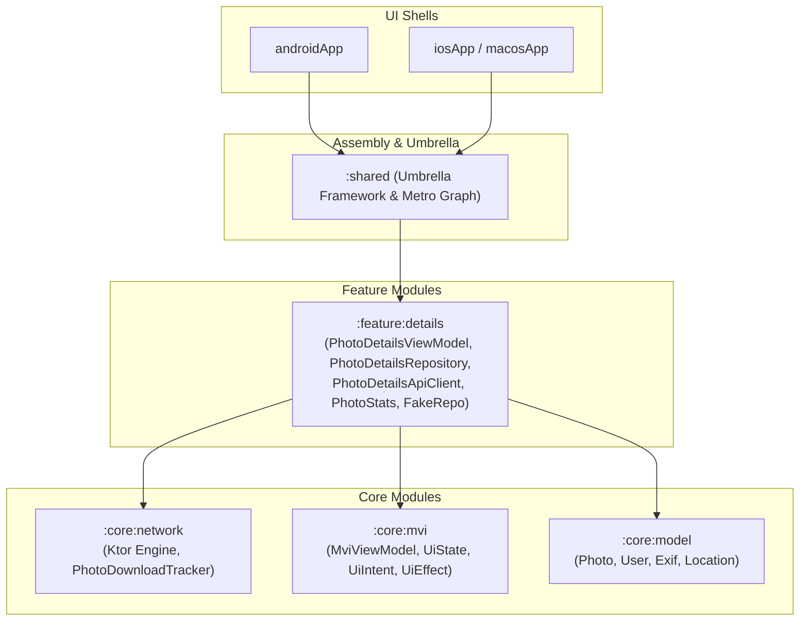

# Specification 47: Modularization Phase 2 - Pilot Feature Migration (`:feature:details`)

**Status:** Approved

## 1. Overview & Problem Statement

Following the extraction of foundational core modules in [Spec 46](file:///Users/davidtiagoconceicao/Developer/image-feed-app/specs/46_modularization_foundation_core_extraction.md), **Phase 2** validates the vertical feature modularization pattern (**Option B: Vertical Feature Ownership**) on a single pilot feature: **Photo Details** ([`:feature:details`](file:///Users/davidtiagoconceicao/Developer/image-feed-app/specs/researches/modularization_evaluation.md#L547-L552)).

As evaluated in [`specs/researches/modularization_evaluation.md`](file:///Users/davidtiagoconceicao/Developer/image-feed-app/specs/researches/modularization_evaluation.md#L414-L466), Photo Details serves as the ideal pilot candidate because:
1. **Vertical Domain Ownership**: Under Option B, `:feature:details` owns its complete vertical slice: presentation MVI ViewModels, dedicated domain repository (`PhotoDetailsRepository`), concrete implementation (`PhotoDetailsRepositoryImpl`), dedicated HTTP client (`PhotoDetailsApiClient`), feature-scoped domain model (`PhotoStats`), and isolated test fake (`FakePhotoDetailsRepository`).
2. **Assisted Dependency Injection**: It requires runtime parameterization (`photoId: String`) via Metro's `@AssistedInject` and `@AssistedFactory`. Validating that Metro compiles assisted factories across Gradle module boundaries is essential before migrating remaining features.
3. **Elimination of God-Fakes & Monolithic Couplings**: It replaces the monolithic `FakeUnsplashRepository` (which forced stubbing all 17 Unsplash API methods) with a lean 2-method `FakePhotoDetailsRepository` (`getPhotoDetails`, `getPhotoStats`), while delegating download tracking to `PhotoDownloadTracker` from `:core:network`.
4. **Dual-Platform Integration Seams**: It integrates directly with Android's Navigation 3 entry providers and iOS's detented glass inspector sheets, testing Swift symbol resolution and Objective-C bridging through the `:shared` umbrella framework.

---

## 2. Technical Architecture & Component Design



### A. Module Configuration (`:feature:details`)
* **Module Path**: `feature/details`
* **Gradle Plugins**:
  - `alias(libs.plugins.kotlinMultiplatform)`
  - `alias(libs.plugins.androidMultiplatformLibrary)`
  - `alias(libs.plugins.metro)`
* **Dependencies**:
  - `projects.core.model` (for `Photo`, `User`, `Exif`, `Location`)
  - `projects.core.mvi` (for `MviViewModel`, `UiState`, `UiIntent`, `UiEffect`)
  - `projects.core.network` (for `HttpClient`, `PhotoDownloadTracker`)
  - `libs.kotlinx.coroutines.core`
  - `libs.androidx.lifecycle.viewmodel`
* **Target Platforms**: `android` (namespace `com.example.imagefeed.feature.details`), `iosArm64`, `iosSimulatorArm64`, `macosArm64`.

### B. Vertical Feature Artifacts & Domain Scoping

#### 1. Presentation
Move the following files from `shared/src/commonMain/kotlin/com/example/imagefeed/presentation/details/` to `feature/details/src/commonMain/kotlin/com/example/imagefeed/presentation/details/`:
- [`PhotoDetailsViewModel.kt`](file:///Users/davidtiagoconceicao/Developer/image-feed-app/shared/src/commonMain/kotlin/com/example/imagefeed/presentation/details/PhotoDetailsViewModel.kt)
- `PhotoDetailsState.kt`
- `PhotoDetailsIntent.kt`
- `PhotoDetailsEffect.kt`

#### 2. Data & Networking (Feature-Owned)
- **`PhotoDetailsRepository`**:
  ```kotlin
  interface PhotoDetailsRepository {
      suspend fun getPhotoDetails(id: String): Photo
      suspend fun getPhotoStats(id: String): PhotoStats
  }
  ```
- **`PhotoDetailsRepositoryImpl`**: `internal class PhotoDetailsRepositoryImpl(private val apiClient: PhotoDetailsApiClient) : PhotoDetailsRepository`
- **`PhotoDetailsApiClient`**: `internal class PhotoDetailsApiClient(private val client: HttpClient)` querying `photos/{id}` and `photos/{id}/statistics`.

#### 3. Feature Domain Model
- Migrate `PhotoStats` (and its nested types `StatMetric`, `HistoricalStats`, `StatsValue`) out of `shared/.../model/Photo.kt` into `feature/details/src/commonMain/kotlin/com/example/imagefeed/details/model/PhotoStats.kt`. This eliminates the domain model smell where feature metrics were polluting global core entities.

#### 4. Compliance Download Tracking
- `PhotoDetailsViewModel` injects `PhotoDownloadTracker` (from `:core:network`), delegating `trackDownload` directly rather than routing through a generic domain repository.

#### 5. Lean Unit Test Harness
- Relocate and modernize unit tests from [`shared/src/commonTest/kotlin/com/example/imagefeed/presentation/details/PhotoDetailsViewModelTest.kt`](file:///Users/davidtiagoconceicao/Developer/image-feed-app/shared/src/commonTest/kotlin/com/example/imagefeed/presentation/details/PhotoDetailsViewModelTest.kt) to `feature/details/src/commonTest/kotlin/com/example/imagefeed/presentation/details/PhotoDetailsViewModelTest.kt`.
- Replace the fragile 17-method `FakeUnsplashRepository` with a concise, targeted `FakePhotoDetailsRepository` implementing only `getPhotoDetails` and `getPhotoStats`.

### C. Metro Compile-Time DI Across Module Boundaries
- `PhotoDetailsViewModel` constructor receives feature-owned dependencies:
  ```kotlin
  class PhotoDetailsViewModel @AssistedInject constructor(
      @Assisted private val photoId: String,
      private val repository: PhotoDetailsRepository,
      private val downloadTracker: PhotoDownloadTracker,
  ) : MviViewModel<PhotoDetailsState, PhotoDetailsIntent, PhotoDetailsEffect>(...) {
      @AssistedFactory
      interface Factory {
          fun create(photoId: String): PhotoDetailsViewModel
      }
  }
  ```
- `:feature:details` declares a `public` Metro binding container (or `@ContributesTo(AppScope::class)`) providing `PhotoDetailsApiClient` and binding the public interface `PhotoDetailsRepository` to its `internal class PhotoDetailsRepositoryImpl`. Because the container is public, `:shared` can reference it without violating Kotlin module visibility rules, while the implementation class remains strictly internal.
- The `:shared` root graph ([`ApplicationGraph`](file:///Users/davidtiagoconceicao/Developer/image-feed-app/shared/src/commonMain/kotlin/com/example/imagefeed/di/Metro.kt)) imports `:feature:details` and exposes:
  ```kotlin
  val photoDetailsViewModelFactory: PhotoDetailsViewModel.Factory
  ```
- [`MetroHelper.kt`](file:///Users/davidtiagoconceicao/Developer/image-feed-app/shared/src/commonMain/kotlin/com/example/imagefeed/di/Metro.kt) delegates `getPhotoDetailsViewModel(photoId: String)` seamlessly.

### D. Apple Umbrella Framework Re-export & Encapsulation
To allow Swift views (`PhotoDetailsViewModel.swift`, `PhotoDetailsView.swift`) to access the ViewModel without linking errors:
- In `shared/build.gradle.kts`:
  ```kotlin
  sourceSets {
      commonMain.dependencies {
          api(projects.feature.details)
      }
  }
  ```
- In the native framework binary configuration:
  ```kotlin
  target.binaries.framework {
      baseName = "shared"
      export(projects.feature.details)
  }
  ```
- **Encapsulation Benefit**: Because `PhotoDetailsRepositoryImpl` and `PhotoDetailsApiClient` are marked `internal`, Kotlin/Native generates zero Objective-C bridging stubs for data implementation classes, keeping link latency low.

---

## 3. Implementation Steps

- [ ] **Step 1: Create `:feature:details` Gradle Module**
  - Add `include(":feature:details")` to `settings.gradle.kts`.
  - Author `feature/details/build.gradle.kts` targeting Android (namespace `com.example.imagefeed.feature.details`), iOS, and macOS with Metro plugin and dependencies on `:core:model`, `:core:mvi`, and `:core:network`.
- [ ] **Step 2: Migrate Feature Domain Models**
  - Relocate `PhotoStats`, `StatMetric`, `HistoricalStats`, and `StatsValue` from `Photo.kt` to `feature/details/src/commonMain/kotlin/com/example/imagefeed/details/model/PhotoStats.kt`.
- [ ] **Step 3: Extract Feature Data Layer & Download Tracker Integration**
  - Create `PhotoDetailsRepository` interface and `internal class PhotoDetailsRepositoryImpl`.
  - Create `internal class PhotoDetailsApiClient` encapsulating photo details and statistics HTTP calls.
  - Wire `PhotoDownloadTracker` from `:core:network` for download tracking triggers.
- [ ] **Step 4: Migrate Presentation & Modernize Test Harness**
  - Relocate `PhotoDetailsViewModel`, state, intent, and effect classes from `:shared` to `:feature:details`.
  - Relocate unit tests from [`shared/src/commonTest/kotlin/com/example/imagefeed/presentation/details/PhotoDetailsViewModelTest.kt`](file:///Users/davidtiagoconceicao/Developer/image-feed-app/shared/src/commonTest/kotlin/com/example/imagefeed/presentation/details/PhotoDetailsViewModelTest.kt) to `feature/details/src/commonTest/kotlin/com/example/imagefeed/presentation/details/PhotoDetailsViewModelTest.kt`.
  - Replace the 17-method `FakeUnsplashRepository` in tests with a lean, 2-method `FakePhotoDetailsRepository`.
- [ ] **Step 5: Configure `:shared` Umbrella and Metro Wiring**
  - Add `:feature:details` dependency to `:shared/build.gradle.kts` with `api` scope.
  - Re-export `:feature:details` in Apple framework binaries.
  - Verify Metro graph generation in `:shared` resolves `PhotoDetailsViewModel.Factory` without warnings.
- [ ] **Step 6: Platform UI Shell Verification**
  - Verify Android Compose navigation: `PhotoDetailsScreen` receives ViewModel from `MetroHelper.getPhotoDetailsViewModel(photoId)`.
  - Verify Swift wrapper: `PhotoDetailsViewModel.swift` compiles and observes `iosState` and `iosEffects` from the re-exported framework.
- [ ] **Step 7: Test Execution & Linting**
  - Run `./gradlew :feature:details:allTests`.
  - Verify dual-platform compilation:
    - Android: `./gradlew :androidApp:assembleDebug`
    - iOS/macOS: `xcodegen generate --spec iosApp/project.yml && xcodebuild -project iosApp/iosApp.xcodeproj -scheme iosApp -destination 'generic/platform=iOS Simulator' build CODE_SIGNING_ALLOWED=NO`
  - Execute formatters: `./gradlew ktlintFormat` and `swiftformat .`.

---

## 4. Acceptance Criteria

- [ ] `:feature:details` is an independent Gradle module vertically owning its presentation, repository, API client, and domain model (`PhotoStats`), configured with Android namespace `com.example.imagefeed.feature.details`.
- [ ] Centralized `:core:data` is bypassed; `:feature:details` depends only on `:core:model`, `:core:mvi`, and `:core:network`.
- [ ] Monolithic test fakes are eliminated in favor of a lean `FakePhotoDetailsRepository`.
- [ ] Metro successfully generates assisted injection factories across module boundaries with clean container visibility.
- [ ] `:shared` exports `PhotoDetailsViewModel` cleanly into the Apple framework without breaking Swift code.
- [ ] Dual-pane view on Android and detented inspector sheet on iOS function identically to baseline.
- [ ] All unit tests pass under `:feature:details:allTests`.
