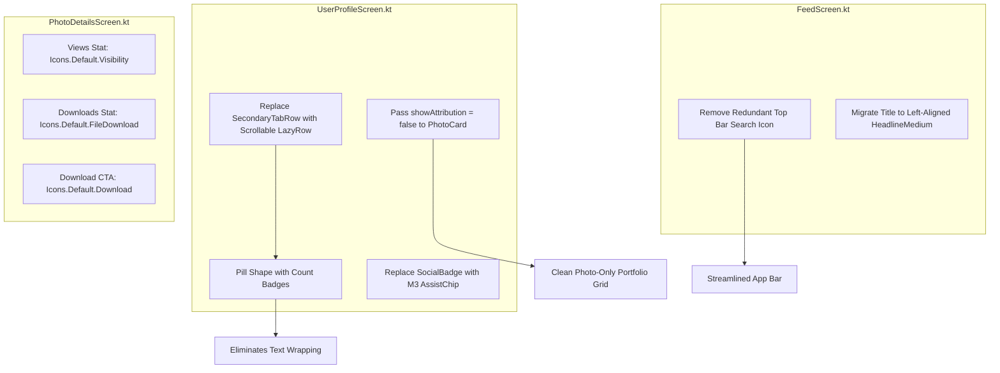

# Specification 53: Android Material 3 Expressive Core Friction Fixes & Screen Hygiene

**Status:** Implemented

---

## 1. Overview & Problem Statement

An audit of the Android UI identified several layout, typographic, and navigational friction points across existing screens ([`UserProfileScreen.kt`](file:///Users/davidtiagoconceicao/Developer/image-feed-app/androidApp/src/main/java/com/example/imagefeed/android/UserProfileScreen.kt), [`FeedScreen.kt`](file:///Users/davidtiagoconceicao/Developer/image-feed-app/androidApp/src/main/java/com/example/imagefeed/android/FeedScreen.kt), and [`PhotoDetailsScreen.kt`](file:///Users/davidtiagoconceicao/Developer/image-feed-app/androidApp/src/main/java/com/example/imagefeed/android/PhotoDetailsScreen.kt)):

1. **Profile Tab Label Wrapping Bug**:
   * In [`UserProfileScreen.kt#L470-L509`](file:///Users/davidtiagoconceicao/Developer/image-feed-app/androidApp/src/main/java/com/example/imagefeed/android/UserProfileScreen.kt#L470-L509), `SecondaryTabRow` divides available horizontal screen width evenly across 4 fixed tabs (`PORTFOLIO`, `LIKES`, `COLLECTIONS`, `INSIGHTS`).
   * When displaying counts alongside titles (e.g. `"COLLECTIONS (6)"`), the label exceeds column width on standard phone viewports, breaking mid-word into `"COLLECTIO / NS (6)"`.
2. **Redundant Feed Navigation Icon**:
   * In [`FeedScreen.kt#L161-L174`](file:///Users/davidtiagoconceicao/Developer/image-feed-app/androidApp/src/main/java/com/example/imagefeed/android/FeedScreen.kt#L161-L174), the top app bar displays `Icons.Default.Search` directly adjacent to `Icons.Default.Refresh`.
   * Search is already a top-level destination permanently accessible in the application navigation chrome.
3. **Misleading & Non-Standard Iconography**:
   * In [`PhotoDetailsScreen.kt#L760-L775`](file:///Users/davidtiagoconceicao/Developer/image-feed-app/androidApp/src/main/java/com/example/imagefeed/android/PhotoDetailsScreen.kt#L760-L775), the views metric uses `Icons.Default.Info` (an information icon) and the downloads metric uses `Icons.Default.PlayArrow` (a media playback icon).
   * The primary download button in [`PhotoDetailsScreen.kt#L825`](file:///Users/davidtiagoconceicao/Developer/image-feed-app/androidApp/src/main/java/com/example/imagefeed/android/PhotoDetailsScreen.kt#L825) uses `Icons.Default.Done` (a checkmark), falsely signaling that the image has already been downloaded.
4. **Repetitive Creator Attribution in Portfolio Grids**:
   * In [`UserProfileScreen.kt#L572-L580`](file:///Users/davidtiagoconceicao/Developer/image-feed-app/androidApp/src/main/java/com/example/imagefeed/android/UserProfileScreen.kt#L572-L580), each photo item in the creator's portfolio invokes `PhotoCard`, which stamps the photographer's avatar and truncated name over every image.
   * Because the user is already on the creator's profile page, repeating this overlay across every tile creates unnecessary visual clutter.
5. **Rigid Social Link Badges & Tracked-Out Headers**:
   * Social links in [`UserProfileScreen.kt#L440-L462`](file:///Users/davidtiagoconceicao/Developer/image-feed-app/androidApp/src/main/java/com/example/imagefeed/android/UserProfileScreen.kt#L440-L462) use uppercase custom badge containers (`"INSTAGRAM: @..."`, `"WEBSITE: LINK"`).
   * App bars in [`FeedScreen.kt`](file:///Users/davidtiagoconceicao/Developer/image-feed-app/androidApp/src/main/java/com/example/imagefeed/android/FeedScreen.kt#L152-L160) and [`PhotoDetailsScreen.kt`](file:///Users/davidtiagoconceicao/Developer/image-feed-app/androidApp/src/main/java/com/example/imagefeed/android/PhotoDetailsScreen.kt#L151-L160) use all-caps tracked-out titles (`"FEED"`, `"DETAILS"`), contrasting with Material 3 Expressive typographic hierarchy.

This specification addresses these core usability and visual hygiene friction points with zero external library additions.

---

## 2. Technical Architecture & Component Design



### A. Horizontally Scrollable Pill Tabs with Badges ([`UserProfileScreen.kt`](file:///Users/davidtiagoconceicao/Developer/image-feed-app/androidApp/src/main/java/com/example/imagefeed/android/UserProfileScreen.kt))

1. **Replace `SecondaryTabRow` with `LazyRow`**:
   * Replace the rigid 4-slot `SecondaryTabRow` in `ProfileTabSelector` with a horizontally scrollable `LazyRow` using `spacedBy(8.dp)` and `PaddingValues(horizontal = 16.dp)`.
2. **Pill Shapes & Animated Morphing**:
   * Each tab item is wrapped in an M3 `Surface` with animated corner radius:
     * Selected: `MaterialTheme.shapes.large` (16dp).
     * Unselected: `MaterialTheme.shapes.extraLarge` (28dp pill) with outline stroke.
   * Animated container colors shifting between `primaryContainer` and `surfaceContainerHigh`.
3. **Inline Count Badges**:
   * Decouple numeric counters from the label string.
   * Render the count inside an M3 `Badge` composable positioned alongside the label, ensuring that labels like `"Collections"` never wrap mid-word regardless of display scale or localization length.

### B. Compact Social Media Assist Chips ([`UserProfileScreen.kt`](file:///Users/davidtiagoconceicao/Developer/image-feed-app/androidApp/src/main/java/com/example/imagefeed/android/UserProfileScreen.kt))

1. **Migrate `SocialBadge` to `AssistChip`**:
   * Replace custom container boxes with official Material 3 `AssistChip` components.
   * Leading icons:
     * Instagram: `Icons.Default.Share` or camera vector glyph.
     * Twitter / X: brand glyph.
     * Portfolio: `Icons.Default.Language` or `Public`.
   * Labels: clean formatted handle without all-caps prefixes (e.g. `@undeniablydairy`, `Website`).

### C. Attribution Scoping in Photo Grids ([`FeedScreen.kt`](file:///Users/davidtiagoconceicao/Developer/image-feed-app/androidApp/src/main/java/com/example/imagefeed/android/FeedScreen.kt), [`UserProfileScreen.kt`](file:///Users/davidtiagoconceicao/Developer/image-feed-app/androidApp/src/main/java/com/example/imagefeed/android/UserProfileScreen.kt))

1. **`PhotoCard` Parameter Addition**:
   * Add `showAttribution: Boolean = true` to `PhotoCard` in [`FeedScreen.kt#L306`](file:///Users/davidtiagoconceicao/Developer/image-feed-app/androidApp/src/main/java/com/example/imagefeed/android/FeedScreen.kt#L306).
   * Wrap the bottom photographer attribution gradient and row inside `if (showAttribution) { ... }`.
2. **Profile Portfolio vs. Likes Scoping (Unsplash Compliance Guard)**:
   * In [`UserProfileScreen.kt`](file:///Users/davidtiagoconceicao/Developer/image-feed-app/androidApp/src/main/java/com/example/imagefeed/android/UserProfileScreen.kt), `PortfolioTabContent` is reused for both `ProfileTab.PORTFOLIO` (lines 280–290) and `ProfileTab.LIKES` (lines 291–301).
   * Add `showAttribution: Boolean = true` parameter to `PortfolioTabContent`.
   * For `ProfileTab.PORTFOLIO`, pass `showAttribution = false` (creator identity is already prominent in the profile header).
   * For `ProfileTab.LIKES`, pass `showAttribution = true` — liked photos are taken by other creators and **must** retain photographer attribution to comply with Unsplash API terms ([`AGENTS.md` Invariant 4](file:///Users/davidtiagoconceicao/Developer/image-feed-app/AGENTS.md#L45)).
   * Main feed, collections, and search screens continue to supply `showAttribution = true`.

### D. Navigation Chrome & Icon Semantic Alignment ([`FeedScreen.kt`](file:///Users/davidtiagoconceicao/Developer/image-feed-app/androidApp/src/main/java/com/example/imagefeed/android/FeedScreen.kt), [`PhotoDetailsScreen.kt`](file:///Users/davidtiagoconceicao/Developer/image-feed-app/androidApp/src/main/java/com/example/imagefeed/android/PhotoDetailsScreen.kt))

1. **Feed Top App Bar**:
   * Remove `IconButton(onClick = onSearchClick)` from `actions` in [`FeedScreen.kt#L162-L167`](file:///Users/davidtiagoconceicao/Developer/image-feed-app/androidApp/src/main/java/com/example/imagefeed/android/FeedScreen.kt#L162-L167).
   * Retain the randomize/refresh action.
   * Update top bar title from uppercase `"FEED"` to left-aligned `headlineMedium` (`"Feed"`).
2. **Details Icon Alignment**:
   * In `StatItem` invocations in [`PhotoDetailsScreen.kt#L775-L785`](file:///Users/davidtiagoconceicao/Developer/image-feed-app/androidApp/src/main/java/com/example/imagefeed/android/PhotoDetailsScreen.kt#L775-L785):
     * Views: `Icons.Default.Visibility` (Material eye symbol).
     * Downloads: `Icons.Default.FileDownload` (Material download arrow).
   * In download action button in [`PhotoDetailsScreen.kt#L838`](file:///Users/davidtiagoconceicao/Developer/image-feed-app/androidApp/src/main/java/com/example/imagefeed/android/PhotoDetailsScreen.kt#L838):
     * Replace `Icons.Default.Done` with `Icons.Default.Download`.

---

## 3. Acceptance Criteria & Verification Plan

### Acceptance Criteria
- [x] Profile tab row uses `LazyRow` with pill/squircle shape morphing and inline `Badge`s; text wrapping like `"COLLECTIO / NS (6)"` is eliminated across all font scaling settings.
- [x] Social links in `UserProfileScreen.kt` render as M3 `AssistChip`s with icons.
- [x] `PhotoCard` supports `showAttribution: Boolean`; creator portfolio grid hides photographer overlay while main feed, search, and user `ProfileTab.LIKES` retain it per Unsplash compliance.
- [x] Feed top bar omits redundant Search action icon.
- [x] Photo details screen displays `Visibility` for Views, `FileDownload` for Downloads, and `Download` for the CTA button.
- [x] Top bar titles adopt Material 3 typography standards (`headlineMedium` title case).
- [x] Zero compiler warnings and zero dead code introduced.

### Verification Commands
```bash
./gradlew :androidApp:assembleDebug
./gradlew test
```
