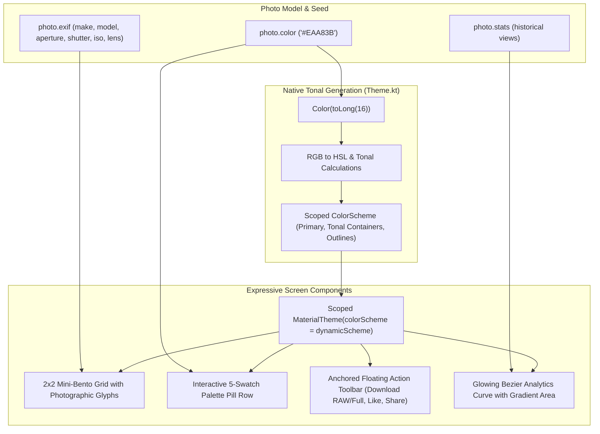

# Specification 54: Android Material 3 Expressive Photo Details & Content-Driven Dynamic Theming

**Status:** Proposed

---

## 1. Overview & Problem Statement

The Photo Details screen ([`PhotoDetailsScreen.kt`](file:///Users/davidtiagoconceicao/Developer/image-feed-app/androidApp/src/main/java/com/example/imagefeed/android/PhotoDetailsScreen.kt)) is the visual focal point of the application, yet several structural and thematic limitations restrict its expressiveness:

1. **Disconnected Primary CTA**:
   * The primary download action button ([`PhotoDetailsScreen.kt#L812-L828`](file:///Users/davidtiagoconceicao/Developer/image-feed-app/androidApp/src/main/java/com/example/imagefeed/android/PhotoDetailsScreen.kt#L812-L828)) is positioned below the 30-day analytics line chart, far from the photo canvas.
   * On mobile devices with metadata-rich photos, the button is buried beneath multiple scroll viewports.
2. **Static Surface Theming vs. Photography Atmosphere**:
   * All photo details screens currently render over an identical static dark surface with cold periwinkle accent buttons, failing to adapt to the warmth, earthiness, or mood of the photograph.
   * The Unsplash API already delivers [`photo.color: String?`](file:///Users/davidtiagoconceicao/Developer/image-feed-app/shared/src/commonMain/kotlin/com/example/imagefeed/model/Photo.kt#L12) (e.g. `"#EAA83B"`), but this seed color is ignored in the Android theme.
3. **Flat EXIF Presentation**:
   * Camera and lens specifications ([`PhotoDetailsScreen.kt#L831-L856`](file:///Users/davidtiagoconceicao/Developer/image-feed-app/androidApp/src/main/java/com/example/imagefeed/android/PhotoDetailsScreen.kt#L831-L856)) are rendered as a plain key-value text list, missing the scannable visual hierarchy of a modern photographic bento layout.
4. **Missing Creative Palette Swatches**:
   * Photography enthusiasts and designers benefit from color swatches extracted from images, but the current UI offers no color extraction or hex discovery.
5. **Analytics Curve Legibility**:
   * The historical views chart in [`PhotoDetailsScreen.kt#L797-L804`](file:///Users/davidtiagoconceicao/Developer/image-feed-app/androidApp/src/main/java/com/example/imagefeed/android/PhotoDetailsScreen.kt#L797-L804) uses a simple polyline without min/max reference bounds, area gradient depth, or smooth Bezier curvature.

This specification modernizes [`PhotoDetailsScreen.kt`](file:///Users/davidtiagoconceicao/Developer/image-feed-app/androidApp/src/main/java/com/example/imagefeed/android/PhotoDetailsScreen.kt) into an immersive Material 3 Expressive experience using native Android tonal generation and zero external dependencies.

---

## 2. Technical Architecture & Component Design



### A. Lightweight Native Dynamic Color Generation ([`Theme.kt`](file:///Users/davidtiagoconceicao/Developer/image-feed-app/androidApp/src/main/java/com/example/imagefeed/android/theme/Theme.kt))

1. **Seed Color Processing**:
   * Provide `generatePhotoColorScheme(seedHex: String?, isDark: Boolean): ColorScheme`.
   * When `seedHex` is present, parse the hex string to an ARGB integer and convert to HSL components (`androidx.core.graphics.ColorUtils.colorToHSL`).
2. **Harmonized Tonal Palette Derivation**:
   * Calculate harmonized tones without third-party dependencies:
     * `primary`: High-chroma seed tone tuned for contrast on dark surfaces ($L \approx 0.70$ in dark theme).
     * `primaryContainer`: Low-luminance tinted container ($L \approx 0.20$).
     * `surfaceContainerLow` & `surfaceContainer`: Subtle background canvas tinted by the seed's hue with low saturation ($S \approx 0.12, L \approx 0.12$).
     * `tertiary`: Complementary accent ($H + 60^\circ$ or $180^\circ$) for dual-gradient chart strokes.
3. **Scoped Theme Injection**:
   * Wrap `PhotoDetailsContent` in a local `MaterialTheme(colorScheme = dynamicScheme)` so that cards, chips, buttons, and canvas gradients automatically inherit the photograph's tonal identity.

### B. Visual EXIF 2x2 Bento Grid ([`PhotoDetailsScreen.kt`](file:///Users/davidtiagoconceicao/Developer/image-feed-app/androidApp/src/main/java/com/example/imagefeed/android/PhotoDetailsScreen.kt))

1. **Grid Geometry & Tokens**:
   * Replace the single vertical card with a 2x2 grid inside `SurfaceContainerLow` containers with `MaterialTheme.shapes.medium`.
2. **Cell Structure & Micro-Icons**:
   * **Aperture**: `Icons.Default.Camera` / iris glyph $\rightarrow$ `f/7.1` (`titleMedium`), label `"Aperture"` (`labelSmall`).
   * **Shutter Speed**: `Icons.Default.Timer` $\rightarrow$ `1/160s` (`titleMedium`), label `"Shutter"` (`labelSmall`).
   * **Focal Length**: `Icons.Default.Lens` $\rightarrow$ `59.0mm` (`titleMedium`), label `"Lens"` (`labelSmall`).
   * **ISO**: `Icons.Default.Iso` $\rightarrow$ `250` (`titleMedium`), label `"ISO"` (`labelSmall`).
3. **Camera & Lens Header**:
   * Format the camera body and lens model (`"${exif.make} ${exif.model}"`) into an editorial subtitle header above the 2x2 grid.

### C. Interactive Color Palette Swatch Row ([`PhotoDetailsScreen.kt`](file:///Users/davidtiagoconceicao/Developer/image-feed-app/androidApp/src/main/java/com/example/imagefeed/android/PhotoDetailsScreen.kt))

1. **Tonal Swatch Derivation**:
   * From `photo.color`, compute a 5-step tonal swatch series across luminance variations ($L \in [0.35, 0.50, 0.65, 0.75, 0.85]$) or harmonious analog hues.
2. **Interactive Swatch Pills**:
   * Display swatches as rounded capsules with hex labels (e.g. `#EAA83B`).
   * Tapping a swatch copies the hex string to clipboard with sensory haptic feedback (`HapticFeedbackType.LongPress`) and surfaces a brief Snackbar notification.

### D. Anchored Floating Action Toolbar ([`PhotoDetailsScreen.kt`](file:///Users/davidtiagoconceicao/Developer/image-feed-app/androidApp/src/main/java/com/example/imagefeed/android/PhotoDetailsScreen.kt))

1. **Bottom Action Bar Positioning**:
   * Relocate the primary download action from below the chart to an anchored floating action bar positioned over/under the photo canvas or pinned at the bottom viewport.
2. **Action Layout**:
   * Primary action: Split pill button for download with Unsplash download tracking (`onTrackDownload()`), offering quick resolution selection (`Full` / `Raw`).
   * Secondary toggles: Rounded icon buttons for Like and Bookmark / Share.
   * Container styled with high-alpha `surfaceContainerHigh` and subtle border stroke.

### E. Glowing Bezier Analytics Curve ([`PhotoDetailsScreen.kt`](file:///Users/davidtiagoconceicao/Developer/image-feed-app/androidApp/src/main/java/com/example/imagefeed/android/PhotoDetailsScreen.kt))

1. **Cubic Bezier Smoothing**:
   * Migrate the linear polyline to cubic Bezier curves (`Path.cubicTo`) with midpoint horizontal control vectors (`controlX = (p0.x + p1.x) / 2f`).
2. **Multi-Stop Shading**:
   * Area fill: `Brush.verticalGradient` transitioning from `primary.copy(alpha = 0.35f)` to `tertiary.copy(alpha = 0.05f)` to transparent.
   * Stroke: Horizontal gradient stroke transitioning from `primary` to `tertiary` with `StrokeCap.Round`.
3. **Reference Bounds**:
   * Display minimum and maximum views annotations on the Y-axis so historical spikes convey true quantitative magnitude.

---

## 3. Acceptance Criteria & Verification Plan

### Acceptance Criteria
- [ ] `generatePhotoColorScheme` derives a stable, WCAG-compliant dynamic `ColorScheme` from `photo.color` with zero external dependencies.
- [ ] `PhotoDetailsScreen` reflects photo seed color across background containers, chips, and button accents.
- [ ] Camera and lens specs render as a 2x2 Bento grid with micro-icons and clean typography.
- [ ] 5-swatch color palette row renders with tap-to-copy hex functionality and haptic feedback.
- [ ] Primary download CTA is anchored at the bottom in an expressive floating action bar; Unsplash download tracking triggers reliably.
- [ ] Historical views chart renders a smooth cubic Bezier curve with multi-stop area gradient and min/max reference bounds.
- [ ] Dual-pane adaptive layout for tablets and foldables continues to operate smoothly.

### Verification Commands
```bash
./gradlew :androidApp:assembleDebug
./gradlew test
```
