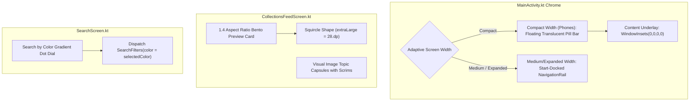

# Specification 55: Android Material 3 Expressive Floating Navigation Chrome & Bento Discovery

**Status:** Proposed

---

## 1. Overview & Problem Statement

The navigation chrome and discovery screens ([`MainActivity.kt`](file:///Users/davidtiagoconceicao/Developer/image-feed-app/androidApp/src/main/java/com/example/imagefeed/android/MainActivity.kt), [`CollectionsFeedScreen.kt`](file:///Users/davidtiagoconceicao/Developer/image-feed-app/androidApp/src/main/java/com/example/imagefeed/android/CollectionsFeedScreen.kt), and [`SearchScreen.kt`](file:///Users/davidtiagoconceicao/Developer/image-feed-app/androidApp/src/main/java/com/example/imagefeed/android/SearchScreen.kt)) currently follow standard Material 3 conventions:

1. **Rigid Docked Navigation Bar on Phones**:
   * In [`MainActivity.kt#L148-L173`](file:///Users/davidtiagoconceicao/Developer/image-feed-app/androidApp/src/main/java/com/example/imagefeed/android/MainActivity.kt#L148-L173), a full-width docked `NavigationBar` abruptly cuts off the masonry photography feed at the bottom edge.
   * Floating, translucent pill navigation bars provide greater spatial depth, allowing imagery to scroll visibly underneath the navigation controls.
2. **Curated Collections Bento Layout Proportions**:
   * While [`CollectionsFeedScreen.kt#L274-L350`](file:///Users/davidtiagoconceicao/Developer/image-feed-app/androidApp/src/main/java/com/example/imagefeed/android/CollectionsFeedScreen.kt#L274-L350) renders a 3-image mosaic, it relies on a fixed height (`200.dp`) rather than an explicit aspect ratio, leading to uneven card heights across varied device widths.
   * Corner treatments use standard 12dp rectangles rather than expressive squircles (`extraLarge = 28.dp`).
3. **Sterile Text-Only Trending Topic Chips**:
   * In [`SearchScreen.kt#L537-L563`](file:///Users/davidtiagoconceicao/Developer/image-feed-app/androidApp/src/main/java/com/example/imagefeed/android/SearchScreen.kt#L537-L563), popular topics render as plain dark gray `SuggestionChip`s, contrasting with the rich visual content of a photography application.
4. **Unexploited Color-Based Search Discovery**:
   * The Unsplash API natively supports filtering photos by color (`black_and_white`, `black`, `white`, `yellow`, `orange`, `red`, `purple`, `magenta`, `green`, `teal`, `blue`), but the search interface offers no visual color dial.

This specification modernizes the root navigation chrome into a floating translucent pill bar and upgrades collections and search discovery into visual bento environments with zero external dependencies.

---

## 2. Technical Architecture & Component Design



### A. Floating Translucent Pill Navigation Bar ([`MainActivity.kt`](file:///Users/davidtiagoconceicao/Developer/image-feed-app/androidApp/src/main/java/com/example/imagefeed/android/MainActivity.kt))

1. **Floating Container Geometry**:
   * For compact phone viewports (`!adaptiveLayoutInfo.useNavigationRail && isAtRoot`), replace the docked `NavigationBar` with a floating pill container:
     * `height = 68.dp`, `shape = CircleShape`.
     * Elevated `12.dp` above navigation bar window insets (`navigationBarsPadding()`).
     * Horizontal screen margins of `24.dp`.
2. **Native Translucent Glass Styling**:
   * Container fill: `MaterialTheme.colorScheme.surfaceContainerHigh.copy(alpha = 0.88f)`.
   * Border: `1.dp` stroke with vertical gradient brush (`listOf(Color.White.copy(alpha = 0.20f), Color.White.copy(alpha = 0.05f))`).
   * Shadow: subtle elevation shadow for floating depth.
3. **Edge-to-Edge List Underlay**:
   * Allow scrolling lists to draw edge-to-edge beneath the floating bar by configuring `contentWindowInsets = WindowInsets(0, 0, 0, 0)` on the root `Scaffold`.
   * Add compensatory bottom content padding (`PaddingValues(bottom = 96.dp)`) to staggered grids so the final items are never obscured.
4. **Adaptive Safety**:
   * On tablets and foldables (`adaptiveLayoutInfo.useNavigationRail == true`), retain the start-docked `NavigationRail` to maintain compliance with `specs/23_adaptive_layout_tablets_foldables.md`.

### B. Proportional Curated Collections Bento Preview ([`CollectionsFeedScreen.kt`](file:///Users/davidtiagoconceicao/Developer/image-feed-app/androidApp/src/main/java/com/example/imagefeed/android/CollectionsFeedScreen.kt))

1. **Aspect Ratio Container**:
   * Replace fixed `height(200.dp)` with `.aspectRatio(1.4f)` on the bento container.
   * Guarantees identical proportions across phone widths, foldables, and desktop windows.
2. **Asymmetric Bento Geometry**:
   * Left hero image: `weight(0.62f)` of container width.
   * Right stacked pair: `weight(0.38f)` of container width, with two vertically stacked thumbnails separated by a `4.dp` gutter.
3. **Corner Radii & Metadata Card**:
   * Card clip: `MaterialTheme.shapes.extraLarge` (28dp squircle).
   * Title and curator attribution formatted inside an editorial card section below the bento preview with photo count badge.

### C. Visual Trending Topics Capsules ([`CollectionsFeedScreen.kt`](file:///Users/davidtiagoconceicao/Developer/image-feed-app/androidApp/src/main/java/com/example/imagefeed/android/CollectionsFeedScreen.kt), [`SearchScreen.kt`](file:///Users/davidtiagoconceicao/Developer/image-feed-app/androidApp/src/main/java/com/example/imagefeed/android/SearchScreen.kt))

1. **Visual Image Capsules**:
   * Upgrade flat text chips to horizontal visual capsule cards (width ~100–120dp, height ~64dp, `shape = MaterialTheme.shapes.large`).
   * Background: representative topic thumbnail image loaded via Coil.
   * Overlay: dark gradient scrim (`Color.Black.copy(alpha = 0.65f)`) with centered bold white title.

### D. "Search by Color" Exploration Dial ([`SearchScreen.kt`](file:///Users/davidtiagoconceicao/Developer/image-feed-app/androidApp/src/main/java/com/example/imagefeed/android/SearchScreen.kt))

1. **Color Dot Selector**:
   * Add a horizontal row of circular color dots below the search bar representing Unsplash supported color tones (Yellow, Orange, Red, Purple, Blue, Green, Teal, Monochrome).
2. **Search Filter Dispatch**:
   * Selecting a color dot updates `SearchFilters.color` and dispatches `UnifiedSearchIntent.UpdateFilters`.
   * Active color displays an animated selection ring (`BorderStroke(2.dp, MaterialTheme.colorScheme.primary)`).

---

## 3. Acceptance Criteria & Verification Plan

### Acceptance Criteria
- [ ] On phone viewports, the bottom navigation bar renders as a floating translucent pill bar with subtle gradient border.
- [ ] Staggered grid content scrolls smoothly beneath the floating pill bar with appropriate bottom content padding.
- [ ] On tablets and foldables, the start-docked `NavigationRail` remains intact and fully functional.
- [ ] Curated Collections previews render with proportional `1.4f` aspect ratio and `extraLarge` squircle corners.
- [ ] Trending topics render as visual image capsules with dark scrims.
- [ ] "Search by Color" row triggers color-filtered photo queries through the existing search state flow.
- [ ] Zero compiler warnings and zero dead code introduced.

### Verification Commands
```bash
./gradlew :androidApp:assembleDebug
./gradlew test
```
