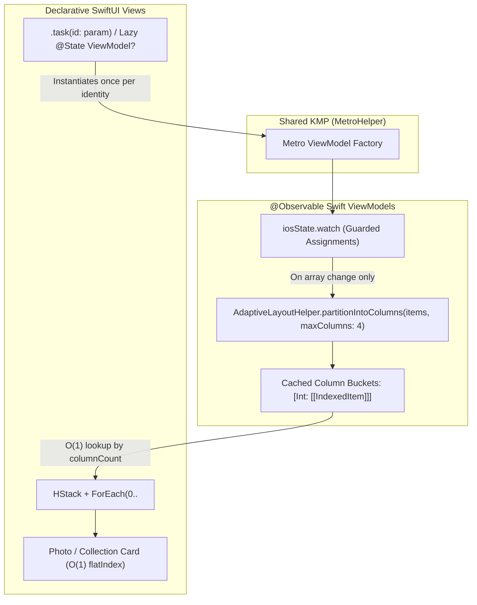

# Specification 68: SwiftUI Performance Phase 1 — Algorithmic & Layout Architecture (Masonry Indexing, Column Memoization & Lazy ViewModel Lifecycle)

**Status:** Implemented

## 1. Overview & Problem Statement

Following the evaluation in [`specs/researches/swiftui_performance_optimization_plan.md`](file:///Users/davidtiagoconceicao/Developer/image-feed-app/specs/researches/swiftui_performance_optimization_plan.md), profiling of `iosApp` and `macosApp` identified five algorithmic, layout, and object-lifecycle bottlenecks that execute on the main thread during scroll rendering, parent view invalidations, and pagination:

1. **$O(N^2)$ Linear Scan Complexity During Masonry Cell Evaluation (Finding 1.1)**:
   - Inside column `ForEach` loops in [`SearchView.swift` L151](file:///Users/davidtiagoconceicao/Developer/image-feed-app/iosApp/iosApp/SearchView.swift#L151), [`UserProfileView.swift` L411](file:///Users/davidtiagoconceicao/Developer/image-feed-app/iosApp/iosApp/UserProfileView.swift#L411), and [`CollectionDetailView.swift` L214](file:///Users/davidtiagoconceicao/Developer/image-feed-app/iosApp/iosApp/CollectionDetailView.swift#L214), every visible cell calls `photos.firstIndex(where: { $0.id == photo.id }) ?? 0` to compute `flatIndex` for `.staggeredReveal(index: flatIndex)`.
   - Meanwhile, [`AdaptiveLayoutHelper.itemsForColumn`](file:///Users/davidtiagoconceicao/Developer/image-feed-app/iosApp/iosApp/AdaptiveLayoutHelper.swift#L53-L58) already calls `items.enumerated()` to filter by column modulo, only to discard `.offset` via `.map(\.element)`. For a 100-item feed, each body evaluation performs up to $10,000$ linear equality checks on the main thread.

2. **Inefficient Backward Scan on Pagination Boundary Check (Finding 1.2)**:
   - In [`CollectionsFeedView.swift` L293-L297](file:///Users/davidtiagoconceicao/Developer/image-feed-app/iosApp/iosApp/CollectionsFeedView.swift#L293-L297), `CollectionMosaicCard.onAppear` executes `viewModel.collections.lastIndex(where: { $0.id == collection.id })` on every appearing card to compare against `viewModel.collections.count - max(4, columnCount * 2)`.
   - By passing the pre-computed flat `index` from `IndexedItem<PhotoCollection>` directly into `CollectionMosaicCard` (or checking against the pre-indexed offset), the $O(N)$ backward search on every cell appearance is reduced to an $O(1)$ integer comparison `index >= viewModel.collections.count - max(4, columnCount * 2)`.

3. **Redundant Column Array Allocation in View `body` (Finding 1.3)**:
   - [`AdaptiveLayoutHelper.photosForColumn`](file:///Users/davidtiagoconceicao/Developer/image-feed-app/iosApp/iosApp/AdaptiveLayoutHelper.swift#L60-L62) and [`itemsForColumn`](file:///Users/davidtiagoconceicao/Developer/image-feed-app/iosApp/iosApp/AdaptiveLayoutHelper.swift#L53-L58) are invoked directly inside `ForEach(0..<columnCount)` in [`ContentView.swift` L278](file:///Users/davidtiagoconceicao/Developer/image-feed-app/iosApp/iosApp/ContentView.swift#L278), [`CollectionsFeedView.swift` L64](file:///Users/davidtiagoconceicao/Developer/image-feed-app/iosApp/iosApp/CollectionsFeedView.swift#L64), [`SearchView.swift` L148](file:///Users/davidtiagoconceicao/Developer/image-feed-app/iosApp/iosApp/SearchView.swift#L148), [`UserProfileView.swift` L410](file:///Users/davidtiagoconceicao/Developer/image-feed-app/iosApp/iosApp/UserProfileView.swift#L410), and [`CollectionDetailView.swift` L211](file:///Users/davidtiagoconceicao/Developer/image-feed-app/iosApp/iosApp/CollectionDetailView.swift#L211).
   - Every time any observed state property changes on a screen, SwiftUI re-evaluates `body` and allocates 2 to 4 brand-new filtered `[Photo]` or `[PhotoCollection]` arrays on the heap.

4. **Greedy Root `GeometryReader` Wrapping `CollectionsFeedView` (Finding 1.4)**:
   - [`CollectionsFeedView.swift` L22-L26](file:///Users/davidtiagoconceicao/Developer/image-feed-app/iosApp/iosApp/CollectionsFeedView.swift#L22-L26) wraps the entire screen in `GeometryReader { geometry in ... }` solely to read `geometry.size.width` for `cardWidth`.
   - Furthermore, inside [`CollectionMosaicCard` (`CollectionsFeedView.swift` L160-L161)](file:///Users/davidtiagoconceicao/Developer/image-feed-app/iosApp/iosApp/CollectionsFeedView.swift#L160-L161), `cardWidth` is only used to compute `sideWidth = width / 3` for the right-hand thumbnail stack `.frame(width: CGFloat(sideWidth))` ([L233](file:///Users/davidtiagoconceicao/Developer/image-feed-app/iosApp/iosApp/CollectionsFeedView.swift#L233)) and the CDN image URLs—the outer card itself does not apply `.frame(width: cardWidth)` and is already sized naturally by its parent `HStack` / `LazyVStack`.
   - Note: Target deployment in [`iosApp/project.yml`](file:///Users/davidtiagoconceicao/Developer/image-feed-app/iosApp/project.yml) is `iOS 17.0` and `macOS 14.0`, and on macOS `CollectionsFeedView` is hosted inside a `NavigationSplitView` detail pane ([`MacOSContentView.swift` L32-L35](file:///Users/davidtiagoconceicao/Developer/image-feed-app/iosApp/iosApp/MacOSContentView.swift#L32-L35)).

5. **Eager KMP ViewModel Instantiation Inside View `init` (Finding 1.5)**:
   - Parameterized SwiftUI views—[`PhotoDetailsView.swift` L62](file:///Users/davidtiagoconceicao/Developer/image-feed-app/iosApp/iosApp/PhotoDetailsView.swift#L62), [`SearchView.swift` L27](file:///Users/davidtiagoconceicao/Developer/image-feed-app/iosApp/iosApp/SearchView.swift#L27), [`UserProfileView.swift` L17](file:///Users/davidtiagoconceicao/Developer/image-feed-app/iosApp/iosApp/UserProfileView.swift#L17), and [`CollectionDetailView.swift` L23](file:///Users/davidtiagoconceicao/Developer/image-feed-app/iosApp/iosApp/CollectionDetailView.swift#L23)—instantiate their `@Observable` ViewModel eagerly inside `init` via `self._viewModel = State(initialValue: ...ViewModel(...))`.
   - Because SwiftUI value-type `View` structs are re-initialized whenever their parent view (`ContentView` / `NavigationStack`) re-evaluates its body, `State(initialValue:)`’s `@autoclosure` is only lazy with respect to SwiftUI's internal storage assignment if passed directly to `@State`, **not** when a helper object is constructed or when `State(initialValue: FooViewModel(...))` evaluates its argument in `init` (in Swift, `State.init(initialValue: Value)` takes a non-`@autoclosure` `Value` parameter!).
   - Consequently, every parent body re-evaluation constructs a throwaway Swift `*ViewModel`, calls `MetroHelper.shared.get*ViewModel(...)`, creates a Kotlin `MviViewModel` with active `viewModelScope` coroutines, and attaches `iosState.watch` / `iosEffects.watch` `Closeable` watchers before SwiftUI discards the temporary instance and triggers `deinit`.

> [!NOTE]
> **Coordination with [Spec 67](file:///Users/davidtiagoconceicao/Developer/image-feed-app/specs/67_memory_optimization_phase3_network_navigation_di_and_ui_churn.md)**:
> Spec 67 Section 2.D.1 and 2.D.3 touch `@Observable` property guards in the 6 Swift ViewModels and `IndexedItem` in `AdaptiveLayoutHelper.swift`. This specification (Spec 68) is the canonical blueprint for full column bucket memoization, $O(1)$ pagination index checks in `CollectionsFeedView.swift`, root `GeometryReader` removal, and lazy ViewModel lifecycle initialization.

---

## 2. Technical Architecture & Design

### A. `IndexedItem<T>` & Single-Pass Column Partitioning in [`AdaptiveLayoutHelper.swift`](file:///Users/davidtiagoconceicao/Developer/image-feed-app/iosApp/iosApp/AdaptiveLayoutHelper.swift)

1. Define a generic, `Identifiable` and `Equatable` indexed wrapper in `AdaptiveLayoutHelper`:
   - `struct IndexedItem<T>: Identifiable` holding `let index: Int`, `let item: T`, and `let id: String`.
   - Provide convenience initializers or factory methods for `Photo` (`id: photo.id`) and `PhotoCollection` (`id: collection.id`) so `ForEach(columnItems) { indexed in ... }` requires no `id:` keypath boilerplate and preserves `index` in $O(1)$ time.
2. Add a single-pass partitioning function on `AdaptiveLayoutHelper`:
   - `static func partitionIntoColumns<T>(from items: [T], totalColumns: Int, idOf: (T) -> String) -> [[IndexedItem<T>]]`
   - Iterates `items.enumerated()` **once** ($O(N)$ total across all columns rather than $O(C \times N)$ via repeated `.filter`) and appends `IndexedItem(index: offset, item: element, id: idOf(element))` into `buckets[offset % totalColumns]`.
   - Retain lightweight wrappers `indexedPhotosForColumn` / `indexedItemsForColumn` for any ad-hoc call sites, and remove dead un-indexed helpers once all call sites are migrated per **Core Invariant 3 (Zero Dead Code Policy)**.

### B. Column Bucket Memoization in `@Observable` ViewModels

1. Instead of slicing arrays inside SwiftUI `View.body` on every frame:
   - Add a memoized column lookup method on [`FeedViewModel.swift`](file:///Users/davidtiagoconceicao/Developer/image-feed-app/iosApp/iosApp/FeedViewModel.swift), [`CollectionsFeedViewModel.swift`](file:///Users/davidtiagoconceicao/Developer/image-feed-app/iosApp/iosApp/CollectionsFeedViewModel.swift), [`SearchViewModel.swift`](file:///Users/davidtiagoconceicao/Developer/image-feed-app/iosApp/iosApp/SearchViewModel.swift), [`CollectionDetailViewModel.swift`](file:///Users/davidtiagoconceicao/Developer/image-feed-app/iosApp/iosApp/CollectionDetailViewModel.swift), and [`UserProfileViewModel.swift`](file:///Users/davidtiagoconceicao/Developer/image-feed-app/iosApp/iosApp/UserProfileViewModel.swift) (for both `portfolioPhotos` and `likedPhotos`).
   - Because `columnCount` is view-environment dependent (`2`, `3`, or `4` depending on iPhone, macOS, or iPad `horizontalSizeClass`), store a `@ObservationIgnored private var cachedBuckets: [Int: [[IndexedItem<Photo>]]] = [:]` (or precompute for column counts `2, 3, 4` when `self.photos != state.photos` in `iosState.watch`, invalidating `cachedBuckets.removeAll()` whenever the backing array changes).
   - Expose `func columnItems(for columnIndex: Int, totalColumns: Int) -> [IndexedItem<Photo>]` (and `IndexedItem<PhotoCollection>` on `CollectionsFeedViewModel`) which returns the pre-chunked array in $O(1)$ time without mutating `@Observable` state during `body` evaluation.
2. **Eliminate $O(N^2)$ `firstIndex(where:)` & $O(N)$ `lastIndex(where:)`**:
   - In [`SearchView.swift` L147-L160](file:///Users/davidtiagoconceicao/Developer/image-feed-app/iosApp/iosApp/SearchView.swift#L147-L160), [`CollectionDetailView.swift` L210-L224](file:///Users/davidtiagoconceicao/Developer/image-feed-app/iosApp/iosApp/CollectionDetailView.swift#L210-L224), and [`UserProfileView.swift` L409-L445](file:///Users/davidtiagoconceicao/Developer/image-feed-app/iosApp/iosApp/UserProfileView.swift#L409-L445) (`GridPhotosList`), iterate over the pre-indexed column bucket items (`indexed.index` and `indexed.item`) and pass `indexed.index` directly to `.staggeredReveal(index: indexed.index)`.
   - In [`ContentView.swift` L277-L295](file:///Users/davidtiagoconceicao/Developer/image-feed-app/iosApp/iosApp/ContentView.swift#L277-L295), consume `viewModel.columnItems(for: colIndex, totalColumns: columnCount)` so `PhotosFeedTabView` never filters `viewModel.photos` during `body` evaluation.
   - In [`CollectionsFeedView.swift` L64-L82, L96-L109, L292-L298](file:///Users/davidtiagoconceicao/Developer/image-feed-app/iosApp/iosApp/CollectionsFeedView.swift#L64-L109), pass `index: indexed.index` into `CollectionMosaicCard` and replace `viewModel.collections.lastIndex(where: { $0.id == collection.id })` in `.onAppear` ([L293](file:///Users/davidtiagoconceicao/Developer/image-feed-app/iosApp/iosApp/CollectionsFeedView.swift#L293)) with the $O(1)$ check: `if index >= viewModel.collections.count - max(4, columnCount * 2) { viewModel.loadNextPage() }`.

### C. Eliminating Root `GeometryReader` in [`CollectionsFeedView.swift`](file:///Users/davidtiagoconceicao/Developer/image-feed-app/iosApp/iosApp/CollectionsFeedView.swift)

1. Remove the root `GeometryReader { geometry in ... }` wrapper at [`CollectionsFeedView.swift` L22-L26](file:///Users/davidtiagoconceicao/Developer/image-feed-app/iosApp/iosApp/CollectionsFeedView.swift#L22-L26).
2. Compute `cardWidth` via `AdaptiveLayoutHelper` (`let containerWidth = AdaptiveLayoutHelper.getScreenWidth()`, `let totalSpacing = CGFloat((columnCount - 1) * 16 + 24)`, `let cardWidth = max(200, (containerWidth - totalSpacing) / CGFloat(max(1, columnCount)))`), matching how `PhotoCard`, `SearchPhotoGridCard`, and `CollectionPhotoGridCard` already compute item widths across the app.
3. Inside `CollectionMosaicCard` ([L165-L236](file:///Users/davidtiagoconceicao/Developer/image-feed-app/iosApp/iosApp/CollectionsFeedView.swift#L165-L236)), use proportional layout for the 2/3 cover photo and 1/3 side preview stack (or `cardWidth / 3`) so the mosaic layout adapts cleanly to any container width on iPhone, iPad, and macOS split view without requiring a root `GeometryReader` wrapping the `ScrollView`.

### D. Lazy ViewModel Initialization in Parameterized Views

1. Eliminate eager `State(initialValue: ...ViewModel(...))` calls inside `View.init` across all 4 parameterized screens:
   - [`PhotoDetailsView.swift` L12, L62](file:///Users/davidtiagoconceicao/Developer/image-feed-app/iosApp/iosApp/PhotoDetailsView.swift#L12)
   - [`SearchView.swift` L8, L27](file:///Users/davidtiagoconceicao/Developer/image-feed-app/iosApp/iosApp/SearchView.swift#L8)
   - [`UserProfileView.swift` L7, L17](file:///Users/davidtiagoconceicao/Developer/image-feed-app/iosApp/iosApp/UserProfileView.swift#L7)
   - [`CollectionDetailView.swift` L6, L23](file:///Users/davidtiagoconceicao/Developer/image-feed-app/iosApp/iosApp/CollectionDetailView.swift#L6)
2. **Lifecycle-Safe Lazy `@State` Pattern**:
   - Declare `@State private var viewModel: <Screen>ViewModel?` (initialized to `nil`, which is zero-cost in `View.init`).
   - Initialize the ViewModel inside `.onAppear` / `.task(id: <parameter>)` on the root container (e.g., `if viewModel == nil { viewModel = PhotoDetailsViewModel(photoId: photoId) }`), rendering the screen's existing loading/skeleton branch while `viewModel == nil`.
   - **Hero Transition Continuity in `PhotoDetailsView`**: Ensure that the outer `ZStack` and top-bar chrome modifiers in `PhotoDetailsView` remain mounted immediately on the first frame even if `viewModel` is initialized in `.onAppear` / `.task(id: photoId)`, so `matchedGeometryEffect` and push/overlay transitions never flicker.

---

## 3. Implementation Plan & Source Modifications

1. **[`AdaptiveLayoutHelper.swift`](file:///Users/davidtiagoconceicao/Developer/image-feed-app/iosApp/iosApp/AdaptiveLayoutHelper.swift)**:
   - Add `IndexedItem<T>: Identifiable, Equatable` (when `T: Equatable`).
   - Add `partitionIntoColumns` and `indexedPhotosForColumn` / `indexedItemsForColumn`.
2. **ViewModels ([`FeedViewModel.swift`](file:///Users/davidtiagoconceicao/Developer/image-feed-app/iosApp/iosApp/FeedViewModel.swift), [`CollectionsFeedViewModel.swift`](file:///Users/davidtiagoconceicao/Developer/image-feed-app/iosApp/iosApp/CollectionsFeedViewModel.swift), [`SearchViewModel.swift`](file:///Users/davidtiagoconceicao/Developer/image-feed-app/iosApp/iosApp/SearchViewModel.swift), [`CollectionDetailViewModel.swift`](file:///Users/davidtiagoconceicao/Developer/image-feed-app/iosApp/iosApp/CollectionDetailViewModel.swift), [`UserProfileViewModel.swift`](file:///Users/davidtiagoconceicao/Developer/image-feed-app/iosApp/iosApp/UserProfileViewModel.swift), [`PhotoDetailsViewModel.swift`](file:///Users/davidtiagoconceicao/Developer/image-feed-app/iosApp/iosApp/PhotoDetailsViewModel.swift))**:
   - Guard `@Observable` property assignments in `iosState.watch` (coordinated with Spec 67).
   - Add memoized `columnItems(for:totalColumns:)` backed by `@ObservationIgnored` column caches invalidated only when the underlying `photos` or `collections` array changes.
3. **Views ([`ContentView.swift`](file:///Users/davidtiagoconceicao/Developer/image-feed-app/iosApp/iosApp/ContentView.swift), [`CollectionsFeedView.swift`](file:///Users/davidtiagoconceicao/Developer/image-feed-app/iosApp/iosApp/CollectionsFeedView.swift), [`SearchView.swift`](file:///Users/davidtiagoconceicao/Developer/image-feed-app/iosApp/iosApp/SearchView.swift), [`UserProfileView.swift`](file:///Users/davidtiagoconceicao/Developer/image-feed-app/iosApp/iosApp/UserProfileView.swift), [`CollectionDetailView.swift`](file:///Users/davidtiagoconceicao/Developer/image-feed-app/iosApp/iosApp/CollectionDetailView.swift), [`PhotoDetailsView.swift`](file:///Users/davidtiagoconceicao/Developer/image-feed-app/iosApp/iosApp/PhotoDetailsView.swift))**:
   - Replace `AdaptiveLayoutHelper.photosForColumn` and `firstIndex(where:)` calls with memoized `IndexedItem` column buckets.
   - Pass `index: Int` to `CollectionMosaicCard` and replace `lastIndex(where:)` with $O(1)$ index threshold comparison.
   - Remove root `GeometryReader` from `CollectionsFeedView`.
   - Refactor `PhotoDetailsView`, `SearchView`, `UserProfileView`, and `CollectionDetailView` to lazy `@State private var viewModel: ...?` initialization outside `View.init`.

---

## 4. Verification & Profiling Strategy

1. **Xcode Instruments — Time Profiler**:
   - Scroll rapidly through 100+ items in `SearchView`, `UserProfileView`, and `CollectionDetailView`; verify **zero** `Sequence.firstIndex(where:)` or `AdaptiveLayoutHelper.photosForColumn` samples during scroll frames.
2. **Xcode Instruments — Allocations & Leaks**:
   - Trigger parent state changes in `ContentView` while `PhotoDetailsView`, `SearchView`, `UserProfileView`, or `CollectionDetailView` is presented/pushed; verify `MetroHelper.shared.get*ViewModel` is called **exactly once** per screen presentation, with zero throwaway ViewModel allocations in `View.init`.
3. **Dual-Platform Build & Lint Verification**:
   - Run `./gradlew :androidApp:assembleDebug ktlintCheck detekt`.
   - Run `xcodegen generate --spec iosApp/project.yml && xcodebuild -project iosApp/iosApp.xcodeproj -scheme iosApp -destination 'generic/platform=iOS Simulator' build CODE_SIGNING_ALLOWED=NO`.
   - Run `xcodebuild -project iosApp/iosApp.xcodeproj -scheme macosApp -destination 'generic/platform=macOS' build CODE_SIGNING_ALLOWED=NO`.
   - Run `swiftformat --lint iosApp/ && swiftlint lint --config .swiftlint.yml`.

---

## 5. Acceptance Criteria

- [x] `AdaptiveLayoutHelper` defines `IndexedItem<T>` and single-pass `partitionIntoColumns`, eliminating all $O(N^2)$ `firstIndex(where:)` linear scans in `SearchView.swift`, `UserProfileView.swift`, and `CollectionDetailView.swift`.
- [x] `CollectionMosaicCard` in `CollectionsFeedView.swift` uses an $O(1)$ index threshold check in `.onAppear` instead of `lastIndex(where:)`.
- [x] Column buckets are memoized in `@Observable` ViewModels (`FeedViewModel`, `CollectionsFeedViewModel`, `SearchViewModel`, `CollectionDetailViewModel`, `UserProfileViewModel`) and invalidated only when the backing list changes, eliminating per-body array allocations.
- [x] Root `GeometryReader` in `CollectionsFeedView.swift` is removed, and collection cards size cleanly across iOS, iPadOS, and macOS.
- [x] `PhotoDetailsView`, `SearchView`, `UserProfileView`, and `CollectionDetailView` defer ViewModel creation out of `View.init`, preventing throwaway KMP ViewModel instantiations on parent re-renders.
- [x] Zero compiler warnings, zero dead code, and clean builds + lint checks across Android, iOS, and macOS.
