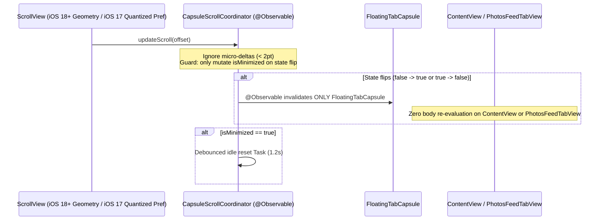

# Specification 69: SwiftUI Performance Phase 2 — Scroll Dynamics, Native Geometry Tracking & State Isolation

**Status:** Implemented

## 1. Overview & Problem Statement

Following Phase 1 ([Spec 68](file:///Users/davidtiagoconceicao/Developer/image-feed-app/specs/68_ios_swiftui_performance_phase1_algorithmic_and_layout_architecture.md)) and the evaluation in [`specs/researches/swiftui_performance_optimization_plan.md`](file:///Users/davidtiagoconceicao/Developer/image-feed-app/specs/researches/swiftui_performance_optimization_plan.md), Phase 2 targets frame drops and main-thread hierarchy diffing during scroll gestures, search typing, and pagination appends across `iosApp` and `macosApp`:

1. **120Hz `PreferenceKey` Propagation & Root Hierarchy Diffing in [`ContentView.swift`](file:///Users/davidtiagoconceicao/Developer/image-feed-app/iosApp/iosApp/ContentView.swift#L265-L315) (Finding 2.1)**:
   - Inside `PhotosFeedTabView`, a 0-height `GeometryReader` ([L266-L271](file:///Users/davidtiagoconceicao/Developer/image-feed-app/iosApp/iosApp/ContentView.swift#L266-L271)) reads `proxy.frame(in: .named("photoFeedScroll")).minY` and writes `FeedScrollOffsetKey` on every single ProMotion display frame (120Hz).
   - `.onPreferenceChange(FeedScrollOffsetKey.self)` ([L312-L314](file:///Users/davidtiagoconceicao/Developer/image-feed-app/iosApp/iosApp/ContentView.swift#L312-L314)) invokes `handleScroll(offset:)` ([L470-L498](file:///Users/davidtiagoconceicao/Developer/image-feed-app/iosApp/iosApp/ContentView.swift#L470-L498)), which:
     - Calls `withAnimation(.spring(response: 0.35, dampingFraction: 0.8)) { activeCapsuleMinimized.wrappedValue = ... }` **unconditionally** whenever `offset >= -20`, `delta < -15`, or `delta > 15`—even when `activeCapsuleMinimized.wrappedValue` already holds the target boolean value.
     - Mutates `@State private var isCapsuleMinimized` owned by the root [`ContentView` (`ContentView.swift` L9, L36, L57)](file:///Users/davidtiagoconceicao/Developer/image-feed-app/iosApp/iosApp/ContentView.swift#L9), forcing SwiftUI to re-evaluate `ContentView.body`, `TabView`, `PhotosFeedTabView`, and `CollectionsFeedTabView` whenever the capsule state toggles.
     - Cancels and allocates a new `scrollResetTask = Task { try? await Task.sleep(nanoseconds: 1_200_000_000) ... }` ([L488-L497](file:///Users/davidtiagoconceicao/Developer/image-feed-app/iosApp/iosApp/ContentView.swift#L488-L497)) on **every single pixel** of scroll movement, even when the capsule is already expanded (`isMinimized == false`).

2. **Investigation & Resolution of `.onScrollGeometryChange` Deployment Availability (Open Doubt 1)**:
   - Section 3.2.1 of [`specs/researches/swiftui_performance_optimization_plan.md`](file:///Users/davidtiagoconceicao/Developer/image-feed-app/specs/researches/swiftui_performance_optimization_plan.md#L197-L207) proposed replacing `FeedScrollOffsetKey` exclusively with `.onScrollGeometryChange(for: CGFloat.self)`.
   - **Technical Investigation Result**: `.onScrollGeometryChange` was introduced by Apple in **iOS 18.0 / macOS 15.0** (WWDC 2024), whereas [`iosApp/project.yml`](file:///Users/davidtiagoconceicao/Developer/image-feed-app/iosApp/project.yml#L11) sets `deploymentTarget: "17.0"` for `iosApp` and `deploymentTarget: "14.0"` for `macosApp`. Calling `.onScrollGeometryChange` without an `#available(iOS 18.0, macOS 15.0, *)` guard fails to compile under the project's deployment target.
   - **Resolution**: Provide a dedicated `.onFeedScrollOffsetChange` view modifier that uses native zero-layout-overhead `.onScrollGeometryChange(for: CGFloat.self)` on `#available(iOS 18.0, macOS 15.0, *)` (quantized/throttled at the action boundary) and falls back cleanly on iOS 17 to a lightweight, bucket-quantized `PreferenceKey` (emitting only when offset crosses 10pt buckets rather than every sub-pixel frame).

3. **Investigation & Resolution of Search Keystroke Debouncing (Finding 2.2 / Open Doubt 2)**:
   - Section 3.1.2 & 3.2.3 of [`specs/researches/swiftui_performance_optimization_plan.md`](file:///Users/davidtiagoconceicao/Developer/image-feed-app/specs/researches/swiftui_performance_optimization_plan.md#L175-L183) noted that [`SearchView.swift` L250-L252](file:///Users/davidtiagoconceicao/Developer/image-feed-app/iosApp/iosApp/SearchView.swift#L250-L252) dispatches `viewModel.updateQuery(newQuery: newValue)` on every keystroke and proposed adding a 300ms `Task.sleep` debounce in `SearchView.swift`.
   - **Technical Investigation Result**: Inspecting [`UnifiedSearchViewModel.kt` L62-L76](file:///Users/davidtiagoconceicao/Developer/image-feed-app/feature/search/src/commonMain/kotlin/com/example/imagefeed/presentation/search/UnifiedSearchViewModel.kt#L62-L76) reveals that the shared KMP ViewModel **already** cancels `searchJob` and performs `delay(300.milliseconds)` inside `viewModelScope` before invoking `performSearch`! However, line 63 of `UnifiedSearchViewModel.kt` immediately calls `updateState { it.copy(query = newQuery) }` on every keystroke, which emits a new `UnifiedSearchState` over `iosState` back to `SearchViewModel.swift` ([L32-L47](file:///Users/davidtiagoconceicao/Developer/image-feed-app/iosApp/iosApp/SearchViewModel.swift#L32-L47)) on every character typed, AND adding a second 300ms sleep in `SearchView.swift` would create an unintended **600ms double-debounce** and race with `.onSubmit(of: .search)` ([L247-L249](file:///Users/davidtiagoconceicao/Developer/image-feed-app/iosApp/iosApp/SearchView.swift#L247-L249))!
   - **Resolution**:
     - Do **not** add a duplicate 300ms network delay in `SearchView.swift` that would double the KMP debounce to 600ms.
     - Instead, eliminate keystroke state-emission round-trips and redundant intent dispatches:
       1. Guard `SearchView.onChange(of: searchText)` so it does not re-dispatch `updateQuery` when `newValue == viewModel.query` (e.g., during `initialQuery` initialization or programmatic suggestion selection at [L63-L64](file:///Users/davidtiagoconceicao/Developer/image-feed-app/iosApp/iosApp/SearchView.swift#L63-L64), which currently dispatches `updateQuery` **twice**—once directly at L64 and a second time via `.onChange(of: searchText)` at L251!).
       2. Guard `@Observable` property assignments in [`SearchViewModel.swift` L32-L47](file:///Users/davidtiagoconceicao/Developer/image-feed-app/iosApp/iosApp/SearchViewModel.swift#L32-L47) (per Spec 67 / Spec 68) so when `UnifiedSearchViewModel` updates `state.query` on keystroke, `SearchViewModel` does **not** reassign `photos`, `collections`, `users`, `filters`, or `searchHistory`, preventing `SearchView` body invalidations while typing.

4. **Whole-Grid Spring Animation Thrashing on Pagination Appends (Finding 2.3)**:
   - [`SearchView.swift` L164](file:///Users/davidtiagoconceicao/Developer/image-feed-app/iosApp/iosApp/SearchView.swift#L164) attaches `.animation(.spring(), value: viewModel.photos)` to the entire multi-column `HStack`.
   - Whenever pagination appends 15 new photos to an existing 30–60 photos, SwiftUI's layout engine runs a spring solver across every visible card in all columns simultaneously, causing a visible hitch on page append while `.staggeredReveal(index:)` is already animating the newly inserted cards.

---

## 2. Technical Architecture & Design

### A. Isolated `CapsuleScrollCoordinator` & State Guards in [`ContentView.swift`](file:///Users/davidtiagoconceicao/Developer/image-feed-app/iosApp/iosApp/ContentView.swift) & [`FloatingTabCapsule.swift`](file:///Users/davidtiagoconceicao/Developer/image-feed-app/iosApp/iosApp/FloatingTabCapsule.swift)

1. **Decouple `isCapsuleMinimized` from `ContentView` Root `@State`**:
   - Extract a lightweight `@MainActor @Observable final class CapsuleScrollCoordinator` (or scoped observable state holder) that owns `var isMinimized: Bool = false`, `private var lastScrollOffset: CGFloat = 0`, and `private var scrollResetTask: Task<Void, Never>?`.
   - Pass `CapsuleScrollCoordinator` to `PhotosFeedTabView` and `FloatingTabCapsule` (or read `coordinator.isMinimized` strictly inside `FloatingTabCapsule` / its wrapper subview).
   - Because `ContentView.body` and `PhotosFeedTabView.body` never read `coordinator.isMinimized`, toggling `isMinimized` during scroll only invalidates `FloatingTabCapsule`—producing **zero** body evaluations on `ContentView` or `PhotosFeedTabView`.
2. **Strict State Transition & Task Guards**:
   - Inside `coordinator.handleScroll(offset:)`:
     - Compute `let delta = offset - lastScrollOffset`. Ignore sub-2pt micro-jitter (`guard abs(delta) >= 2 || offset >= -20 else { return }`), then update `lastScrollOffset = offset`.
     - If `offset >= -20` or `delta > 15`:
       - Cancel `scrollResetTask?.cancel(); scrollResetTask = nil`.
       - **Only if `isMinimized == true`**, animate `withAnimation(.spring(response: 0.35, dampingFraction: 0.75)) { isMinimized = false }`.
     - Else if `delta < -15`:
       - **Only if `isMinimized == false`**, animate `withAnimation(.spring(response: 0.35, dampingFraction: 0.75)) { isMinimized = true }`.
     - **Idle Reset Timer Guard**: Only schedule `scrollResetTask` when `isMinimized == true` (and throttle/reschedule only on meaningful scroll ticks), eliminating 120Hz `Task` allocation/cancellation churn when the capsule is already expanded.
   - Provide `coordinator.expand()` for tab switches (`onChange(of: selectedTab)`), detail dismissal (`onChange(of: isPhotosDetailPresented)`), and `.onDisappear`.

### B. Native `.onScrollGeometryChange` with iOS 17 Quantized Fallback

1. Implement a cross-version scroll offset tracking modifier in [`ContentView.swift`](file:///Users/davidtiagoconceicao/Developer/image-feed-app/iosApp/iosApp/ContentView.swift) (or [`AnimationPrimitives.swift`](file:///Users/davidtiagoconceicao/Developer/image-feed-app/iosApp/iosApp/AnimationPrimitives.swift)):
   - **On `#available(iOS 18.0, macOS 15.0, *)`**:
     - Attach `.onScrollGeometryChange(for: Int.self) { geo in Int((geo.contentOffset.y + geo.contentInsets.top) / 8) } action: { _, newBucket in ... }` directly to the `ScrollView`.
     - Transforming `contentOffset.y` to a coarse 8pt integer bucket inside the `transform` closure guarantees SwiftUI only invokes `action` when the scroll position moves by at least 8pt, completely eliminating 120Hz per-pixel callbacks and requiring no `GeometryReader` or `PreferenceKey` in the scroll content tree.
   - **On iOS 17.x fallback**:
     - Quantize the preference value to 8pt buckets (`Int(minY / 8) * 8`) before writing `FeedScrollOffsetKey` so `onPreferenceChange` only fires across 8pt thresholds instead of every sub-pixel frame.

### C. Search Input Deduplication & Pagination Animation Cleanup in [`SearchView.swift`](file:///Users/davidtiagoconceicao/Developer/image-feed-app/iosApp/iosApp/SearchView.swift)

1. **Eliminate Duplicate `updateQuery` Dispatches**:
   - In [`SearchView.swift` L62-L65](file:///Users/davidtiagoconceicao/Developer/image-feed-app/iosApp/iosApp/SearchView.swift#L62-L65), setting `searchText = text` inside `SearchSuggestionsView.onSelect` already triggers `.onChange(of: searchText)` ([L250-L252](file:///Users/davidtiagoconceicao/Developer/image-feed-app/iosApp/iosApp/SearchView.swift#L250-L252)). Remove the redundant direct `viewModel.updateQuery(newQuery: text)` call in `onSelect` (or guard `.onChange(of: searchText)` with `guard newValue != viewModel.query else { return }`) so selecting a history item or topic card dispatches `UnifiedSearchIntentUpdateQuery` once, not twice.
   - Ensure `SearchViewModel.init(initialQuery:)` sets `self.query = initialQuery` before dispatching so `.onChange(of: searchText)` never double-dispatches on initial appearance.
2. **Remove Whole-Grid Spring Animation on `viewModel.photos`**:
   - Delete `.animation(.spring(), value: viewModel.photos)` at [`SearchView.swift` L164](file:///Users/davidtiagoconceicao/Developer/image-feed-app/iosApp/iosApp/SearchView.swift#L164).
   - Newly loaded search result cards continue to animate smoothly via `.staggeredReveal(index: flatIndex)` and `.feedScrollTransition()` without forcing a full-grid spring layout pass across existing items on pagination.

---

## 3. Implementation Plan & Source Modifications

1. **[`FloatingTabCapsule.swift`](file:///Users/davidtiagoconceicao/Developer/image-feed-app/iosApp/iosApp/FloatingTabCapsule.swift) & [`ContentView.swift`](file:///Users/davidtiagoconceicao/Developer/image-feed-app/iosApp/iosApp/ContentView.swift)**:
   - Introduce `@MainActor @Observable final class CapsuleScrollCoordinator` managing `isMinimized`, guarded transitions, and debounced idle reset task lifecycle.
   - Replace root `@State private var isCapsuleMinimized` binding chain through `ContentView` -> `PhotosFeedTabView` with `CapsuleScrollCoordinator`.
   - Implement `.onScrollGeometryChange` (for iOS 18+ / macOS 15+) with quantized iOS 17 `PreferenceKey` fallback.
2. **[`SearchView.swift`](file:///Users/davidtiagoconceicao/Developer/image-feed-app/iosApp/iosApp/SearchView.swift) & [`SearchViewModel.swift`](file:///Users/davidtiagoconceicao/Developer/image-feed-app/iosApp/iosApp/SearchViewModel.swift)**:
   - Guard `.onChange(of: searchText)` against duplicate `newValue == viewModel.query` dispatches and remove duplicate `viewModel.updateQuery` call in `SearchSuggestionsView.onSelect`.
   - Remove `.animation(.spring(), value: viewModel.photos)` from `SearchView.swift` L164.

---

## 4. Verification & Profiling Strategy

1. **Xcode Instruments — SwiftUI View Body Evaluations**:
   - Scroll up and down through `PhotosFeedTabView` on iOS Simulator / device; verify `ContentView.body` and `PhotosFeedTabView.body` record **0 evaluations** driven by scroll offset changes, and `FloatingTabCapsule.body` evaluates **only** at the moment `isMinimized` flips between `false` and `true`.
2. **Xcode Instruments — Allocations**:
   - Confirm `Task` allocations inside `handleScroll` drop from ~120/sec during active scrolling to at most 1 per scroll gesture when minimized.
3. **Search Input & Pagination Verification**:
   - Type rapidly in `SearchView`, tap a popular topic card, and scroll through 3+ pages of search results; verify KMP `UnifiedSearchViewModel` receives a single debounced query per input pause and pagination appends new photos with zero whole-grid spring jump.
4. **Dual-Platform Build & Lint Verification**:
   - Run `./gradlew :androidApp:assembleDebug ktlintCheck detekt`.
   - Run `xcodegen generate --spec iosApp/project.yml && xcodebuild -project iosApp/iosApp.xcodeproj -scheme iosApp -destination 'generic/platform=iOS Simulator' build CODE_SIGNING_ALLOWED=NO`.
   - Run `xcodebuild -project iosApp/iosApp.xcodeproj -scheme macosApp -destination 'generic/platform=macOS' build CODE_SIGNING_ALLOWED=NO`.
   - Run `swiftformat --lint iosApp/ && swiftlint lint --config .swiftlint.yml`.

---

## 5. Acceptance Criteria

- [x] `CapsuleScrollCoordinator` isolates `isMinimized` state from `ContentView.body` and `PhotosFeedTabView.body`, guarding `withAnimation` so it only fires when `isMinimized` actually changes value.
- [x] `scrollResetTask` is only scheduled when `isMinimized == true` and throttled against 120Hz per-pixel recreation.
- [x] Scroll tracking uses native `.onScrollGeometryChange` on iOS 18+ / macOS 15+ (with 8pt bucket quantization) and a quantized iOS 17 fallback.
- [x] `SearchView` eliminates duplicate `updateQuery` dispatches on suggestion selection and avoids double-debouncing against KMP `UnifiedSearchViewModel`'s built-in 300ms coroutine debounce.
- [x] `.animation(.spring(), value: viewModel.photos)` is removed from `SearchView.swift` L164, eliminating full-grid spring thrashing during pagination.
- [x] Zero compiler warnings, zero dead code, and clean builds + lint checks across Android, iOS, and macOS.
