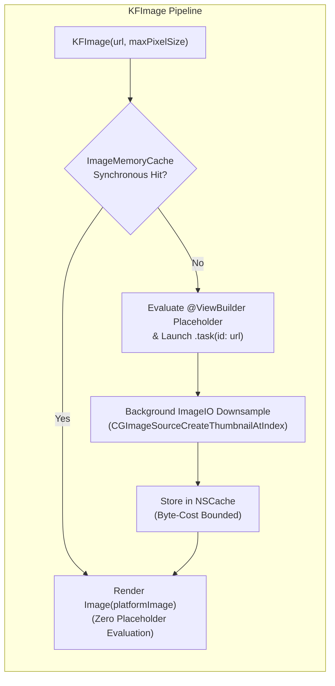

# Specification 70: SwiftUI Performance Phase 3 — GPU Compositor, Single-Pass Shimmer & Image Pipeline

**Status:** Implemented

## 1. Overview & Problem Statement

Building on Phase 1 ([Spec 68](file:///Users/davidtiagoconceicao/Developer/image-feed-app/specs/68_ios_swiftui_performance_phase1_algorithmic_and_layout_architecture.md)), Phase 2 ([Spec 69](file:///Users/davidtiagoconceicao/Developer/image-feed-app/specs/69_ios_swiftui_performance_phase2_scroll_dynamics_and_state_isolation.md)), and the evaluation in [`specs/researches/swiftui_performance_optimization_plan.md`](file:///Users/davidtiagoconceicao/Developer/image-feed-app/specs/researches/swiftui_performance_optimization_plan.md), Phase 3 addresses GPU fill-rate saturation, offscreen Metal render passes, image re-decoding stalls, and type-erased view allocations across `iosApp` and `macosApp`:

1. **Missing Decoded Bitmap Cache & Eager `AnyView` Placeholder in [`KFImage.swift`](file:///Users/davidtiagoconceicao/Developer/image-feed-app/iosApp/iosApp/KFImage.swift) (Finding 4.1)**:
   - `KFImage` wraps SwiftUI's `AsyncImage(url:)` ([L36](file:///Users/davidtiagoconceicao/Developer/image-feed-app/iosApp/iosApp/KFImage.swift#L36)), which caches compressed HTTP bytes in `URLCache` but maintains no application-level decoded bitmap cache (`NSCache`). Every time a masonry cell scrolls off-screen in `LazyVStack` and re-enters the viewport, `AsyncImage` re-fetches/re-decodes the image asynchronously, briefly flashing the placeholder and spiking CPU/GPU decoding work.
   - `placeholderView: AnyView?` ([L5, L14-L18](file:///Users/davidtiagoconceicao/Developer/image-feed-app/iosApp/iosApp/KFImage.swift#L5)) eagerly evaluates `AnyView(content())` inside `.placeholder { ... }` on every parent body pass—even when the image is already cached in memory—and erases the static view type of the placeholder.
   - **Investigation of macOS Compatibility (Open Doubt 1)**: Section 4.2.1 of [`specs/researches/swiftui_performance_optimization_plan.md`](file:///Users/davidtiagoconceicao/Developer/image-feed-app/specs/researches/swiftui_performance_optimization_plan.md#L298-L319) sketched `NSCache<NSURL, UIImage>` and `Image(uiImage:)`. Because [`KFImage.swift`](file:///Users/davidtiagoconceicao/Developer/image-feed-app/iosApp/iosApp/KFImage.swift) is compiled into **both** `iosApp` and `macosApp` targets ([`iosApp/project.yml` L12-L13, L66-L67](file:///Users/davidtiagoconceicao/Developer/image-feed-app/iosApp/project.yml#L12-L13)), using `UIImage` unconditionally breaks the `macosApp` build. The image pipeline must use a cross-platform `PlatformImage` alias (`UIImage` on `#if os(iOS)`, `NSImage` on `#elseif os(macOS)`) and `ImageIO` (`CGImageSourceCreateThumbnailAtIndex`) which is natively available on both iOS and macOS, coordinated with [Spec 65 Section 2.B](file:///Users/davidtiagoconceicao/Developer/image-feed-app/specs/65_memory_optimization_phase1_caches_grids_and_scopes.md#L46-L61).

2. **Stacked Offscreen Metal Passes & Dynamic Drop Shadows in High-Frequency Feed Cards (Finding 4.2)**:
   - In every photo card across [`PhotoCard` (`ContentView.swift` L643-L688)](file:///Users/davidtiagoconceicao/Developer/image-feed-app/iosApp/iosApp/ContentView.swift#L643-L688), [`SearchPhotoGridCard` (`SearchView.swift` L281-L324)](file:///Users/davidtiagoconceicao/Developer/image-feed-app/iosApp/iosApp/SearchView.swift#L281-L324), [`CollectionPhotoGridCard` (`CollectionDetailView.swift` L325-L368)](file:///Users/davidtiagoconceicao/Developer/image-feed-app/iosApp/iosApp/CollectionDetailView.swift#L325-L368), [`UserProfileView.swift` L420-L428](file:///Users/davidtiagoconceicao/Developer/image-feed-app/iosApp/iosApp/UserProfileView.swift#L420-L428), and [`CollectionMosaicCard` (`CollectionsFeedView.swift` L170-L231)](file:///Users/davidtiagoconceicao/Developer/image-feed-app/iosApp/iosApp/CollectionsFeedView.swift#L170-L231):
     - The loading placeholder layers `RoundedRectangle.fill(Color(hex: ...))` + **a second `RoundedRectangle.fill(.ultraThinMaterial)`** over a flat solid hex color (where backdrop blur produces zero visual difference against a solid color, yet forces a Metal backdrop-capture offscreen pass!).
     - The inset attribution capsule layers `.background { Capsule().fill(Color.black.opacity(0.35)) }` + `.glassCapsule(style: .ultraThin, showBorder: true, hasShadow: true)`. Because `CABackdropLayer` (`.ultraThinMaterial`) + a 10pt Gaussian drop shadow (`hasShadow: true`) is applied on every card's capsule, scrolling 20–30 visible cards forces 40–60 simultaneous offscreen Metal passes per frame.
   - **Tiered Glass Performance Policy & `ios-glass-design` Skill Alignment**:
     - Evaluating GPU cost vs. visual fidelity shows a clear distinction between **low-cardinality chrome/sheets** (1–3 instances on screen) and **high-frequency masonry grid cells** (20–30 instances scrolling at 120Hz):
       1. Introduce `GlassStyle.lightweight` (or `.glassLightweightCapsule()`) in [`GlassTheme.swift`](file:///Users/davidtiagoconceicao/Developer/image-feed-app/iosApp/iosApp/GlassTheme.swift): uses a translucent high-contrast dark scrim fill (`GlassTheme.highContrastScrimColor.opacity(0.62)`) paired with the standard `0.5pt` `GlassTheme.specularBorderGradient` rim and `hasShadow: false` (degrading to `GlassTheme.fallbackBackgroundColor` and `GlassTheme.fallbackBorderColor` when `accessibilityReduceTransparency` is enabled).
       2. Apply `.lightweight` (`hasShadow: false`) to high-frequency masonry cell badges (`PhotoCard`, `SearchPhotoGridCard`, `CollectionPhotoGridCard`, and `CollectionMosaicCard` photo-count pill), eliminating per-cell `CABackdropLayer` blur and shadow passes during 120Hz flings while preserving the signature specular glass rim and WCAG contrast.
       3. Remove the redundant `.fill(.ultraThinMaterial)` layer on top of solid hex color rectangles inside image loading placeholders (`PhotoCard`, `SearchPhotoGridCard`, `CollectionPhotoGridCard`, `UserProfileView`, `CollectionMosaicCard`).
       4. Reserve real-time `CABackdropLayer` materials (`.ultraThinMaterial`, `.thinMaterial`, `.regularMaterial`) and ambient drop shadows (`hasShadow: true`) for persistent chrome (`FeedCategoryBar`, `FloatingTabCapsule`, `GlassToolbarButton`) and detail/inspector surfaces (`PhotoDetailsView` attribution bar, `PhotoInspectorView`, `UserProfileView` header chips).
       5. Update [`.agents/skills/ios-glass-design/SKILL.md`](file:///Users/davidtiagoconceicao/Developer/image-feed-app/.agents/skills/ios-glass-design/SKILL.md) to codify this tiered material & shadow performance policy.

3. **Double-Pass `.mask(content)` & Nested Shimmers in [`AnimationPrimitives.swift`](file:///Users/davidtiagoconceicao/Developer/image-feed-app/iosApp/iosApp/AnimationPrimitives.swift#L48-L75) (Finding 4.3)**:
   - `ShimmerModifier` ([L52-L74](file:///Users/davidtiagoconceicao/Developer/image-feed-app/iosApp/iosApp/AnimationPrimitives.swift#L52-L74)) renders `content`, overlays a `GeometryReader` with a rotated `LinearGradient`, and applies `.mask(content)` ([L68](file:///Users/davidtiagoconceicao/Developer/image-feed-app/iosApp/iosApp/AnimationPrimitives.swift#L68)), forcing SwiftUI to rasterize the entire `content` view hierarchy **twice** into offscreen masking buffers for every skeleton card.
   - Furthermore, in [`CollectionDetailView.swift` L46-L76](file:///Users/davidtiagoconceicao/Developer/image-feed-app/iosApp/iosApp/CollectionDetailView.swift#L46-L76) and [`SearchView.swift` L80-L114](file:///Users/davidtiagoconceicao/Developer/image-feed-app/iosApp/iosApp/SearchView.swift#L80-L114), up to 12–15 independent `@State private var phase` animations and `GeometryReader`s run simultaneously during initial loading.
   - **Investigation of `.blendMode(.sourceAtop)` in SwiftUI (Open Doubt 3)**:
     - Section 4.2.3 of [`specs/researches/swiftui_performance_optimization_plan.md`](file:///Users/davidtiagoconceicao/Developer/image-feed-app/specs/researches/swiftui_performance_optimization_plan.md#L327-L341) proposed `content.overlay { LinearGradient(...).blendMode(.sourceAtop) }`.
     - **Technical Investigation Result**: In CoreAnimation / SwiftUI, `.blendMode(.sourceAtop)` composites against the entire underlying destination buffer unless isolated in an offscreen compositing group (`.compositingGroup()`), and an unclipped `.offset(x:)` gradient overflows the skeleton shape bounds unless clipped or isolated.
     - **Resolution**: Because every skeleton primitive in `PhotoCardSkeleton`, `CollectionMosaicCardSkeleton`, `UserProfileHeaderSkeleton`, `SearchView`, and `CollectionDetailView` consists of simple geometric shapes (`RoundedRectangle`, `Circle`) filled with `Color.white.opacity(0.06)`, we can render a single-pass animated shimmer by either:
       - Applying `.compositingGroup()` on the leaf skeleton container with `.overlay { LinearGradient(...).blendMode(.sourceAtop) }.clipped()`, **or** animating opacity/phase across the skeleton shapes directly in a single pass without `.mask(content)` (eliminating the duplicate `content` hierarchy rasterization and per-card `GeometryReader` overhead).

4. **Real-Time 60pt Gaussian Blur in Detail Ambient Backdrop ([`PhotoDetailsView.swift` L473-L494](file:///Users/davidtiagoconceicao/Developer/image-feed-app/iosApp/iosApp/PhotoDetailsView.swift#L473-L494)) (Finding 4.4)**:
   - `ambientBackdrop(photo:)` renders `KFImage(URL(string: photo.urls.small))` with `.scaleEffect(1.3)` and `.blur(radius: 60)` behind the interactive zoom/pan photo canvas and detented inspector sheet.
   - A 60pt blur kernel has a massive sampling radius ($>120\text{px}$ per axis); during interactive sheet dragging (`.presentationBackgroundInteraction`) and pinch/pan gestures, the Metal compositor re-evaluates this backdrop layer.
   - Because `photo.urls.small` is already a 400px image used purely for ambient color diffusion, reducing the blur radius to `28` (or downsampling the backdrop thumbnail to `maxPixelSize: 128`) and rasterizing the static backdrop into a cached Metal texture via `.drawingGroup()` eliminates per-frame blur kernel recalculation while preserving the exact same atmospheric glow.

---

## 2. Technical Architecture & Design

### A. Generic `KFImage<Placeholder: View>` & Cross-Platform `ImageMemoryCache` ([`KFImage.swift`](file:///Users/davidtiagoconceicao/Developer/image-feed-app/iosApp/iosApp/KFImage.swift))

1. **Cross-Platform `PlatformImage` & Byte-Bounded `ImageMemoryCache` (Coordinated with [Spec 65 Section 2.B](file:///Users/davidtiagoconceicao/Developer/image-feed-app/specs/65_memory_optimization_phase1_caches_grids_and_scopes.md#L46-L61))**:
   - Define `public typealias PlatformImage = UIImage` on `#if os(iOS)` and `public typealias PlatformImage = NSImage` on `#elseif os(macOS)`.
   - Implement `public final class ImageMemoryCache: @unchecked Sendable` backed by `NSCache<NSURL, PlatformImage>` (`NSCache` is thread-safe on Darwin):
     - `countLimit = 150` and `totalCostLimit = 50 * 1024 * 1024` (50 MB, aligned with Spec 65's memory budget).
     - Compute byte cost from decoded `CGImage` dimensions (`cgImage.bytesPerRow * cgImage.height`, or fallback `Int(size.width * size.height * 4)`).
     - On `#if os(iOS)`, observe `UIApplication.didReceiveMemoryWarningNotification` to evict all cached objects upon OS memory pressure.
2. **Off-Main-Thread `ImageIO` Downsampling**:
   - Decode fetched `Data` off the main actor using `CGImageSourceCreateWithData` and `CGImageSourceCreateThumbnailAtIndex` with:
     - `kCGImageSourceCreateThumbnailFromImageAlways: true`
     - `kCGImageSourceShouldCacheImmediately: true` (forces immediate bitmap decompression on the background thread so the main thread never stalls on first draw)
     - `kCGImageSourceCreateThumbnailWithTransform: true`
     - `kCGImageSourceThumbnailMaxPixelSize: maxPixelSize` (inferred from the URL's `w=` query parameter when present, or defaulted to `1080`).
3. **Eliminate `AnyView` Type Erasure & Eager Placeholder Evaluation**:
   - Refactor `KFImage` to be generic over its placeholder view: `public struct KFImage<Placeholder: View>: View`.
   - Store `private let placeholderBuilder: (() -> Placeholder)?` instead of `AnyView?`.
   - Provide a default initializer `public init(_ url: URL?, maxPixelSize: Int? = nil) where Placeholder == EmptyView` so existing call sites without `.placeholder { ... }` (`KFImage(URL(string: ...)).resizable()`) continue to compile with zero source changes, and `.placeholder(@ViewBuilder _ content: @escaping () -> P) -> KFImage
` returns a typed `KFImage
` without `AnyView`.
   - In `body`, check `ImageMemoryCache.shared.image(for: url)` synchronously first: on a cache hit, render `Image(uiImage: cached)` / `Image(nsImage: cached)` immediately on the very first frame without ever invoking `placeholderBuilder?()` or showing a spinner.

### B. Tiered `GlassStyle.lightweight` & Streamlined Feed Card Materials

1. **Add `GlassStyle.lightweight` in [`GlassTheme.swift`](file:///Users/davidtiagoconceicao/Developer/image-feed-app/iosApp/iosApp/GlassTheme.swift)**:
   - Extend `GlassStyle` with `case lightweight` alongside `.ultraThin`, `.thin`, `.regular`, `.thick`, `.ultraThick`.
   - In `GlassBackgroundModifier.backgroundShape`, when `style == .lightweight` (and `!reduceTransparency`), fill the shape with `GlassTheme.highContrastScrimColor.opacity(0.62)` (a single-pass translucent dark glass tint that requires zero `CABackdropLayer` offscreen sampling) while keeping `borderShape` (`GlassTheme.specularBorderGradient` at `0.5pt`) and defaulting `hasShadow` to `false`.
2. **Remove Redundant `.ultraThinMaterial` Over Opaque Hex Placeholders**:
   - In [`ContentView.swift` L643-L651](file:///Users/davidtiagoconceicao/Developer/image-feed-app/iosApp/iosApp/ContentView.swift#L643-L651), [`SearchView.swift` L281-L289](file:///Users/davidtiagoconceicao/Developer/image-feed-app/iosApp/iosApp/SearchView.swift#L281-L289), [`CollectionDetailView.swift` L325-L333](file:///Users/davidtiagoconceicao/Developer/image-feed-app/iosApp/iosApp/CollectionDetailView.swift#L325-L333), [`UserProfileView.swift` L420-L428](file:///Users/davidtiagoconceicao/Developer/image-feed-app/iosApp/iosApp/UserProfileView.swift#L420-L428), and [`CollectionsFeedView.swift` L170-L177](file:///Users/davidtiagoconceicao/Developer/image-feed-app/iosApp/iosApp/CollectionsFeedView.swift#L170-L177), remove the second `RoundedRectangle(cornerRadius: 12).fill(.ultraThinMaterial)` / `Rectangle().fill(.ultraThinMaterial)` stacked directly on top of the opaque `Color(hex: photo.color ?? "1E1E24")` fill.
   - Replace the two empty-slot `Rectangle().fill(.ultraThinMaterial)` fallbacks in [`CollectionMosaicCard` (`CollectionsFeedView.swift` L205-L207, L228-L230)](file:///Users/davidtiagoconceicao/Developer/image-feed-app/iosApp/iosApp/CollectionsFeedView.swift#L205-L230) with `GlassTheme.surfaceBackgroundColor`.
3. **Adopt `.lightweight` (`hasShadow: false`) on Recurring Masonry Attribution & Count Capsules**:
   - In [`PhotoCard` (`ContentView.swift` L682-L686)](file:///Users/davidtiagoconceicao/Developer/image-feed-app/iosApp/iosApp/ContentView.swift#L682-L686), [`SearchPhotoGridCard` (`SearchView.swift` L318-L322)](file:///Users/davidtiagoconceicao/Developer/image-feed-app/iosApp/iosApp/SearchView.swift#L318-L322), [`CollectionPhotoGridCard` (`CollectionDetailView.swift` L362-L366)](file:///Users/davidtiagoconceicao/Developer/image-feed-app/iosApp/iosApp/CollectionDetailView.swift#L362-L366), and [`CollectionMosaicCard` (`CollectionsFeedView.swift` L286)](file:///Users/davidtiagoconceicao/Developer/image-feed-app/iosApp/iosApp/CollectionsFeedView.swift#L286), replace the double-layered `.background { Capsule().fill(Color.black.opacity(0.35)) }.glassCapsule(style: .ultraThin, showBorder: true, hasShadow: true)` with a single `.glassCapsule(style: .lightweight, showBorder: true, hasShadow: false)`.
   - Reserve `CABackdropLayer` materials (`.ultraThin`, `.thin`, `.regular`) and `hasShadow: true` for low-cardinality chrome and detail views (`FeedCategoryBar`, `FloatingTabCapsule`, `GlassToolbarButton`, `PhotoDetailsView` floating bars, and `PhotoInspectorView`).

### C. Single-Pass `ShimmerModifier` in [`AnimationPrimitives.swift`](file:///Users/davidtiagoconceicao/Developer/image-feed-app/iosApp/iosApp/AnimationPrimitives.swift)

1. Refactor [`ShimmerModifier` (`AnimationPrimitives.swift` L48-L75)](file:///Users/davidtiagoconceicao/Developer/image-feed-app/iosApp/iosApp/AnimationPrimitives.swift#L48-L75) to eliminate `.mask(content)` (which renders `content` twice):
   - Render `content` once, overlay the translating `LinearGradient` with `.blendMode(.sourceAtop)`, and wrap in `.compositingGroup()` (or clip to the skeleton shape) so the highlight sweep is masked directly against the alpha channel of the already-rendered `content` in a single pass.
   - Respect `@Environment(\.accessibilityReduceMotion)`: when Reduce Motion is enabled, skip the repeating sweep animation and render the static skeleton placeholder.

### D. Rasterized Ambient Backdrop in [`PhotoDetailsView.swift`](file:///Users/davidtiagoconceicao/Developer/image-feed-app/iosApp/iosApp/PhotoDetailsView.swift)

1. In [`ambientBackdrop(photo:)` (`PhotoDetailsView.swift` L473-L494)](file:///Users/davidtiagoconceicao/Developer/image-feed-app/iosApp/iosApp/PhotoDetailsView.swift#L473-L494):
   - Pass a low `maxPixelSize: 160` to `KFImage(URL(string: photo.urls.small), maxPixelSize: 160)` so the backdrop decodes a tiny $160\text{px}$ thumbnail rather than a full $400\text{px}$ bitmap.
   - Reduce `.blur(radius: 60)` to `.blur(radius: 28)` paired with `Color.black.opacity(0.42)` scrim, and apply `.drawingGroup()` on the static backdrop `ZStack` so Metal composites and caches the blurred texture once instead of recalculating the Gaussian blur kernel on every interactive sheet drag or zoom gesture frame.

---

## 3. Implementation Plan & Source Modifications

1. **[`KFImage.swift`](file:///Users/davidtiagoconceicao/Developer/image-feed-app/iosApp/iosApp/KFImage.swift)**:
   - Implement `PlatformImage` (`UIImage` / `NSImage`), `ImageMemoryCache` (`NSCache<NSURL, PlatformImage>` with 50 MB byte-cost limit and iOS memory warning observer), and background `ImageIO` thumbnail downsampling (`CGImageSourceCreateThumbnailAtIndex` with `kCGImageSourceShouldCacheImmediately`).
   - Refactor `KFImage` to generic `KFImage<Placeholder: View>` with lazy `placeholderBuilder: (() -> Placeholder)?` and synchronous cache-hit rendering.
2. **[`AnimationPrimitives.swift`](file:///Users/davidtiagoconceicao/Developer/image-feed-app/iosApp/iosApp/AnimationPrimitives.swift)**:
   - Replace `.mask(content)` in `ShimmerModifier` with single-pass `.blendMode(.sourceAtop)` + `.compositingGroup()` and `@Environment(\.accessibilityReduceMotion)` support.
3. **[`GlassTheme.swift`](file:///Users/davidtiagoconceicao/Developer/image-feed-app/iosApp/iosApp/GlassTheme.swift), [`ContentView.swift`](file:///Users/davidtiagoconceicao/Developer/image-feed-app/iosApp/iosApp/ContentView.swift), [`SearchView.swift`](file:///Users/davidtiagoconceicao/Developer/image-feed-app/iosApp/iosApp/SearchView.swift), [`CollectionDetailView.swift`](file:///Users/davidtiagoconceicao/Developer/image-feed-app/iosApp/iosApp/CollectionDetailView.swift), [`UserProfileView.swift`](file:///Users/davidtiagoconceicao/Developer/image-feed-app/iosApp/iosApp/UserProfileView.swift), [`CollectionsFeedView.swift`](file:///Users/davidtiagoconceicao/Developer/image-feed-app/iosApp/iosApp/CollectionsFeedView.swift)**:
   - Add `GlassStyle.lightweight` in `GlassTheme.swift`.
   - Remove redundant `.ultraThinMaterial` overlays inside solid hex color image placeholders.
   - Adopt `.glassCapsule(style: .lightweight, showBorder: true, hasShadow: false)` on recurring masonry grid attribution and photo-count capsules (`PhotoCard`, `SearchPhotoGridCard`, `CollectionPhotoGridCard`, `CollectionMosaicCard`).
4. **[`PhotoDetailsView.swift`](file:///Users/davidtiagoconceicao/Developer/image-feed-app/iosApp/iosApp/PhotoDetailsView.swift)**:
   - Optimize `ambientBackdrop(photo:)` with `maxPixelSize: 160`, `.blur(radius: 28)`, `Color.black.opacity(0.42)`, and `.drawingGroup()`.
5. **[`.agents/skills/ios-glass-design/SKILL.md`](file:///Users/davidtiagoconceicao/Developer/image-feed-app/.agents/skills/ios-glass-design/SKILL.md)**:
   - Update Section 1.A and 1.B when implementing this spec to document the Tiered Material Selection policy (`GlassStyle.lightweight` with `hasShadow: false` for recurring 120Hz masonry grid cells vs. real-time `CABackdropLayer` materials and ambient drop shadows for low-cardinality persistent chrome and inspection sheets) and prohibit stacking `.ultraThinMaterial` over opaque solid-color loading placeholders.

---

## 4. Verification & Profiling Strategy

1. **Xcode Instruments — Core Animation Commits & GPU Offscreen Passes**:
   - Enable "Color Offscreen-Rendered Yellow" in iOS Simulator while scrolling `PhotosFeedTabView`, `SearchView`, and `CollectionDetailView`; verify elimination of offscreen shadow passes on recurring attribution pills and removal of `.ultraThinMaterial` passes on solid-color loading placeholders.
   - Drag the detented `PhotoInspectorView` sheet up and down in `PhotoDetailsView` while pinching/zooming the photo; verify smooth 120Hz sheet tracking with `.drawingGroup()` on `ambientBackdrop`.
2. **Xcode Instruments — Allocations & VM Tracker**:
   - Scroll down 100+ photos and scroll back to the top; verify cached images render synchronously on the first frame without flashing placeholders, and total `ImageMemoryCache` memory stays bounded within 50 MB and clears on `Simulate Memory Warning`.
3. **Dual-Platform Build & Lint Verification**:
   - Run `./gradlew :androidApp:assembleDebug ktlintCheck detekt`.
   - Run `xcodegen generate --spec iosApp/project.yml && xcodebuild -project iosApp/iosApp.xcodeproj -scheme iosApp -destination 'generic/platform=iOS Simulator' build CODE_SIGNING_ALLOWED=NO`.
   - Run `xcodebuild -project iosApp/iosApp.xcodeproj -scheme macosApp -destination 'generic/platform=macOS' build CODE_SIGNING_ALLOWED=NO`.
   - Run `swiftformat --lint iosApp/ && swiftlint lint --config .swiftlint.yml`.

---

## 5. Acceptance Criteria

- [x] `KFImage.swift` is generic over `<Placeholder: View>` (zero `AnyView` type erasure), evaluates placeholders lazily only on cache misses, downsamples images off the main thread via `ImageIO` (`CGImageSourceCreateThumbnailAtIndex` with `kCGImageSourceShouldCacheImmediately`), and caches decoded `PlatformImage`s (`UIImage`/`NSImage`) in a byte-cost-bounded `NSCache` with iOS memory-warning eviction.
- [x] Cache hits in `KFImage` render synchronously on the first frame without flashing loading spinners or re-decoding bitmaps when scrolling back through `LazyVStack`.
- [x] `GlassTheme.swift` defines `GlassStyle.lightweight` (single-pass translucent dark scrim + specular border, `hasShadow: false`), applied to recurring masonry card attribution and photo-count capsules (`PhotoCard`, `SearchPhotoGridCard`, `CollectionPhotoGridCard`, `CollectionMosaicCard`), and redundant `.ultraThinMaterial` layers over opaque hex placeholders are removed.
- [x] `ShimmerModifier` in `AnimationPrimitives.swift` uses single-pass `.blendMode(.sourceAtop)` with `.compositingGroup()` instead of double-pass `.mask(content)` and respects `accessibilityReduceMotion`.
- [x] `ambientBackdrop` in `PhotoDetailsView.swift` uses a downsampled thumbnail (`maxPixelSize: 160`), reduced blur radius (`28`), and `.drawingGroup()` offscreen caching.
- [x] `.agents/skills/ios-glass-design/SKILL.md` is updated alongside the implementation to codify the tiered material selection (`GlassStyle.lightweight` for high-frequency grid cells vs. `Material` for low-cardinality chrome/sheets) and shadow scoping rules.
- [x] Zero compiler warnings, zero dead code, and clean builds + lint checks across Android, iOS, and macOS.
