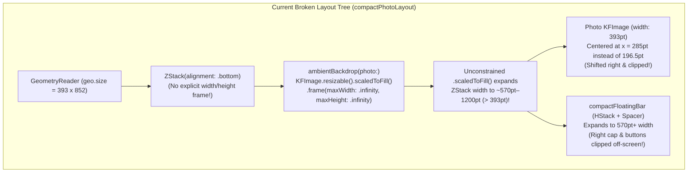

# Specification 72: iOS & macOS Photo Details Image Canvas & Floating Footer Positioning Fix

**Status:** Approved

## 1. Overview & Problem Statement

In [`PhotoDetailsView.swift`](file:///Users/davidtiagoconceicao/Developer/image-feed-app/iosApp/iosApp/PhotoDetailsView.swift), opening a photo detail screen on iOS (`compactPhotoLayout`) or macOS/iPadOS (`dualPaneLayout`) exhibits severe layout and positioning regressions:

1. **Main Photo Shifted Off-Center / Clipped on the Right**:
   - Instead of centering horizontally across the viewport at full container width (`containerWidth`), the high-resolution photo is shifted toward the right edge and clipped on its trailing side, leaving a wide blurred backdrop void along the leading (left) side of the screen.
2. **Floating Attribution Footer (`compactFloatingBar`) Clipped & Trailing Action Buttons Off-Screen**:
   - When the inspector sheet is dismissed, the bottom floating glass attribution capsule (`compactFloatingBar`) stretches past the right edge of the screen. Its right cap, the download button (`arrow.down.to.line`), and the info toggle button (`info.circle`) are pushed completely off-screen to the right.
3. **Hero Transition (`matchedGeometryEffect`) Desynchronization on Lazy ViewModel Initialization**:
   - When transitioning from [`PhotoCard` (`ContentView.swift#L684-L766`)](file:///Users/davidtiagoconceicao/Developer/image-feed-app/iosApp/iosApp/ContentView.swift#L684-L766) to [`PhotoDetailsView`](file:///Users/davidtiagoconceicao/Developer/image-feed-app/iosApp/iosApp/PhotoDetailsView.swift), `PhotoCard` immediately flips `isHeroSource` to `false` (`selectedPhotoForHero?.id != photo.id`), while `PhotoDetailsView` initializes `@State private var viewModel: PhotoDetailsViewModel? = nil` inside `.task(id: photoId)` and renders a `ProgressView()` until `viewModel.photo` loads asynchronously.

---

## 2. Root Cause Analysis

### A. Unconstrained `.scaledToFill()` in `ambientBackdrop` Inflating Parent `ZStack` Width
1. In [`PhotoDetailsView.swift#L493-L515`](file:///Users/davidtiagoconceicao/Developer/image-feed-app/iosApp/iosApp/PhotoDetailsView.swift#L493-L515), `ambientBackdrop(photo:)` places `KFImage(URL(string: photo.urls.small), targetWidthPx: 160).resizable().scaledToFill().frame(maxWidth: .infinity, maxHeight: .infinity)` inside a `ZStack`.
2. In SwiftUI layout, `.frame(maxWidth: .infinity, maxHeight: .infinity)` proposes the parent container's size (`geo.size.width x geo.size.height`, e.g., `393 x 852` on iPhone) to `.scaledToFill()`.
3. `.scaledToFill()` scales the image so that its smaller dimension fills the `852pt` height—causing the image's reported layout width to become `852 * aspectRatio` (e.g., `~570pt` for a 2:3 portrait photo, or `~1278pt` for a 3:2 landscape photo).
4. Because `.clipped()` in SwiftUI is purely a rendering mask and **does not constrain layout size**, `ambientBackdrop` reports a width of `570pt–1278pt` back to its parent `ZStack(alignment: .bottom)` in [`compactPhotoLayout` (`PhotoDetailsView.swift#L338`)](file:///Users/davidtiagoconceicao/Developer/image-feed-app/iosApp/iosApp/PhotoDetailsView.swift#L338) and `ZStack(alignment: .bottomLeading)` in [`dualPaneLayout` (`PhotoDetailsView.swift#L243`)](file:///Users/davidtiagoconceicao/Developer/image-feed-app/iosApp/iosApp/PhotoDetailsView.swift#L243).
5. Because `GeometryReader` aligns oversized children to `.topLeading` `(0, 0)`, the `ZStack` in `compactPhotoLayout` starts at `x = 0` and extends `177pt–885pt` past the right edge of the screen:
   - The inner photo `ZStack` (`.frame(maxWidth: .infinity, maxHeight: .infinity)`) centers the `containerWidth`-wide photo inside that `570pt+` `ZStack`, shifting the photo right and clipping its right edge.
   - `compactFloatingBar` (which contains a flexible `Spacer()`) stretches across the full `570pt+` width of the `ZStack`, pushing the download button, info button, and right capsule border completely off the right side of the screen.

### B. Missing Initial `Photo` Seeding & `matchedGeometryEffect` Source Conflict
1. When a photo is tapped in [`PhotosFeedTabView` (`ContentView.swift#L373-L377, L425-L448`)](file:///Users/davidtiagoconceicao/Developer/image-feed-app/iosApp/iosApp/ContentView.swift#L425-L448), the caller already holds the `Photo` domain model (`selectedPhotoForHero`), yet only passes `photoId: photo.id` into `PhotoDetailsView`.
2. Because `PhotoDetailsView` defers `viewModel = PhotoDetailsViewModel(photoId: photoId)` to `.task(id: photoId)` ([`PhotoDetailsView.swift#L106-L110`](file:///Users/davidtiagoconceicao/Developer/image-feed-app/iosApp/iosApp/PhotoDetailsView.swift#L106-L110)), `viewModel?.photo` is `nil` during the initial hero transition frames, rendering `ProgressView()` instead of the destination `KFImage` with `.matchedGeometryEffect(id: "photo-img-\(photoId)", in: heroNamespace)`.
3. Additionally, in [`dualPaneLayout` (`PhotoDetailsView.swift#L261-L263`)](file:///Users/davidtiagoconceicao/Developer/image-feed-app/iosApp/iosApp/PhotoDetailsView.swift#L261-L263), `.matchedGeometryEffect` is applied *before* `.frame(maxWidth: .infinity, maxHeight: .infinity)`, whereas in `compactPhotoLayout` ([`PhotoDetailsView.swift#L349-L350`](file:///Users/davidtiagoconceicao/Developer/image-feed-app/iosApp/iosApp/PhotoDetailsView.swift#L349-L350)) it is applied *after* `.frame(width: containerWidth, height: calculatedHeight)`.

### C. Bottom Safe Area Inset Handling for `compactFloatingBar`
1. In [`compactPhotoLayout` (`PhotoDetailsView.swift#L424`)](file:///Users/davidtiagoconceicao/Developer/image-feed-app/iosApp/iosApp/PhotoDetailsView.swift#L424), `.ignoresSafeArea()` is applied to the entire `GeometryReader`, causing `compactFloatingBar` to position itself relative to the physical bottom edge of the screen with a fixed `.padding(.bottom, 24)` rather than accounting for `geo.safeAreaInsets.bottom`.

---

## 3. Technical Design & Proposed Fix

### 1. Constrain `ambientBackdrop` Layout Bounds Using `Color.black.overlay` ([`PhotoDetailsView.swift`](file:///Users/davidtiagoconceicao/Developer/image-feed-app/iosApp/iosApp/PhotoDetailsView.swift#L493-L515))
- Refactor `ambientBackdrop(photo:)` so that `Color.black` defines the exact layout footprint of the backdrop, and the `.scaledToFill()` `KFImage` is rendered inside `.overlay { ... }` with `.clipped()`:
  - Because `Color.black` always accepts the exact proposed size (`containerWidth x containerHeight`) and `.overlay` never alters its parent's layout dimensions, `ambientBackdrop` is guaranteed to never inflate the width or height of any parent `ZStack` in either `compactPhotoLayout` or `dualPaneLayout`.
- Explicitly apply `.frame(width: geo.size.width, height: geo.size.height)` on the root `ZStack(alignment: .bottom)` inside `compactPhotoLayout` ([`PhotoDetailsView.swift#L338-L422`](file:///Users/davidtiagoconceicao/Developer/image-feed-app/iosApp/iosApp/PhotoDetailsView.swift#L338-L422)) so both the photo canvas and `compactFloatingBar` are strictly bounded to the viewport width (`containerWidth`).

### 2. Immediate `initialPhoto` Display for Seamless Frame-0 Hero Transitions ([`PhotoDetailsView.swift`](file:///Users/davidtiagoconceicao/Developer/image-feed-app/iosApp/iosApp/PhotoDetailsView.swift) & [`ContentView.swift`](file:///Users/davidtiagoconceicao/Developer/image-feed-app/iosApp/iosApp/ContentView.swift))
- Add an optional `initialPhoto: Photo? = nil` parameter to [`PhotoDetailsView`](file:///Users/davidtiagoconceicao/Developer/image-feed-app/iosApp/iosApp/PhotoDetailsView.swift#L6-L63).
- In [`PhotosFeedTabView` (`ContentView.swift#L425-L448`)](file:///Users/davidtiagoconceicao/Developer/image-feed-app/iosApp/iosApp/ContentView.swift#L425-L448), pass `initialPhoto: photo` when presenting `PhotoDetailsView` for `selectedPhotoForHero`.
- In `PhotoDetailsView.body` ([`PhotoDetailsView.swift#L70-L104`](file:///Users/davidtiagoconceicao/Developer/image-feed-app/iosApp/iosApp/PhotoDetailsView.swift#L70-L104)), resolve `let activePhoto = viewModel?.photo ?? initialPhoto`:
  - Whenever `activePhoto` is available, immediately render `dualPaneLayout(photo: activePhoto, viewModel: viewModel)` or `compactPhotoLayout(photo: activePhoto, viewModel: viewModel)` on the very first frame, even before `.task(id: photoId)` finishes initializing `viewModel` or fetching extended EXIF/stats from the repository.
  - This keeps lazy ViewModel creation out of `View.init` (preserving [Spec 68](file:///Users/davidtiagoconceicao/Developer/image-feed-app/specs/68_ios_swiftui_performance_phase1_algorithmic_and_layout_architecture.md)) while ensuring the `matchedGeometryEffect` hero target is mounted on Frame 0.

### 3. Safe Area & Floating Bar Layout Polish ([`PhotoDetailsView.swift`](file:///Users/davidtiagoconceicao/Developer/image-feed-app/iosApp/iosApp/PhotoDetailsView.swift))
- In `compactFloatingBar` ([`PhotoDetailsView.swift#L427-L490`](file:///Users/davidtiagoconceicao/Developer/image-feed-app/iosApp/iosApp/PhotoDetailsView.swift#L427-L490)) and `dualPaneLayout`'s attribution capsule ([`PhotoDetailsView.swift#L267-L303`](file:///Users/davidtiagoconceicao/Developer/image-feed-app/iosApp/iosApp/PhotoDetailsView.swift#L267-L303)):
  - Ensure the bottom padding of `compactFloatingBar` accounts for the bottom safe area inset (`max(24, geo.safeAreaInsets.bottom + 12)`) so it floats cleanly above the iOS Home Indicator while remaining constrained to `containerWidth`.
  - Ensure top overlay action buttons (`chevron.backward` and `info.circle`) use safe-area-aware top padding rather than a hardcoded `.padding(.top, 60)` if needed, or stay aligned with the safe area top inset.

---

## 4. Implementation Steps

1. **Update [`PhotoDetailsView.swift`](file:///Users/davidtiagoconceicao/Developer/image-feed-app/iosApp/iosApp/PhotoDetailsView.swift)**:
   - Refactor `ambientBackdrop(photo:)` to use `Color.black.overlay { ... }.clipped().drawingGroup().ignoresSafeArea().allowsHitTesting(false)` so `.scaledToFill()` never expands parent layout dimensions.
   - Add `.frame(width: containerWidth, height: geo.size.height)` to the outer `ZStack(alignment: .bottom)` in `compactPhotoLayout`.
   - Add `initialPhoto: Photo? = nil` to `PhotoDetailsView.init` and render `compactPhotoLayout` / `dualPaneLayout` immediately using `let activePhoto = viewModel?.photo ?? initialPhoto` (updating `dualPaneLayout`, `compactPhotoLayout`, and `compactFloatingBar` to accept `viewModel: PhotoDetailsViewModel?`).
   - Adjust `compactFloatingBar` bottom padding to respect `geo.safeAreaInsets.bottom`.
2. **Update [`ContentView.swift`](file:///Users/davidtiagoconceicao/Developer/image-feed-app/iosApp/iosApp/ContentView.swift)**:
   - Pass `initialPhoto: photo` to `PhotoDetailsView` in `PhotosFeedTabView` ([`ContentView.swift#L426-L445`](file:///Users/davidtiagoconceicao/Developer/image-feed-app/iosApp/iosApp/ContentView.swift#L426-L445)).
3. **Update [`specs/steps.md`](file:///Users/davidtiagoconceicao/Developer/image-feed-app/specs/steps.md)**:
   - Record Step 72 referencing `specs/72_ios_photo_details_image_and_footer_positioning_fix.md`.
4. **Verify Dual-Platform Builds & Linting**:
   - Run `swiftformat --lint iosApp/ && swiftlint lint --config .swiftlint.yml`.
   - Run `xcodegen generate --spec iosApp/project.yml` and build both `iosApp` and `macosApp` via `xcodebuild`.

---

## 5. Acceptance Criteria

- [ ] `ambientBackdrop(photo:)` in [`PhotoDetailsView.swift`](file:///Users/davidtiagoconceicao/Developer/image-feed-app/iosApp/iosApp/PhotoDetailsView.swift) constrains its `.scaledToFill()` image inside an `.overlay` over `Color.black` with `.clipped()`, preventing any horizontal or vertical layout overflow into parent `ZStack` containers.
- [ ] In `compactPhotoLayout`, the main photo renders centered horizontally and vertically at full `containerWidth` across portrait, square, and landscape aspect ratios without being shifted or clipped to the right.
- [ ] In `compactPhotoLayout`, dismissing the inspector sheet displays `compactFloatingBar` fully within the horizontal screen bounds (`containerWidth` minus horizontal padding), with the photographer attribution on the leading side and both the download (`arrow.down.to.line`) and info (`info.circle`) buttons visible and interactive on the trailing side.
- [ ] Presenting `PhotoDetailsView` from `PhotosFeedTabView` passes `initialPhoto: photo` so the hero `matchedGeometryEffect` target renders on Frame 0 without flashing a loading spinner or locking to column geometry.
- [ ] Both `iosApp` (iOS Simulator) and `macosApp` (macOS) compile with zero warnings, and `swiftformat` / `swiftlint` pass with zero violations.
