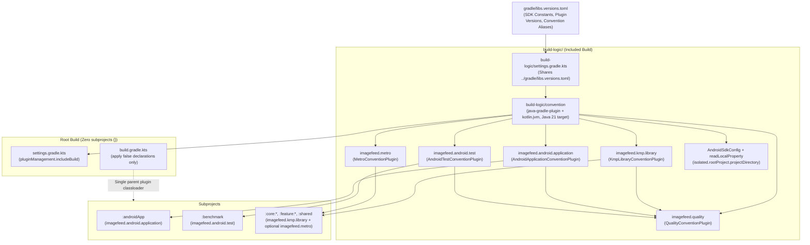

# Specification 78: Gradle `build-logic` Convention Plugins & Isolated Projects Readiness

**Status:** Accepted

---

## 1. Overview & Motivation

Following commit `eca2095` (Gradle `9.9.2`, AGP `9.4.1`, Kotlin `2.4.21`, and centralized `# Android SDK` constants in [`gradle/libs.versions.toml`](../gradle/libs.versions.toml)), Android `compileSdk` (`37.2`), `minSdk` (`29`), and `targetSdk` (`37`) are defined in one place, and standard Gradle configuration/build caching works cleanly. However, the current root [`build.gradle.kts`](../build.gradle.kts) and the 13 subproject build scripts still exhibit several structural inefficiencies:

1. **Cross-Project Mutation via `subprojects {}`**:
   * Root [`build.gradle.kts`](../build.gradle.kts) mutates every child project inside `subprojects { ... }` to configure Android SDK versions and apply `ktlint` and `detekt`.
   * This blocks **Gradle Isolated Projects** (`org.gradle.unsafe.isolated-projects=true`), preventing parallel project configuration and per-module incremental configuration cache invalidation in Android Studio and CI.
   * Applying `ktlint` and `detekt` unconditionally via `subprojects` also attaches lint tasks to empty intermediate container projects (`:core` and `:feature`).
2. **Repeated Build Script Boilerplate Across 13 Modules**:
   * All 11 KMP modules (`:core:*`, `:feature:*`, `:shared`) duplicate `jvmToolchain(17)`, `iosArm64()`, `iosSimulatorArm64()`, `macosArm64()`, and `withHostTest {}`.
   * All 9 Metro-enabled modules repeat the identical `metro { enabled = true; debug = false }` block.
   * [`androidApp/build.gradle.kts`](../androidApp/build.gradle.kts) and [`benchmark/build.gradle.kts`](../benchmark/build.gradle.kts) duplicate `kotlin { jvmToolchain(17) }`.
3. **Cross-Project Filesystem Access in Module Scripts**:
   * [`androidApp/build.gradle.kts`](../androidApp/build.gradle.kts) and [`core/network/build.gradle.kts`](../core/network/build.gradle.kts) read `local.properties` through `rootProject.file("local.properties")`, which violates Isolated Projects boundary rules by reaching into the root project's mutable `Project` instance from subprojects.

This specification defines a migration from root `subprojects {}` to a local **`build-logic` included build** (`includeBuild("build-logic")`) housing typed convention plugins, informed by empirical Gradle `9.9.2` Isolated Projects spike testing across the repository's full plugin stack.

---

## 2. Evaluated Centralization Architectures & Decision

| Dimension | Current (`libs.versions.toml` + Root `subprojects {}`) | `com.android.settings` in `settings.gradle.kts` | Direct `libs.versions.android.*` in Every Module | **`build-logic` Convention Plugins (`includeBuild`) — Selected** |
| :--- | :--- | :--- | :--- | :--- |
| **Build & Config Cache** | Full support | Full support | Full support | Full support (one-time cached `:build-logic:convention` build) |
| **Isolated Projects Ready?** | **No** (`subprojects {}` aborts root evaluation) | Partial (removes SDK `subprojects {}`, leaves `ktlint`/`detekt`) | Partial (still needs solution for `ktlint`/`detekt`) | **Yes** (0 build-script violations across all 13 modules) |
| **Single `agp` Version Source?** | **Yes** (`libs.versions.toml`) | **No** (must duplicate `agp` version string in `settings.gradle.kts`) | **Yes** (`libs.versions.toml`) | **Yes** (`build-logic` reads `../gradle/libs.versions.toml`) |
| **Boilerplate Eliminated** | SDK constants only | SDK constants only | None (`compileSdk` block repeated 13 times) | SDKs + `jvmToolchain(17)` + Apple K/N targets + `withHostTest` + `metro` + `ktlint` + `detekt` + `local.properties` helper |
| **Container Project Hygiene** | Applies `ktlint`/`detekt` to empty `:core` and `:feature` | Same as current | Same as current | Applies `imagefeed.quality` strictly to concrete modules |

### Decision
Adopt a **`build-logic:convention`** included build using `java-gradle-plugin` + `org.jetbrains.kotlin.jvm` (pinned to catalog Kotlin `2.4.21`), combined with the **`compileOnly` in `build-logic` + `apply false` in root `build.gradle.kts`** classpath pattern:

* Avoids Gradle's `kotlin-dsl` plugin embedded-Kotlin version mismatch against Kotlin `2.4.21` plugins.
* Keeps all version numbers (including `agp`, `kotlin`, `metro`, `ktlint`, `detekt`, and Android SDK levels) single-sourced in [`gradle/libs.versions.toml`](../gradle/libs.versions.toml).
* Avoids AGP/KGP classloader splitting discovered during the pre-implementation spike (see §8).

---

## 3. Empirical Isolated Projects Audit (Spike Findings)

Before authoring this spec, both the clean `eca2095` baseline and a full working `build-logic` prototype were benchmarked against **Gradle `9.9.2`** with `-Dorg.gradle.unsafe.isolated-projects=true`.

| Probe Target | Baseline (`eca2095`) with `-Dorg.gradle.unsafe.isolated-projects=true` | Prototype (`build-logic`) with `-Dorg.gradle.unsafe.isolated-projects=true` | Attribution / Notes |
| :--- | :--- | :--- | :--- |
| **Root Evaluation (`:`)** | **FAIL** at `build.gradle.kts:35` (`Project ':' cannot access 'Project.pluginManager' functionality on subprojects`) | **0 violations** | Eliminated by removing `subprojects {}` |
| **`:benchmark:compileBenchmarkReleaseKotlin`** | Blocked by root failure | **PASS** — **0 problems** (`609ms`, CC stored) | `com.android.test` + `androidx.baselineprofile` `1.5.0` + `imagefeed.quality` are IP-clean |
| **`:core:network:compileAndroidMain`** | Blocked by root failure | **PASS** — **0 problems** (`545ms`, CC stored) | KMP + AGP KMP Library + `buildkonfig` `0.24.1` + `kotlin.serialization` + `metro` `1.6.0` + `readLocalProperty` are IP-clean |
| **`detekt` (all 13 modules)** | Blocked by root failure | **PASS** — **0 problems** (`482ms`, CC stored) | All 13 modules configured & cached cleanly |
| **`:feature:feed:ktlintCheck`, `:androidApp:ktlintCheck`, `:benchmark:ktlintCheck`, `:feature:feed:compileKotlinIosSimulatorArm64`** | Blocked by root failure | **PASS** — **0 problems** (`585ms`, CC stored) | `ktlint` `14.2.0` + Apple K/N compilation are IP-clean |
| **`:feature:collections`, `:feature:profile`, `:feature:search` (`compileAndroidMain`)** | Blocked by root failure | **PASS** — **0 problems** (`526ms`, CC stored) | All feature modules without `:core:database` are IP-clean |
| **`:core:database:compileAndroidMain` / `:shared:compileKotlinIosSimulatorArm64` / `:androidApp:assembleDebug` / root `ktlintCheck`** | Blocked by root failure | **FAIL (1 upstream plugin error)** on `:core:database` (`kspAndroidMain`, `kspKotlinIosSimulatorArm64`, `kspAndroidHostTest`) | **`KSP 2.3.6`**: `KspSubpluginKt.nonSelfDeps(KspSubplugin.kt:493)` calls `DefaultTaskDependency.getDependencies()` during task registration (`Project ':core:database' cannot access task dependencies directly`) |

### Go / No-Go Gate for `org.gradle.unsafe.isolated-projects=true`
* **Implement `build-logic` Now (GO):** The `build-logic` migration delivers **0 build-script violations** across all 13 modules, eliminates boilerplate, removes wasted tasks on `:core` and `:feature`, isolates `local.properties` reads, and makes **12 of 13 modules** completely Isolated-Projects-ready. Standard Configuration Cache (`org.gradle.configuration-cache=true`) passes cleanly across all targets.
* **Global `gradle.properties` Flag Enablement (NO-GO until KSP fix):** Do **not** set `org.gradle.unsafe.isolated-projects=true` in [`gradle.properties`](../gradle.properties) as part of this migration. Because `:shared`, `:feature:details`, `:feature:favorites`, and `:androidApp` depend transitively on `:core:database`, KSP `2.3.6`'s `KspSubpluginKt.nonSelfDeps` exception aborts aggregate Android/iOS builds under strict IP mode. Re-evaluate toggling the flag once an upgraded `ksp` release eliminates `DefaultTaskDependency.getDependencies()` access in `KspAATask` registration and `:androidApp:assembleDebug -Dorg.gradle.unsafe.isolated-projects=true` succeeds with `0` problems.

---

## 4. Target `build-logic` Architecture & Plugin Topology

### A. Version Catalog Additions ([`gradle/libs.versions.toml`](../gradle/libs.versions.toml))
Retain the existing `# Android SDK` version entries (`android-compileSdk = "37"`, `android-compileSdkMinor = "2"`, `android-minSdk = "29"`, `android-targetSdk = "37"`) and add:

* **`[libraries]` (Gradle plugin classpath artifacts for `build-logic`)**:
  * `android-gradlePlugin` -> `com.android.tools.build:gradle` (`version.ref = "agp"`)
  * `kotlin-gradlePlugin` -> `org.jetbrains.kotlin:kotlin-gradle-plugin` (`version.ref = "kotlin"`)
  * `metro-gradlePlugin` -> `dev.zacsweers.metro:gradle-plugin` (`version.ref = "metro"`)
  * `ktlint-gradlePlugin` -> `org.jlleitschuh.gradle:ktlint-gradle` (`version.ref = "ktlint"`)
  * `detekt-gradlePlugin` -> `io.gitlab.arturbosch.detekt:detekt-gradle-plugin` (`version.ref = "detekt"`)
* **`[plugins]`**:
  * `kotlin-jvm` -> `org.jetbrains.kotlin.jvm` (`version.ref = "kotlin"`)
  * `imagefeed-quality` -> `id = "imagefeed.quality"`
  * `imagefeed-kmp-library` -> `id = "imagefeed.kmp.library"`
  * `imagefeed-metro` -> `id = "imagefeed.metro"`
  * `imagefeed-android-application` -> `id = "imagefeed.android.application"`
  * `imagefeed-android-test` -> `id = "imagefeed.android.test"`

### B. Included Build Configuration (`build-logic/`)
* **`build-logic/settings.gradle.kts`**:
  * Configures `pluginManagement` and `dependencyResolutionManagement` repositories (`google()`, `mavenCentral()`, `gradlePluginPortal()`).
  * Imports the root catalog via `versionCatalogs { create("libs") { from(files("../gradle/libs.versions.toml")) } }`.
  * Sets `rootProject.name = "build-logic"` and `include(":convention")`.
* **`build-logic/convention/build.gradle.kts`**:
  * Applies `` `java-gradle-plugin` `` and `alias(libs.plugins.kotlin.jvm)` with `group = "com.example.imagefeed.buildlogic"`.
  * Configures `JavaVersion.VERSION_21` and `JvmTarget.JVM_21` (required by `dev.zacsweers.metro:gradle-plugin:1.6.0`; see §8).
  * Declares **`compileOnly(...)`** dependencies on `libs.android.gradlePlugin`, `libs.kotlin.gradlePlugin`, `libs.metro.gradlePlugin`, `libs.ktlint.gradlePlugin`, and `libs.detekt.gradlePlugin`.
  * Registers the 5 convention plugins (`imagefeed.quality`, `imagefeed.kmp.library`, `imagefeed.metro`, `imagefeed.android.application`, `imagefeed.android.test`) under `com.example.imagefeed.buildlogic.*`.

---

## 5. Convention Plugin Contracts & Shared Helpers

All convention sources live under `build-logic/convention/src/main/kotlin/com/example/imagefeed/buildlogic/` and use core Gradle Java/Kotlin APIs without requiring the `kotlin-dsl` plugin:

| Artifact / Plugin ID | Class | Plugins Applied | Contract & Configuration |
| :--- | :--- | :--- | :--- |
| Shared helper | `AndroidSdkConfig.kt` | — | Reads `android-compileSdk`, `android-compileSdkMinor` (`.takeIf { it > 0 }`), `android-minSdk`, and `android-targetSdk` from `VersionCatalogsExtension` `"libs"`. Provides `CompileSdkSpec.configureFromCatalog(sdk)` and top-level `Project.readLocalProperty(key: String): String` backed by `providers.fileContents(isolated.rootProject.projectDirectory.file("local.properties")).asText.orNull`. |
| `imagefeed.quality` | `QualityConventionPlugin` | `org.jlleitschuh.gradle.ktlint`, `io.gitlab.arturbosch.detekt` | Configures `KtlintExtension` (`android = true`, `outputToConsole = true`, `ignoreFailures = false`, excluding `**/build/**`, `**/BuildKonfig.kt`, and paths containing `generated`), `BaseKtLintCheckTask` matching exclusions, and `Detekt` (`buildUponDefaultConfig = true`, `ignoreFailures = true`, XML/HTML/SARIF reports enabled). |
| `imagefeed.kmp.library` | `KmpLibraryConventionPlugin` | `org.jetbrains.kotlin.multiplatform`, `com.android.kotlin.multiplatform.library`, `imagefeed.quality` | Configures `KotlinMultiplatformExtension.jvmToolchain(17)`, configures `"android"` `KotlinMultiplatformAndroidLibraryTarget` via `(kmp as ExtensionAware).extensions.configure("android", ...)` with catalog `compileSdk`, `minSdk`, and `withHostTest {}`, and registers `iosArm64()`, `iosSimulatorArm64()`, and `macosArm64()`. |
| `imagefeed.metro` | `MetroConventionPlugin` | `dev.zacsweers.metro` | Configures `MetroPluginExtension` with `enabled.set(true)` and `debug.set(false)`. |
| `imagefeed.android.application` | `AndroidApplicationConventionPlugin` | `com.android.application`, `imagefeed.quality` | Configures `ApplicationExtension` (`compileSdk` + `defaultConfig.minSdk` + `defaultConfig.targetSdk` from catalog, Java 17 `compileOptions`) and `KotlinAndroidProjectExtension.jvmToolchain(17)`. |
| `imagefeed.android.test` | `AndroidTestConventionPlugin` | `com.android.test`, `imagefeed.quality` | Configures `TestExtension` (`compileSdk` + `defaultConfig.minSdk` + `defaultConfig.targetSdk` from catalog) and `KotlinAndroidProjectExtension.jvmToolchain(17)`. |

---

## 6. Per-Module Migration Matrix

| File / Module | Convention Plugin(s) Applied | Boilerplate Removed | Module-Specific Settings Retained |
| :--- | :--- | :--- | :--- |
| [`settings.gradle.kts`](../settings.gradle.kts) | — (`includeBuild("build-logic")` inside `pluginManagement`) | — | Existing repositories & 13 `include(...)` modules |
| [`build.gradle.kts`](../build.gradle.kts) | — | Entire `subprojects { ... }` block, imports, SDK vals, unused `kotlin.android` and `android.library` `apply false` lines | `apply false` declarations for all active plugins (`kotlin.multiplatform`, `kotlin.serialization`, `kotlin.compose`, `android.application`, `android.kotlin.multiplatform.library`, `android.test`, `baselineprofile`, `buildkonfig`, `metro`, `ktlint`, `detekt`, `ksp`, `androidx.room`) |
| [`androidApp/build.gradle.kts`](../androidApp/build.gradle.kts) | `imagefeed.android.application` | `android.application`, `compileOptions`, `kotlin { jvmToolchain(17) }`, `java.util.Properties` + `rootProject.file("local.properties")` | `kotlin.compose`, `kotlin.serialization`, `baselineprofile`, `readLocalProperty("google.maps.api.key")`, `namespace`, `defaultConfig`, `buildTypes`, `buildFeatures`, `dependencies` |
| [`benchmark/build.gradle.kts`](../benchmark/build.gradle.kts) | `imagefeed.android.test` | `android.test`, `kotlin { jvmToolchain(17) }` | `baselineprofile`, `namespace`, `defaultConfig`, `buildTypes`, `targetProjectPath`, `dependencies` |
| [`shared/build.gradle.kts`](../shared/build.gradle.kts) | `imagefeed.kmp.library`, `imagefeed.metro` | `kotlin.multiplatform`, `android.kotlin.multiplatform.library`, `metro`, `jvmToolchain(17)`, `withHostTest {}`, `iosArm64()`, `iosSimulatorArm64()`, `macosArm64()`, `metro { ... }` | `android.namespace`, `KotlinNativeTarget` static framework `export(...)` block, `sourceSets` |
| [`core/database/build.gradle.kts`](../core/database/build.gradle.kts) | `imagefeed.kmp.library`, `imagefeed.metro` | KMP/AGP/Metro plugins, `jvmToolchain(17)`, `withHostTest {}`, Apple targets, `metro { ... }` | `kotlin.serialization`, `ksp`, `androidx.room`, `-Xexpect-actual-classes`, `android.namespace`, `sourceSets`, `ksp*` dependencies, `room { schemaDirectory(...) }` |
| [`core/network/build.gradle.kts`](../core/network/build.gradle.kts) | `imagefeed.kmp.library`, `imagefeed.metro` | KMP/AGP/Metro plugins, `jvmToolchain(17)`, `withHostTest {}`, Apple targets, `metro { ... }`, `rootProject.file("local.properties")` | `buildkonfig`, `kotlin.serialization`, `readLocalProperty("unsplash.api.key")`, `android.namespace`, `sourceSets`, `buildkonfig { ... }` |
| [`core/model/build.gradle.kts`](../core/model/build.gradle.kts) | `imagefeed.kmp.library` | KMP/AGP plugins, `jvmToolchain(17)`, `withHostTest {}`, Apple targets | `kotlin.serialization`, `android.namespace`, `sourceSets` |
| [`core/mvi/build.gradle.kts`](../core/mvi/build.gradle.kts) | `imagefeed.kmp.library` | KMP/AGP plugins, `jvmToolchain(17)`, `withHostTest {}`, Apple targets | `android.namespace`, `sourceSets` |
| [`feature/collections`](../feature/collections/build.gradle.kts), [`details`](../feature/details/build.gradle.kts), [`feed`](../feature/feed/build.gradle.kts), [`profile`](../feature/profile/build.gradle.kts), [`search`](../feature/search/build.gradle.kts) | `imagefeed.kmp.library`, `imagefeed.metro` | KMP/AGP/Metro plugins, `jvmToolchain(17)`, `withHostTest {}`, Apple targets, `metro { ... }` | `kotlin.serialization`, `android.namespace`, `sourceSets` |
| [`feature/favorites/build.gradle.kts`](../feature/favorites/build.gradle.kts) | `imagefeed.kmp.library`, `imagefeed.metro` | KMP/AGP/Metro plugins, `jvmToolchain(17)`, `withHostTest {}`, Apple targets, `metro { ... }` | `android.namespace`, `sourceSets` |

---

## 7. Phased Implementation & Rollout Plan

1. **Phase 1 — Version Catalog & `build-logic` Scaffolding**:
   * Add plugin classpath library coordinates and convention plugin aliases to [`gradle/libs.versions.toml`](../gradle/libs.versions.toml).
   * Create `build-logic/settings.gradle.kts`, `build-logic/convention/build.gradle.kts`, `AndroidSdkConfig.kt`, and the 5 convention plugin classes.
2. **Phase 2 — Root Build Cleanup & Module Migration**:
   * Add `includeBuild("build-logic")` to [`settings.gradle.kts`](../settings.gradle.kts).
   * Strip `subprojects { ... }`, unused imports, and SDK constants from root [`build.gradle.kts`](../build.gradle.kts), keeping only `apply false` plugin declarations.
   * Migrate all 13 module `build.gradle.kts` scripts per §6, switching `local.properties` reads in `:androidApp` and `:core:network` to `readLocalProperty(...)`.
3. **Phase 3 — Cross-Platform & Static Analysis Verification**:
   * Verify Android (`:androidApp:assembleDebug`, `:androidApp:testDebugUnitTest`), `:benchmark:checkBenchmarkReleaseAarMetadata` + `:benchmark:compileBenchmarkReleaseKotlin`, multiplatform tests (`./gradlew allTests`), Apple K/N (`:shared:compileKotlinIosSimulatorArm64`, `:shared:compileKotlinMacosArm64`), `xcodegen` + `xcodebuild` for both `iosApp` and `macosApp`, and `ktlintCheck` + `detekt` (including ktlint checks over `build-logic/`).
   * Confirm standard Configuration Cache hits cleanly across repeated invocations.
4. **Phase 4 — Isolated Projects Validation & Conditional Flag Gate**:
   * Re-run strict `-Dorg.gradle.unsafe.isolated-projects=true` probes against non-database modules (must stay at 0 problems) and `:androidApp:assembleDebug` (if KSP has not yet resolved `nonSelfDeps`, keep `org.gradle.unsafe.isolated-projects=true` unset in [`gradle.properties`](../gradle.properties) and track the KSP upgrade blocker in [`wiki/issue-log.md`](../wiki/issue-log.md)).

---

## 8. Risks, Pitfalls & Mitigations

1. **Java 21 Bytecode Requirement in `build-logic` (`Metro 1.6.0`)**:
   * *Empirical finding:* `dev.zacsweers.metro:gradle-plugin:1.6.0` publishes `org.gradle.jvm.version = 21` variants; configuring `jvmToolchain(17)` inside `build-logic:convention` fails dependency resolution.
   * *Mitigation:* Compile `build-logic:convention` against `JavaVersion.VERSION_21` and `JvmTarget.JVM_21` (runs only in the Gradle daemon JVM, currently OpenJDK `25.0.1`), while subproject Android and KMP targets retain `jvmToolchain(17)` / Java `17`.
2. **AGP/KGP Classloader Split (`NoClassDefFoundError: com/android/build/gradle/api/BaseVariant`)**:
   * *Empirical finding:* Declaring `implementation` plugin dependencies in `build-logic:convention` while leaving plugins such as `kotlin.compose` (`compose-compiler-gradle-plugin`) or `buildkonfig` as `apply false` in root [`build.gradle.kts`](../build.gradle.kts) loads `kotlin-gradle-plugin` in the root buildscript classloader **without** `com.android.tools.build:gradle`, causing `KotlinBaseApiPlugin` inside `:androidApp` to throw `NoClassDefFoundError: BaseVariant`.
   * *Mitigation:* Keep all external plugin artifacts as **`compileOnly(...)`** in `build-logic:convention` and preserve the **`apply false`** plugin declarations in root [`build.gradle.kts`](../build.gradle.kts) so every module resolves AGP, KGP, and third-party Gradle plugins through one shared root classloader.
3. **Avoiding `kotlin-dsl` Plugin Version Skew**:
   * *Mitigation:* Use `` `java-gradle-plugin` `` + `alias(libs.plugins.kotlin.jvm)` (Kotlin `2.4.21`) and standard typed Gradle extension/task APIs (`extensions.configure(...)`, `tasks.withType(...)`) instead of Gradle's `kotlin-dsl` plugin, avoiding embedded Kotlin stdlib/compiler metadata conflicts.
4. **KMP Android Target Extension Disambiguation**:
   * *Mitigation:* AGP 9.4.1 registers both `"android"` (`KotlinMultiplatformAndroidLibraryTarget`) and deprecated `"androidLibrary"` (`DeprecatedKotlinMultiplatformAndroidLibraryTarget`) on `KotlinMultiplatformExtension`. Always configure by name `"android"` explicitly.
5. **Empty Container Projects (`:core`, `:feature`) & `build-logic` Lint Coverage**:
   * *Observation:* Removing root `subprojects {}` stops running redundant `ktlint`/`detekt` tasks on `:core` and `:feature`, while `build-logic/` is an included build outside root `ktlintCheck`.
   * *Mitigation:* During implementation, apply `ktlint` (or verify `ktlintCheck` via `:build-logic:convention:ktlintCheck`) so `build-logic` Kotlin sources obey [`.editorconfig`](../.editorconfig) formatting rules.
6. **Worktree `ANDROID_HOME` & Apple `embedAndSignAppleFrameworkForXcode` Synchronization**:
   * *Mitigation:* Because git worktrees omit git-ignored `local.properties`, pass `ANDROID_HOME` when verifying Gradle and Xcode builds in fresh worktrees (per [Verification & Linting](../.agents/skills/verification-and-linting/SKILL.md)), and verify `readLocalProperty` gracefully returns `""` when `local.properties` is absent.

---

## 9. Wiki & Documentation Impact

Upon full implementation (not during this draft spec authoring):

* **[`wiki/architecture-and-modules.md`](../wiki/architecture-and-modules.md)**: Add a build infrastructure section documenting `build-logic:convention`, the 5 convention plugins, and the `compileOnly` + root `apply false` classloader contract.
* **[`wiki/adr-index.md`](../wiki/adr-index.md)**: Append **ADR-11** recording the decision to adopt `build-logic` convention plugins for Isolated Projects readiness and cross-module standardization.
* **[`.agents/skills/verification-and-linting/SKILL.md`](../.agents/skills/verification-and-linting/SKILL.md)**: Note `:build-logic:convention:ktlintCheck` (if wired) and update dependency/catalog guidance if needed.
* **[`wiki/issue-log.md`](../wiki/issue-log.md)**: Record an `[OPEN]` tooling-friction entry for upstream KSP `nonSelfDeps` blocking global `org.gradle.unsafe.isolated-projects=true` if still present at implementation time.

---

## 10. Acceptance Criteria

- [ ] `gradle/libs.versions.toml` defines `android-gradlePlugin`, `kotlin-gradlePlugin`, `metro-gradlePlugin`, `ktlint-gradlePlugin`, `detekt-gradlePlugin`, `kotlin-jvm`, and the 5 `imagefeed-*` plugin aliases alongside existing `# Android SDK` constants.
- [ ] `build-logic/settings.gradle.kts` shares `../gradle/libs.versions.toml` and `build-logic/convention/build.gradle.kts` compiles cleanly with Java `21` compatibility and `compileOnly(...)` plugin classpath dependencies.
- [ ] All 5 convention plugins (`imagefeed.quality`, `imagefeed.kmp.library`, `imagefeed.metro`, `imagefeed.android.application`, `imagefeed.android.test`) and `AndroidSdkConfig.kt` (`readLocalProperty` via `isolated.rootProject.projectDirectory`) are implemented without `kotlin-dsl`.
- [ ] Root `settings.gradle.kts` includes `build-logic` via `pluginManagement.includeBuild("build-logic")`.
- [ ] Root `build.gradle.kts` contains zero `subprojects { ... }` blocks, zero Android SDK declarations, and keeps only active `apply false` plugin declarations.
- [ ] All 13 module `build.gradle.kts` files migrate to convention plugins with zero duplicated SDK versions, `jvmToolchain(17)`, Apple K/N target blocks, `withHostTest {}`, `metro { ... }` blocks, or `rootProject.file("local.properties")` calls.
- [ ] `./gradlew :androidApp:assembleDebug`, `:androidApp:testDebugUnitTest`, `:benchmark:checkBenchmarkReleaseAarMetadata`, `:benchmark:compileBenchmarkReleaseKotlin`, `./gradlew allTests`, `:shared:compileKotlinIosSimulatorArm64`, `:shared:compileKotlinMacosArm64`, `./gradlew ktlintCheck detekt` (plus `build-logic` ktlint check) pass with zero new compiler warnings.
- [ ] `xcodegen generate --spec iosApp/project.yml` and `xcodebuild` for both `iosApp` (iOS Simulator) and `macosApp` (`platform=macOS,arch=arm64`) succeed cleanly.
- [ ] Configuration Cache stores and reuses entries cleanly; strict `-Dorg.gradle.unsafe.isolated-projects=true` produces 0 build-script violations across all modules and 0 total violations on non-KSP modules (with `org.gradle.unsafe.isolated-projects=true` gated per §3).
- [ ] Living docs (`wiki/architecture-and-modules.md`, `wiki/adr-index.md` ADR-11, `wiki/issue-log.md` if KSP blocker remains) and `specs/steps.md` are updated and this spec is archived to `specs/archive/`.

---

## 11. Verification Record (Pre-Implementation Spike)

* **Verified (Prototype Spike in Worktree on `eca2095`, Gradle `9.9.2`, Reverted Cleanly Before Spec Commit)**:
  * Baseline IP probe (`ANDROID_HOME=/Users/davidtiagoconceicao/Library/Android/sdk ./gradlew :androidApp:assembleDebug -Dorg.gradle.unsafe.isolated-projects=true --configuration-cache-problems=warn -Dorg.gradle.configuration-cache.max-problems=5000`): failed at `build.gradle.kts:35` (`Project ':' cannot access 'Project.pluginManager' functionality on subprojects`), confirming `subprojects {}` prevents Isolated Projects evaluation.
  * Prototype standard build (`./gradlew :androidApp:assembleDebug :benchmark:compileBenchmarkReleaseKotlin :shared:compileKotlinIosSimulatorArm64 :shared:compileKotlinMacosArm64 ktlintCheck detekt`): `BUILD SUCCESSFUL in 51s` (`318 actionable tasks: 304 executed, 10 from cache, 4 up-to-date`), `Configuration cache entry stored`.
  * Prototype Isolated Projects strict probes (`-Dorg.gradle.unsafe.isolated-projects=true`):
    * `:benchmark:compileBenchmarkReleaseKotlin` -> `BUILD SUCCESSFUL in 609ms` (`0` problems, CC stored).
    * `:core:network:compileAndroidMain` -> `BUILD SUCCESSFUL in 545ms` (`0` problems, CC stored).
    * `detekt` (all 13 modules) -> `BUILD SUCCESSFUL in 482ms` (`0` problems, CC stored).
    * `:feature:feed:ktlintCheck :androidApp:ktlintCheck :benchmark:ktlintCheck :feature:feed:compileKotlinIosSimulatorArm64` -> `BUILD SUCCESSFUL in 585ms` (`0` problems, CC stored).
    * `:feature:collections:compileAndroidMain :feature:profile:compileAndroidMain :feature:search:compileAndroidMain` -> `BUILD SUCCESSFUL in 526ms` (`0` problems, CC stored).
    * `:androidApp:assembleDebug`, `:shared:compileKotlinIosSimulatorArm64`, `ktlintCheck` (root aggregate), and `:core:database:compileAndroidMain` -> failed solely on `KSP 2.3.6` (`com.google.devtools.ksp.gradle.KspSubpluginKt.nonSelfDeps(KspSubplugin.kt:493)` inside `KspAATask$Companion$registerKspAATask` throwing `Project ':core:database' cannot access task dependencies directly`).
* **Pending Full-Implementation Verification**:
  * Full `./gradlew allTests`, `:androidApp:testDebugUnitTest`, `:benchmark:checkBenchmarkReleaseAarMetadata`, `xcodegen generate --spec iosApp/project.yml` + `xcodebuild` for `iosApp` and `macosApp`, `build-logic` self-ktlint verification, and re-testing `:androidApp:assembleDebug -Dorg.gradle.unsafe.isolated-projects=true` when upgrading KSP past `2.3.6`.
