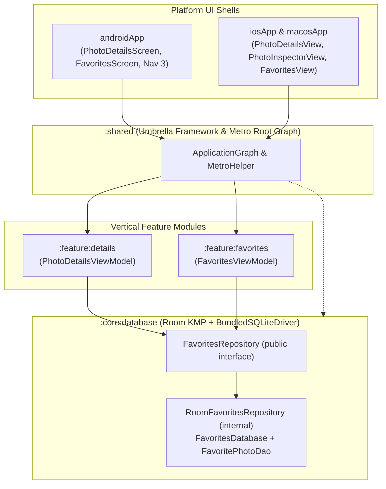

# Specification 76: Local Favorites Persistence (Room KMP) & Dedicated Favorites Screen

**Status:** Implemented (Final)

## 1. Overview & Root Cause Analysis

The photo favorite/bookmark button previously acted as a local, non-persistent UI toggle on Android and was absent from the Apple detail UI, with no shared persistence layer supporting saved items.

### Root Cause Breakdown
1. **Android (`PhotoDetailsScreen.kt`)**:
   * In `FloatingActionToolbar` ([`PhotoDetailsScreen.kt`](../../androidApp/src/main/java/com/example/imagefeed/android/PhotoDetailsScreen.kt)), bookmark state was stored exclusively in ephemeral UI state (`rememberSaveable`).
   * Tapping the bookmark button previously flipped the local boolean and displayed a Snackbar without dispatching any [`PhotoDetailsIntent`](../../feature/details/src/commonMain/kotlin/com/example/imagefeed/presentation/details/PhotoDetailsIntent.kt) to [`PhotoDetailsViewModel`](../../feature/details/src/commonMain/kotlin/com/example/imagefeed/presentation/details/PhotoDetailsViewModel.kt) or reading/writing persisted storage. Leaving and reopening the photo reset the button to `false`.
2. **Apple (`iosApp` / `macosApp`)**:
   * [`PhotoDetailsView.swift`](../../iosApp/iosApp/PhotoDetailsView.swift) (`compactFloatingBar`) and [`PhotoInspectorView.swift`](../../iosApp/iosApp/PhotoInspectorView.swift) did not render a favorite/bookmark button, even though bookmark localization keys (`"Bookmark"`, `"Remove Bookmark"`, `"Saved to bookmarks"`, `"Removed from bookmarks"`) already existed in [`Localizable.xcstrings`](../../iosApp/iosApp/Localizable.xcstrings).
3. **Shared KMP Layer**:
   * [`settings.gradle.kts`](../../settings.gradle.kts) contained no local database module, Room setup, `FavoritesRepository`, or `:feature:favorites` presentation module.
   * Neither Android nor Apple provided a top-level Favorites / Saved destination to browse saved photos locally. (Note: Unsplash API user likes require OAuth user authentication, which is out of scope; favorites are strictly local-only with no cross-device sync.)

---

## 2. Evaluated Local SQLite Persistence Options & Decision

Three SQLite persistence architectures were evaluated for Kotlin Multiplatform (`android`, `iosArm64`, `iosSimulatorArm64`, `macosArm64`) under the project's **Kotlin 2.4.21**, **AGP 9.5.1** (`com.android.kotlin.multiplatform.library`), and **Metro DI** stack:

| Evaluation Dimension | Option 1: **Room KMP** (`androidx.room` + `sqlite-bundled`) — **Selected** | Option 2: SQLDelight 2.x | Option 3: `androidx.sqlite` (`sqlite-bundled`) Raw Driver |
| :--- | :--- | :--- | :--- |
| **Build Pipeline & Codegen** | Uses `androidx.room` Gradle plugin + KSP (`room-compiler`) scoped strictly to `:core:database`. Feature modules and `:shared` require zero KSP processing. | Gradle plugin generates Kotlin from `.sq` files without KSP; must verify compatibility with AGP 9.5.1 `com.android.kotlin.multiplatform.library` and Kotlin 2.4.21. | Zero KSP and zero codegen plugins; requires manual SQL statement binding, cursor mapping, and schema versioning boilerplate. |
| **Apple / Xcode Linking** | `BundledSQLiteDriver` ships a consistent SQLite C binary across Android, iOS, and macOS without manual `-lsqlite3` linker flags in `iosApp/project.yml` (`DEAD_CODE_STRIPPING: YES` on `macosApp` strips unreachable `sqlite-framework` cinterop stubs). | Native SQLite driver requires `-lsqlite3` `OTHER_LDFLAGS` configuration in Xcode targets. | Uses `BundledSQLiteDriver` without extra Xcode linker flags. |
| **Reactive Queries (`Flow`)** | Built-in invalidation tracker emitting `Flow<List<FavoritePhotoEntity>>` and `Flow<Boolean>` automatically whenever the `favorite_photos` table changes. | Built-in `asFlow().mapToList()` via `coroutines-extensions`. | Requires manually maintaining `MutableStateFlow` invalidation triggers across all write paths. |
| **Type Safety & Ergonomics** | Compile-time SQL verification and mapping via `@Entity`, `@Dao`, `@Query`, `@Upsert`, and `@Database`. | Compile-time verified SQL via `.sq` schema and queries. | Runtime SQL strings and manual `SQLiteStatement` column indexing; higher boilerplate and typo risk. |
| **Ecosystem Alignment** | Official AndroidX Jetpack multiplatform database library pairing naturally with `androidx.lifecycle.viewmodel` and `androidx.navigation3` already used in the project. | Mature third-party KMP SQL library. | Low-level driver foundation (intended primarily underneath higher-level libraries like Room). |

### Decision: Select Room KMP (`androidx.room` + `androidx.sqlite:sqlite-bundled`)
* **Selected Library**: **Room KMP** backed by `androidx.sqlite:sqlite-bundled` (`BundledSQLiteDriver`).
* **Architectural Containment (Spec 49 Alignment)**:
  * KSP and the Room Gradle plugin are applied **exclusively inside `:core:database`**, avoiding multi-module KSP overhead across feature modules and `:shared` (preserving the fast Metro compiler-plugin build pipeline documented in [`modularization_evaluation.md`](../researches/modularization_evaluation.md)).
  * `:shared` depends on `:core:database` via `implementation(...)` and **does not** re-export `:core:database` in the Apple framework `export(...)` block. All Room `@Entity`, `@Dao`, and `RoomDatabase` classes remain `internal` to `:core:database`, exposing only the pure Kotlin `FavoritesRepository` interface and `DatabaseModule` Metro binding container.

---

## 3. Technical Architecture & Module Design

### A. `:core:database` Module (`core/database`)
* **Gradle & Dependencies (`gradle/libs.versions.toml` & `core/database/build.gradle.kts`)**:
  * Add multiplatform Room (`androidx.room:room-runtime`, `androidx.room:room-compiler`), `androidx.sqlite:sqlite-bundled`, `androidx.room` Gradle plugin, and `com.google.devtools.ksp` to [`gradle/libs.versions.toml`](../../gradle/libs.versions.toml).
  * Configure `core/database/build.gradle.kts` with `kotlin-multiplatform`, `com.android.kotlin.multiplatform.library` (namespace `com.example.imagefeed.core.database`), `kotlin-serialization`, `metro`, `ksp`, and `androidx.room`.
  * Register KSP `room-compiler` for `kspAndroid`, `kspIosArm64`, `kspIosSimulatorArm64`, and `kspMacosArm64` (plus `room { schemaDirectory("$projectDir/schemas") }`), and include `:core:database` in [`settings.gradle.kts`](../../settings.gradle.kts).
* **Room Schema & Unsplash Hotlinking Compliance**:
  * **Hotlink Policy**: Per [`AGENTS.md`](../../AGENTS.md), image binary files are **never cached locally**. Room stores only serialized Unsplash metadata so cards hotlink exact Unsplash CDN URLs (`ixid` preserved) and prominently display photographer attribution.
  * **Entity (`internal` `FavoritePhotoEntity`, table `favorite_photos`)**:
    * `id: String` (`@PrimaryKey`) — Unsplash `Photo.id`.
    * `photoJson: String` — serialized [`Photo`](../../core/model/src/commonMain/kotlin/com/example/imagefeed/model/Photo.kt) JSON via `kotlinx.serialization.json.Json` (preserving `PhotoUrls`, `User`, `PhotoLinks`, `blurHash`, dimensions, `Exif`, `Location`, and `Tag`s without lossy multi-table joins).
    * `createdAt: Long` — epoch timestamp (milliseconds) when the photo was saved, enabling deterministic reverse-chronological sorting (`ORDER BY createdAt DESC`).
* **DAO (`internal` `FavoritePhotoDao`)**:
  * `observeAll(): Flow<List<FavoritePhotoEntity>>` — `@Query("SELECT * FROM favorite_photos ORDER BY createdAt DESC")`.
  * `observeIsFavorite(photoId: String): Flow<Boolean>` — `@Query("SELECT EXISTS(SELECT 1 FROM favorite_photos WHERE id = :photoId)")`.
  * `getById(photoId: String): FavoritePhotoEntity?` — `suspend` query `@Query("SELECT * FROM favorite_photos WHERE id = :photoId LIMIT 1")`.
  * `isFavorite(photoId: String): Boolean` — `suspend` query `@Query("SELECT EXISTS(SELECT 1 FROM favorite_photos WHERE id = :photoId)")`.
  * `upsert(entity: FavoritePhotoEntity)` — `@Upsert` `suspend` insert/update.
  * `deleteById(photoId: String)` — `suspend` `@Query("DELETE FROM favorite_photos WHERE id = :photoId")`.
* **Database & Multiplatform Path Resolution**:
  * `internal abstract class FavoritesDatabase : RoomDatabase()` annotated with `@Database(entities = [FavoritePhotoEntity::class], version = 1)` and `@ConstructedBy(FavoritesDatabaseConstructor::class)` (with `internal expect object FavoritesDatabaseConstructor : RoomDatabaseConstructor<FavoritesDatabase>`).
  * `internal expect fun createFavoritesDatabaseOrNull(): FavoritesDatabase?`:
    * **`androidMain`**: Reads `@Volatile` application context initialized once via `SharedAndroidInitializer.init(applicationContext)` in [`ImageFeedApplication.onCreate()`](../../androidApp/src/main/java/com/example/imagefeed/android/ImageFeedApplication.kt) (`:androidApp` depends only on `:shared`, keeping `:core:database` encapsulated) and returns `Room.databaseBuilder<FavoritesDatabase>(context, context.getDatabasePath("imagefeed_favorites.db").absolutePath)` with `BundledSQLiteDriver()` and `Dispatchers.IO`. Returns `null` when no Android context is initialized (host JVM tests such as [`ApplicationGraphTest`](../../shared/src/commonTest/kotlin/com/example/imagefeed/di/ApplicationGraphTest.kt)), allowing `DatabaseModule` to select `InMemoryFavoritesRepository`.
    * **`appleMain`**: Reads `NSBundle.mainBundle.bundleIdentifier` and resolves `<NSApplicationSupportDirectory>/<bundleId>/imagefeed_favorites.db` via Foundation `NSFileManager` (creating `<bundleId>` if absent), returning `Room.databaseBuilder<FavoritesDatabase>(name = ...)` with `BundledSQLiteDriver()` and `Dispatchers.IO`. Returns `null` when `bundleIdentifier` is absent (bare Kotlin/Native test binaries), falling back cleanly to `InMemoryFavoritesRepository`.
  * `RoomFavoritesRepository` and `InMemoryFavoritesRepository` synchronize writes via `Mutex`, encode/decode `Photo` via `kotlinx.serialization.json.Json` with `ignoreUnknownKeys = true` on `Dispatchers.Default`, and apply `.distinctUntilChanged()` to `observeIsFavorite(photoId)`.
  * Room integration tests (`RoomFavoritesRepositoryTest` in `appleTest`) run directly against `Room.inMemoryDatabaseBuilder<FavoritesDatabase>()` on `iosSimulatorArm64Test` and `macosArm64Test`, while `FavoritesRepositoryContractTest` in `commonTest` runs across all targets (testing both `InMemoryFavoritesRepository` and `RoomFavoritesRepository` with a fake DAO).
* **Public Repository Contract & Metro DI (`DatabaseModule`)**:
  * Public `FavoritesRepository` interface:
    * `fun observeIsFavorite(photoId: String): Flow<Boolean>`
    * `fun observeFavoritePhotos(): Flow<List<Photo>>`
    * `suspend fun getFavoriteById(photoId: String): Photo?`
    * `suspend fun isFavorite(photoId: String): Boolean`
    * `suspend fun toggleFavorite(photo: Photo): Boolean` (inserts with current timestamp if absent and returns `true`; deletes by ID if present and returns `false`)
    * `suspend fun removeFavorite(photoId: String)`
  * `internal class RoomFavoritesRepository(private val dao: FavoritePhotoDao, private val clock: () -> Long = ::currentTimeMillis)` encoding/decoding `Photo` on `Dispatchers.Default` and exposing reactive domain flows.
  * `@BindingContainer object DatabaseModule` provides `@SingleIn(AppScope::class)` `FavoritesRepository` (`RoomFavoritesRepository` backed by `createFavoritesDatabaseOrNull()` on device, or `InMemoryFavoritesRepository` fallback when no platform DB handle exists in host unit tests), keeping internal Room types hidden from Objective-C headers.

### B. `:feature:details` MVI Integration
* Add `implementation(project(":core:database"))` to [`feature/details/build.gradle.kts`](../../feature/details/build.gradle.kts).
* **[`PhotoDetailsState`](../../feature/details/src/commonMain/kotlin/com/example/imagefeed/presentation/details/PhotoDetailsState.kt)**: Add `val isFavorite: Boolean = false`.
* **[`PhotoDetailsIntent`](../../feature/details/src/commonMain/kotlin/com/example/imagefeed/presentation/details/PhotoDetailsIntent.kt)**: Add `data class ToggleFavorite(val fallbackPhoto: Photo? = null) : PhotoDetailsIntent`.
* **[`PhotoDetailsEffect`](../../feature/details/src/commonMain/kotlin/com/example/imagefeed/presentation/details/PhotoDetailsEffect.kt)**: Add `data class ShowFavoriteToggledSnackbar(val isFavorite: Boolean) : PhotoDetailsEffect` so platforms resolve localized feedback messages without hardcoding strings in shared code.
* **[`PhotoDetailsViewModel`](../../feature/details/src/commonMain/kotlin/com/example/imagefeed/presentation/details/PhotoDetailsViewModel.kt)**:
  * Inject `FavoritesRepository` alongside `PhotoDetailsRepository` and `PhotoDownloadTracker`.
  * Collect `favoritesRepository.observeIsFavorite(photoId)` with `.catch { ... }` inside `viewModelScope` in `init` so `state.isFavorite` loads immediately on screen entry, surfaces storage read failures, and stays synchronized if favorites change elsewhere (e.g., dual-pane list-detail or Favorites tab).
  * Seed `state.photo` from `favoritesRepository.getFavoriteById(photoId)` during `loadDetails()` so locally saved photos remain viewable offline even if network detail fetching fails.
  * Handle `PhotoDetailsIntent.ToggleFavorite`: resolve `state.value.photo ?: intent.fallbackPhoto` (or call `removeFavorite(photoId)` if already favorited before photo metadata finishes loading), guard SQLite/I/O operations with error mapping (`ShowErrorSnackbar`), and emit `PhotoDetailsEffect.ShowFavoriteToggledSnackbar(isFavorite)`.

### C. `:feature:favorites` Vertical Feature Module
* Create `feature/favorites` following the vertical feature module structure established in Spec 48 (depending on `:core:model`, `:core:mvi`, `:core:network` for `toAppError()`, and `:core:database` for `FavoritesRepository` — with zero dependencies on any other `:feature:*` module).
* **Presentation (`com.example.imagefeed.presentation.favorites`)**:
  * `FavoritesState(val photos: List<Photo> = emptyList(), val isLoading: Boolean = true)` implementing `UiState`.
  * `FavoritesIntent` implementing `UiIntent`:
    * `RemoveFavorite(val photoId: String)`
  * `FavoritesEffect` implementing `UiEffect`:
    * `ShowFavoriteRemovedSnackbar`
    * `ShowErrorSnackbar(val error: AppError)`
  * `FavoritesViewModel @Inject constructor(private val favoritesRepository: FavoritesRepository)` observing `favoritesRepository.observeFavoritePhotos()` in `viewModelScope` (with `.catch` error handling), updating `photos` and clearing `isLoading = false` on emission, and catching storage exceptions on `removeFavorite`.

### D. Umbrella & Metro DI (`:shared`)
* Update [`shared/build.gradle.kts`](../../shared/build.gradle.kts):
  * Add `implementation(project(":core:database"))` (NOT in `export(...)` so Room/SQLite types do not inflate Objective-C bridging headers).
  * Add `api(project(":feature:favorites"))` in `commonMain.dependencies` and `export(project(":feature:favorites"))` in `targets.withType<KotlinNativeTarget>()` `binaries.framework`.
* Create `SharedAndroidInitializer` in [`shared/src/androidMain/kotlin/com/example/imagefeed/di/SharedAndroidInitializer.kt`](../../shared/src/androidMain/kotlin/com/example/imagefeed/di/SharedAndroidInitializer.kt) so `:androidApp` initializes database context through `:shared` without depending on `:core:database`.
* Update [`Metro.kt`](../../shared/src/commonMain/kotlin/com/example/imagefeed/di/Metro.kt):
  * Register `DatabaseModule::class` in `@DependencyGraph(bindingContainers = [...])` on `ApplicationGraph`.
  * Expose `val favoritesRepository: FavoritesRepository` and `val favoritesViewModel: FavoritesViewModel` on `ApplicationGraph`.
  * Expose `fun getFavoritesViewModel(): FavoritesViewModel = graph.favoritesViewModel` on `MetroHelper`.

### E. Platform UI & Localization (`androidApp`, `iosApp`, `macosApp`)
1. **Android (`androidApp`)**:
   * **Initialize DB Context**: Call `SharedAndroidInitializer.init(applicationContext)` inside [`ImageFeedApplication`](../../androidApp/src/main/java/com/example/imagefeed/android/ImageFeedApplication.kt) (`onCreate()`), and add Room KMP / `RoomDatabaseConstructor` keep rules to [`androidApp/proguard-rules.pro`](../../androidApp/proguard-rules.pro).
   * **Details (`PhotoDetailsScreen.kt`)**:
     * Remove ephemeral `var isBookmarked by rememberSaveable(photo.id) { mutableStateOf(false) }` from `FloatingActionToolbar` in [`PhotoDetailsScreen.kt`](../../androidApp/src/main/java/com/example/imagefeed/android/PhotoDetailsScreen.kt#L1433).
     * Wire `isFavorite: Boolean = state.isFavorite` and `onToggleFavorite: () -> Unit = { viewModel.dispatch(PhotoDetailsIntent.ToggleFavorite()) }` into `PhotoDetailsContent` and `FloatingActionToolbar`.
     * Collect `PhotoDetailsEffect.ShowFavoriteToggledSnackbar` and `ShowErrorSnackbar` non-blockingly (`dismiss()` + child `launch { snackbarHostState.showSnackbar(...) }`) to show `R.string.details_bookmark_saved` / `R.string.details_bookmark_removed`.
   * **Favorites Screen & Navigation 3**:
     * Add `@Serializable data object Favorites : AppRoute` to [`Routes.kt`](../../androidApp/src/main/java/com/example/imagefeed/android/navigation/Routes.kt) and add it to `TOP_LEVEL_DESTINATIONS` with `Icons.Default.Bookmark` and `R.string.nav_tab_favorites` (with `maxLines = 1, overflow = TextOverflow.Ellipsis` on bottom navigation labels and `16.dp` pill horizontal margins in [`MainActivity.kt`](../../androidApp/src/main/java/com/example/imagefeed/android/MainActivity.kt)).
     * Register `favoritesSection` in [`NavigationSections.kt`](../../androidApp/src/main/java/com/example/imagefeed/android/navigation/NavigationSections.kt) using `ListDetailSceneStrategy.listPane` for dual-pane tablet/foldable support, and register it in `MainActivity.kt`.
     * Create [`FavoritesScreen.kt`](../../androidApp/src/main/java/com/example/imagefeed/android/FavoritesScreen.kt) reusing adaptive `LazyVerticalStaggeredGrid` + `PhotoCard` (with photographer attribution, BlurHash placeholders, shared-element transition keys, quick unbookmark button, Snackbar feedback, and tap-to-open `PhotoDetails` / `UserProfile`), plus an expressive Material 3 empty state when `state.photos.isEmpty()`.
2. **Apple (`iosApp` & `macosApp`)**:
   * **Details ([`PhotoDetailsViewModel.swift`](../../iosApp/iosApp/PhotoDetailsViewModel.swift), [`PhotoDetailsView.swift`](../../iosApp/iosApp/PhotoDetailsView.swift), [`PhotoInspectorView.swift`](../../iosApp/iosApp/PhotoInspectorView.swift))**:
     * Mark `PhotoDetailsViewModel` `@MainActor` with `MainActor.assumeIsolated` flow watch bridges and `@ObservationIgnored private nonisolated(unsafe) var` teardown handles; add `isFavorite`, `favoriteFeedbackTrigger`, and `favoriteToastBanner` synchronized with shared state/effects, plus `func toggleFavorite(fallbackPhoto: Photo? = nil)`.
     * Handle `PhotoDetailsEffectShowFavoriteToggledSnackbar` and error effects by triggering `favoriteFeedbackTrigger` (eliminating spurious haptics when opening already-favorited items) and showing an auto-dismissing `GlassToastPill` overlay (`"Saved to bookmarks"` / `"Removed from bookmarks"`).
     * Add a bookmark `GlassToolbarButton` (`systemName: viewModel?.isFavorite == true ? "bookmark.fill" : "bookmark"`) to `compactFloatingBar` in `PhotoDetailsView.swift` and a `.buttonStyle(.plain)` favorite toggle button alongside `.buttonStyle(.plain)` download CTA in `PhotoInspectorView.swift`.
   * **Favorites Screen & Navigation**:
     * Create [`FavoritesViewModel.swift`](../../iosApp/iosApp/FavoritesViewModel.swift) (`@MainActor @Observable`) wrapping `MetroHelper.shared.getFavoritesViewModel()`, handling `ShowFavoriteRemovedSnackbar` / `ShowErrorSnackbar` toast banners, memoizing masonry column buckets via `AdaptiveLayoutHelper.partitionPhotosIntoColumns`, and calling `viewModel.clear()` in `deinit`.
     * Create [`FavoritesView.swift`](../../iosApp/iosApp/FavoritesView.swift) (`FavoritesTabView`) reusing `PhotoCard` from [`ContentView.swift`](../../iosApp/iosApp/ContentView.swift) inside the adaptive masonry grid with destructive `"Remove Bookmark"` context menu actions, `@ScaledMetric` empty-state iconography, `.tint(.primary)` Light Mode loading indicator, toast overlay, and `NavigationPath` routing to `PhotoDetailsView` and `UserProfileView`.
     * Add the Favorites tab (`index: 2`, `systemImage: "bookmark.fill"`, localized title `"Favorites"`) with `.minimumScaleFactor(0.8)` typography hardening in [`FloatingTabCapsule.swift`](../../iosApp/iosApp/FloatingTabCapsule.swift) and [`ContentView.swift`](../../iosApp/iosApp/ContentView.swift) on iOS, and add `case favorites` (`Label("Favorites", systemImage: "bookmark.fill")`) to `SidebarSelection` in [`MacOSContentView.swift`](../../iosApp/iosApp/MacOSContentView.swift) on macOS.
3. **Localization**:
   * Add all new user-visible strings (Favorites navigation tab, Favorites screen title, empty-state title/subtitle, remove favorite accessibility label) to [`androidApp/src/main/res/values/strings.xml`](../../androidApp/src/main/res/values/strings.xml) and [`iosApp/iosApp/Localizable.xcstrings`](../../iosApp/iosApp/Localizable.xcstrings).

---

## 4. Wiki Impact

This completed specification updates the living system documentation across:
* [`wiki/architecture-and-modules.md`](../../wiki/architecture-and-modules.md) — Adds `:core:database`, `:feature:favorites`, `SharedAndroidInitializer`, and `DatabaseModule` Metro wiring.
* [`wiki/business-rules.md`](../../wiki/business-rules.md) — Documents local-only favorites persistence rules, JSON metadata storage, and offline fallback lookup (`getFavoriteById`).
* [`wiki/design-systems-and-navigation.md`](../../wiki/design-systems-and-navigation.md) — Adds Android `AppRoute.Favorites` / `FavoritesScreen` and Apple `FavoritesTabView` / `MacOSContentView` sidebar & bookmark UI controls.
* [`wiki/performance-and-memory.md`](../../wiki/performance-and-memory.md) — Records `Dispatchers.Default` JSON serialization, `distinctUntilChanged()`, Room ProGuard rules, and `DEAD_CODE_STRIPPING` on `macosApp`.
* [`wiki/adr-index.md`](../../wiki/adr-index.md) — Adds **ADR-10** for Room KMP + `sqlite-bundled` isolated in `:core:database`.
* [`wiki/issue-log.md`](../../wiki/issue-log.md) — Captures worktree `local.properties` / `ANDROID_HOME` friction (`ISS-004`) and pre-existing Swift 6 concurrency/deprecation warnings in untouched files (`ISS-005`).

---

## 5. Implementation Steps

- [x] **Step 1: Add Room KMP, `sqlite-bundled`, and KSP Dependencies**
  - Register `androidx-room`, `androidx-sqlite-bundled`, and `ksp` versions/libraries/plugins in `gradle/libs.versions.toml` and root `build.gradle.kts` (`apply false`).
- [x] **Step 2: Create `:core:database` Module**
  - Register `:core:database` in `settings.gradle.kts` and configure `core/database/build.gradle.kts` with Room, KSP across Android/iOS/macOS targets, `kotlinx-serialization`, and Metro.
  - Implement `FavoritePhotoEntity`, `FavoritePhotoDao`, `FavoritesDatabase`, `FavoritesDatabaseConstructor`, platform `createFavoritesDatabaseOrNull()` (`androidMain` + `appleMain`), `FavoritesRepository`, `RoomFavoritesRepository`, `InMemoryFavoritesRepository`, and `DatabaseModule`.
  - Add `:core:database:appleTest` (`RoomFavoritesRepositoryTest`) verifying insert/upsert, deletion, reverse-chronological ordering, `getFavoriteById`, `observeIsFavorite`, and `observeFavoritePhotos` using an in-memory Room database, plus `:core:database:commonTest` (`FavoritesRepositoryContractTest`).
- [x] **Step 3: Wire Favorites Persistence into `:feature:details`**
  - Update `feature/details/build.gradle.kts`, `PhotoDetailsState`, `PhotoDetailsIntent`, `PhotoDetailsEffect`, and `PhotoDetailsViewModel`.
  - Add `FakeFavoritesRepository` and expand `PhotoDetailsViewModelTest` to verify initial `isFavorite` observation, reactive updates, offline local fallback, `ToggleFavorite(fallbackPhoto)`, storage error effects, and `ShowFavoriteToggledSnackbar` emission.
- [x] **Step 4: Create `:feature:favorites` Vertical Feature Module**
  - Register `:feature:favorites` in `settings.gradle.kts` and implement `FavoritesState`, `FavoritesIntent`, `FavoritesEffect`, and `FavoritesViewModel`.
  - Author `FavoritesViewModelTest` in `feature/favorites/src/commonTest` covering initial loading transitions, reactive list updates, removal, cancellation via `clear()`, and storage error effects.
- [x] **Step 5: Integrate `:core:database` & `:feature:favorites` into `:shared` Umbrella & Metro Graph**
  - Update `shared/build.gradle.kts` (`implementation(project(":core:database"))`, `api` + `export(project(":feature:favorites"))`), add `SharedAndroidInitializer`, and update `Metro.kt` and `ApplicationGraphTest.kt`.
- [x] **Step 6: Implement Android UI (`PhotoDetailsScreen`, `FavoritesScreen`, Navigation 3, ProGuard & Strings)**
  - Initialize `SharedAndroidInitializer` in `ImageFeedApplication.kt` and add Room KMP ProGuard keep rules in `androidApp/proguard-rules.pro`.
  - Remove ephemeral `rememberSaveable` bookmark state in `PhotoDetailsScreen.kt` and connect `state.isFavorite`, `PhotoDetailsIntent.ToggleFavorite()`, and non-blocking `ShowFavoriteToggledSnackbar`.
  - Add `AppRoute.Favorites`, `favoritesSection`, `FavoritesScreen.kt`, `NavigatorTest` coverage, and localization strings in `strings.xml`.
- [x] **Step 7: Implement Apple UI (`iosApp` & `macosApp`) & Localization**
  - Update `PhotoDetailsViewModel.swift`, `PhotoDetailsView.swift`, and `PhotoInspectorView.swift` to bind `isFavorite`, add bookmark buttons with `favoriteFeedbackTrigger` haptics and `GlassToastPill`, and support compact + dual-pane layouts.
  - Implement `FavoritesViewModel.swift` and `FavoritesView.swift`, and wire into `ContentView.swift`, `FloatingTabCapsule.swift`, `MacOSContentView.swift`, `iosApp/project.yml` (`DEAD_CODE_STRIPPING: YES` on `macosApp`), and `Localizable.xcstrings`.
- [x] **Step 8: Cross-Platform Verification, Linting, Wiki Sync & Archival**
  - Run `./gradlew ktlintCheck detekt allTests :androidApp:testDebugUnitTest :androidApp:assembleDebug :androidApp:assembleRelease`.
  - Run `xcodegen generate --spec iosApp/project.yml`, build both `iosApp` and `macosApp` schemes via `xcodebuild`, and run `swiftformat --lint .` and `swiftlint lint iosApp/iosApp`.
  - Update `wiki/*.md`, `.agents/skills/kmp-architecture/SKILL.md`, set this spec to `**Status:** Implemented (Final)`, archive to [`specs/archive/76_local_favorites_sqlite_storage_and_screen.md`](76_local_favorites_sqlite_storage_and_screen.md), and register Step 76 in [`specs/steps.md`](../steps.md).

---

## 6. Acceptance Criteria

- [x] Tapping the favorite/bookmark button in Android `PhotoDetailsScreen` and Apple `PhotoDetailsView` / `PhotoInspectorView` persists the photo to local Room SQLite storage and survives navigating away and restarting the app.
- [x] Opening `PhotoDetails` for an already-saved photo automatically loads `isFavorite = true` from Room on initial presentation across Android, iOS, and macOS.
- [x] Unfavoriting a photo updates `PhotoDetails` immediately and removes it reactively from the Favorites screen.
- [x] Dedicated Favorites screen (`FavoritesScreen` on Android, `FavoritesView` on iOS/macOS) displays saved photos in reverse-chronological order with photographer attribution, hotlinked Unsplash URLs (zero local image binary caching), adaptive multi-column grids, and an empty state when no favorites exist.
- [x] KSP and Room compiler internals remain isolated to `:core:database`; `:shared` does not export Room/SQLite symbols to the Apple Objective-C framework header.
- [x] All shared KMP unit tests (`./gradlew allTests`), Android debug/release builds (`:androidApp:assembleDebug`, `:androidApp:assembleRelease`), iOS Simulator build (`iosApp`), macOS build (`macosApp`), and Kotlin/Swift linters (`ktlintCheck`, `detekt`, `swiftformat --lint .`, `swiftlint`) pass with zero warnings or errors in modified files.

---

## 7. Verification Record

* **Verified**:
  * `ANDROID_HOME=/Users/davidtiagoconceicao/Library/Android/sdk ./gradlew :core:database:ktlintCheck --no-build-cache --rerun-tasks`: `BUILD SUCCESSFUL` (45 tasks executed; verified KSP-generated Room sources excluded solely by `generated` path filter).
  * `ANDROID_HOME=/Users/davidtiagoconceicao/Library/Android/sdk ./gradlew ktlintCheck detekt allTests :androidApp:testDebugUnitTest :androidApp:assembleDebug :androidApp:assembleRelease`: `BUILD SUCCESSFUL` (696 tasks; zero Kotlin compiler warnings, all commonTest/appleTest/Android unit tests passed, and R8 release minification succeeded).
  * `swiftformat --lint . && swiftlint lint iosApp/iosApp`: `0/24 files require formatting`; `Done linting! Found 78 violations, 0 serious in 24 files` (zero new SwiftLint violations in `PhotoDetailsViewModel.swift`, `FavoritesViewModel.swift`, and `FloatingTabCapsule.swift`).
  * `xcodegen generate --spec iosApp/project.yml`: Regenerated `iosApp/iosApp.xcodeproj`.
  * `ANDROID_HOME=/Users/davidtiagoconceicao/Library/Android/sdk xcodebuild -project iosApp/iosApp.xcodeproj -scheme iosApp -destination 'generic/platform=iOS Simulator' build CODE_SIGNING_ALLOWED=NO`: `** BUILD SUCCEEDED **` with zero warnings on modified Swift files.
  * `ANDROID_HOME=/Users/davidtiagoconceicao/Library/Android/sdk xcodebuild -project iosApp/iosApp.xcodeproj -scheme macosApp -destination 'platform=macOS,arch=arm64' build CODE_SIGNING_ALLOWED=NO`: `** BUILD SUCCEEDED **` with zero warnings on modified Swift files.
  * Post-merge Markdown validation: verified all relative Markdown links across `specs/archive/76_local_favorites_sqlite_storage_and_screen.md`, `specs/steps.md`, `wiki/*.md`, and `.agents/skills/kmp-architecture/SKILL.md` resolve to existing files, root `specs/` contains no stray active spec files, and `AGENTS.md` remains `< 75` lines.
* **Unverified / Gaps**:
  * Interactive GUI runtime verification on a physical device or live Android Emulator / iOS Simulator / macOS window (end-to-end visual inspection, cold-start Room SQLite persistence across process kills, offline fallback rendering with airplane mode, tactile haptic feel, and TalkBack/VoiceOver announcements) was not executed in this CLI session.
