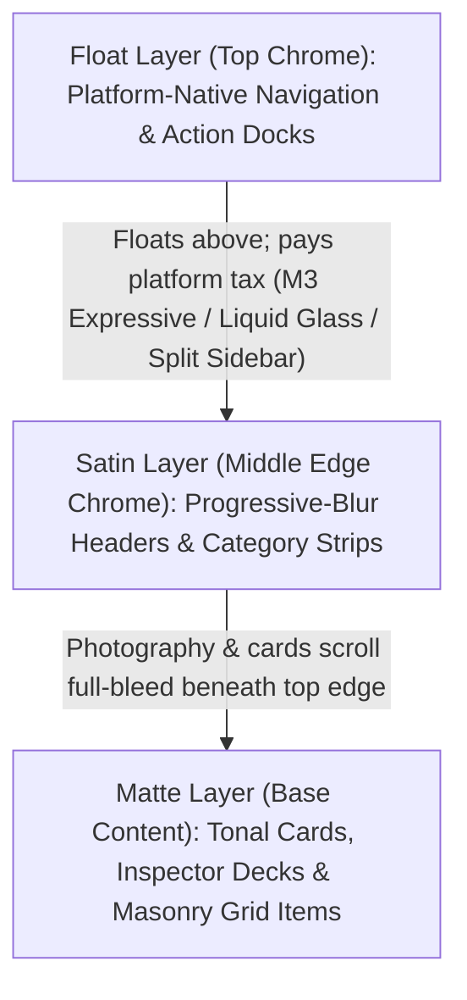
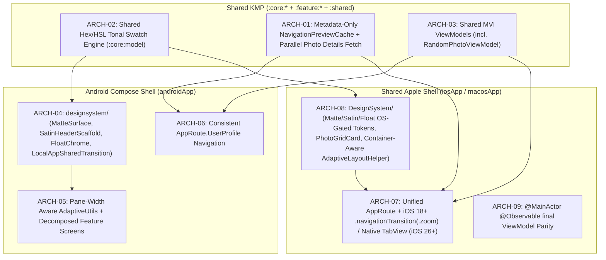
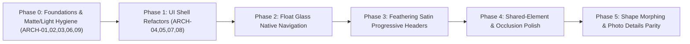

# Cross-Platform Material Craft Evaluation & Architecture Review

* **Status:** Proposed (Exploratory Research & Architecture Review)
* **Date:** 2026-11-22
* **Reference Source:** TJ Dahunsi, *"Material is the metaphor: Pushing the limits of building with Material design cross platform with Jetpack Compose"* (Oct 14, 2026) — [tunjid.com article](https://www.tunjid.com/articles/material-is-the-metaphor-pushing-the-limits-of-building-with-material-design-cross-platform-with-jetpack-compose-6acf75b3c23999c5f99f8d5b)
* **Target Platforms:** Android (`minSdk 29`, `compileSdk 37`, Compose BOM `2026.09.00+`), iOS (`17.0+` with progressive `18+` / `26+` enhancements), macOS (`14.0+` with progressive `15+` / `26+` Tahoe enhancements)
* **Scope:** Cross-platform UI design language evaluation across [`androidApp`](../../androidApp) and [`iosApp`](../../iosApp) (`iosApp` + `macosApp`), paired with a full-stack architecture review across `:core:*`, `:feature:*`, `:shared`, `androidApp`, and `iosApp`.

---

## 1. Executive Summary & Architectural Contrast

TJ Dahunsi’s article documents how **Heron** (an AT Protocol client built with **Compose Multiplatform**) resolves the tension between platform-stock conformity and brand individuality. Rather than treating Material Design as rigid stock widgets or flattening every surface with uniform blur, Heron interprets *“material is the metaphor”* through a **three-tier glass surface grammar** (**Matte → Satin → Float**), coupled with three engineering crafts: **Timeline Dilation shape morphing**, **scroll-reactive progressive-blur “Satin” headers with shared-element occlusion masking**, and **platform-native “Float” navigation chrome**.

### Key Architectural & Domain Contrasts

1. **Shared Compose UI vs. Thin Native UI Shells:**
   * **Heron** shares UI rendering via Compose Multiplatform on Android and iOS, forcing intricate Compose-on-iOS interop workarounds (porting Android’s progressive blur to Skia on iOS, overlaying `UITabBar` via `UIKitInteropProperties(placedAsOverlay = true)`).
   * **Image Feed App** shares domain logic, Ktor networking, Room KMP persistence, Metro DI, and MVI ViewModels across `:core:*`, `:feature:*`, and `:shared` ([Architecture & Modules](../../wiki/architecture-and-modules.md)), while keeping thin **native UI shells**: Jetpack Compose + Material 3 + Navigation 3 on Android, and shared SwiftUI (`iosApp` + `macosApp`) on Apple ([Design Systems & Navigation](../../wiki/design-systems-and-navigation.md)). We gain direct access to Apple’s Metal-backed Liquid Glass and macOS desktop idioms with **zero UIKit/Compose interop hacks**.
2. **Micro-Blogging Stream vs. Editorial Photography Gallery:**
   * Heron renders text-first posts with threaded reply lines and inline avatars. Image Feed App renders full-bleed Unsplash photography where **photographic composition, framing fidelity, and WCAG contrast** must remain primary. Every craft must therefore be reinterpreted for photography rather than copied literally.
3. **Baseline Post-Spec-77 State & Discovered Platform Inversion:**
   * Building on `main` after Spec 77 ([`77_shim_retirement_and_swift6_warning_cleanup.md`](../archive/77_shim_retirement_and_swift6_warning_cleanup.md), which retired legacy `:shared` shims and restored zero-warning Swift 6 compilation in `KFImage.swift` and `UserProfileView.swift`), a full UI and architecture audit reveals an unexpected **cross-platform inversion**:
     * **Android** currently hand-rolls a faux-glass floating bottom pill with hardcoded `Color.White` specular strokes ([`MainActivity.kt`](../../androidApp/src/main/java/com/example/imagefeed/android/MainActivity.kt#L175-L238)) while clipping feed grids rigidly below opaque `TopAppBar` chrome.
     * **iOS** hides Apple’s native `UITabBar` ([`ContentView.swift`](../../iosApp/iosApp/ContentView.swift#L85-L92)) in favor of a hand-rolled `.regularMaterial` [`FloatingTabCapsule.swift`](../../iosApp/iosApp/FloatingTabCapsule.swift) + `CapsuleScrollCoordinator`, stacks live `.ultraThinMaterial` cards onto opaque or already-blurred surfaces, and renders a double-bar seam at the top of scrollable views.
     * **macOS** uses native `NavigationSplitView` ([`MacOSContentView.swift`](../../iosApp/iosApp/MacOSContentView.swift)), yet injects oversized 40×40pt circular iOS [`GlassToolbarButton`](../../iosApp/iosApp/GlassTheme.swift#L361-L406) controls into desktop `.toolbar` slots.

### Cross-Platform Fit Matrix

| Article Craft / Concept | Overall Fit | Android (`androidApp`) | iOS (`iosApp` 17 → 26+) | macOS (`macosApp` 14 → 26+) |
| :--- | :---: | :--- | :--- | :--- |
| **1. Matte / Satin / Float Layer Grammar** | **Very High** | Formalize tonal cards (`Matte`), edge-to-edge progressive-blur headers (`Satin`), and M3 Expressive nav (`Float`) | Strip redundant live blur inside cards (`Matte`), apply soft top edge (`Satin`), adopt native Liquid Glass nav (`Float`) | Keep native split sidebar (`Float`), add Matte collection/inspector cards + soft top edge (`Satin`) |
| **2. Matte Glass Adaptive Cards** | **High** | Strong adaptive grids; refine `PhotoCard` attribution scrim & remove hardcoded dark slate gradients | Frame `CollectionsFeedView` items on iPad & replace nested `.ultraThin` cards inside `PhotoInspectorView` / `InsightsView` | Same as iOS — Matte collection framing & low-glare desktop inspector cards fit `macosApp` cleanly |
| **3. Feathering Satin (Progressive Blur Headers)** | **Very High** *(Top visual win)* | Full-bleed scrolling behind transparent `TopAppBar` + Compose 1.13+ progressive `Modifier.blur` (API 33+ with gradient scrim fallback on API 29–32) | Replace double-seam `.toolbarBackground(.visible)` + capsule stack with iOS 26 `.scrollEdgeEffectStyle(.soft, for: .top)` (fade fallback on iOS 17–25) | macOS 26 `.scrollEdgeEffectStyle(.soft, for: .top)` under toolbar & category strip (fade fallback on macOS 14–15); keep bars persistent |
| **4. Shared-Element Satin Occlusion Masking** | **High** | Essential with `SharedTransitionLayout` + Predictive Back; also fixes `CollectionDetailScreen` `.blur(20.dp)` snap | Needed when dismissing hero overlay behind `FeedCategoryBar`, or solved natively via iOS 18+ `.navigationTransition(.zoom)` | Applies to hero dismissal; keep transitions brisk (~250–300ms) for pointer-driven desktop feel |
| **5. Float Glass (“Pay the Platform Tax”)** | **Very High** | Adopt M3 Expressive `HorizontalFloatingToolbar`, `ShortNavigationBar`, `WideNavigationRail`, and spring `MotionScheme` | Adopt iOS 26 native `TabView` Liquid Glass + `.tabBarMinimizeBehavior(.onScrollDown)` + `Tab(role: .search)` (keep `FloatingTabCapsule` for iOS 17–25) | Replace 40pt circular `GlassToolbarButton` items in `.toolbar` with native macOS toolbar buttons + unified Search (`⌘F`) + `Escape` dismiss |
| **6. Timeline Dilation & Shape Morphing** | **Selective** *(Reinterpret, don’t copy literally)* | Skip reply-line avatar distortion. Adopt `PolygonShape` / `MorphPolygonShape` for bookmark/aperture/color-dial/empty states + **add missing Avatar shared-element transition** | Skip warped polygons. Add **Avatar hero transitions**, SF Symbol `.symbolEffect(.replace/.bounce)`, and iOS 26 `GlassEffectContainer` + `.glassEffectID` morphing | Same as iOS (SF Symbol transitions + macOS 26 `GlassEffectContainer` for floating pills); keep photos strictly crisp rectangles |
| **7. Brand Cohesion & Feature Parity** | **High** | Bring compact-phone pinch-to-zoom, edge-to-edge Satin header, and ambient backdrop to `PhotoDetailsScreen` | Fix Light Mode `.white` token leaks; bring 2×2 EXIF Bento, tonal Color Swatches, Full/RAW download split, and photo-hue accenting | Same as iOS plus dual-pane canvas zoom, window-width adaptive columns, and keyboard navigation |

---

## 2. Detailed Craft-by-Craft Evaluation

### 2.1 Three-Tier Material Metaphor (*Matte → Satin → Float*)

Heron defines a disciplined three-layer surface vocabulary tied to brand adjectives (*graceful, smooth, elegant*). Translating that discipline to Image Feed App’s photographic identity (**Luminous, Editorial, Tactile**) gives all three platforms a unified mental model while respecting native platform languages:

* **Matte Layer (Base Content):** Opaque, shimmerless, high-FPS surfaces for masonry cards, collection mosaics, inspector specs, and analytics cards. Zero live backdrop blur passes so 120Hz scrolling stays deterministic.
* **Satin Layer (Middle Edge Chrome):** Brand-defining translucent top headers, collapsing titles, and category/search tab strips anchored at the top edge where photography scrolls underneath.
* **Float Layer (Top Chrome):** Floating bottom/rail navigation and primary action toolbars that defer strictly to native platform geometry, haptics, and user accessibility settings.

---

### 2.2 “Matte Glass” Adaptive Content Surfaces

Heron rejects divider-separated lists in favor of opaque Material cards (`Matte`) so layouts expand effortlessly from phones to tablets and foldables.

* **Android (`androidApp`):**
  * Adaptive column counts and `ListDetailSceneStrategy` are already well established in [`AdaptiveUtils.kt`](../../androidApp/src/main/java/com/example/imagefeed/android/AdaptiveUtils.kt) and [`MainActivity.kt`](../../androidApp/src/main/java/com/example/imagefeed/android/MainActivity.kt#L278-L300).
  * **Opportunity 1 — Photo Card Scrim Hygiene:** [`PhotoCard`](../../androidApp/src/main/java/com/example/imagefeed/android/FeedScreen.kt#L316-L454) paints a full-width dark vertical gradient (`alpha = 0.75f`) across the bottom of every image. Replacing that edge-to-edge gradient with a compact corner attribution capsule (mirroring Apple’s [`PhotoCard`](../../iosApp/iosApp/ContentView.swift#L840-L865), using an opaque/single-pass tonal scrim pill rather than live blur) preserves clean photographic edges while keeping photographer attribution prominent and tappable.
  * **Opportunity 2 — Remove Hardcoded Dark Gradients in Discovery Cards:** [`TopicCapsuleCard`](../../androidApp/src/main/java/com/example/imagefeed/android/FeedScreen.kt#L514-L569) uses hardcoded `Color.White.copy(alpha = 0.15f)` borders and dark slate hexes (`0xFF1E293B` / `0xFF0F172A`), and Popular Topics in [`SearchScreen.kt`](../../androidApp/src/main/java/com/example/imagefeed/android/SearchScreen.kt#L588-L608) apply the same hardcoded white hairline border. Grounding fallback fills and outlines in `MaterialTheme.colorScheme` Matte tokens preserves Light Mode parity.
* **iOS (`iosApp`):**
  * Feed [`PhotoCard`](../../iosApp/iosApp/ContentView.swift#L859) already respects GPU budgets via `GlassStyle.lightweight` ([`GlassTheme.swift`](../../iosApp/iosApp/GlassTheme.swift#L151-L152), ADR-07).
  * **Redundant Live Blur Violation:** [`PhotoInspectorView.swift`](../../iosApp/iosApp/PhotoInspectorView.swift#L51-L253) (photographer card, chart card, download/bookmark buttons, EXIF card, location card, tag pills, `MetricCard`) and [`InsightsView`](../../iosApp/iosApp/UserProfileView.swift#L600-L607) wrap **7+ nested interior cards** in `.glassCard(style: .ultraThin)` even though they sit inside an already-blurred bottom sheet or on an opaque `GlassTheme.canvasBackgroundColor` dual-pane canvas. This violates both TJ’s Matte rule and [`.agents/skills/ios-glass-design/SKILL.md`](../../.agents/skills/ios-glass-design/SKILL.md#L29). Converting interior cards to a new **Matte surface token** (subtle semantic tonal fill + 0.5pt hairline border, zero backdrop blur) eliminates redundant offscreen blur passes and improves legibility.
  * **Unframed Collection Cards:** [`CollectionMosaicCard`](../../iosApp/iosApp/CollectionsFeedView.swift#L151-L297) currently renders title, description, and curator text directly on the bare canvas below the 3-photo mosaic, contrasting with Android’s framed [`CollectionMosaicCard`](../../androidApp/src/main/java/com/example/imagefeed/android/CollectionsFeedScreen.kt#L286-L294). Wrapping it in a Matte card container gives multi-column iPad layouts crisp visual containment.
* **macOS (`macosApp`):**
  * Directly benefits from `CollectionMosaicCard` Matte framing in 2+ column desktop grids and Matte interior cards inside the 320–420pt right inspector pane of [`PhotoDetailsView.swift`](../../iosApp/iosApp/PhotoDetailsView.swift#L330-L350), matching macOS HIG (`controlBackgroundColor` + subtle `separatorColor` borders).

---

### 2.3 “Feathering Satin” — Scroll-Reactive Progressive Blur Headers

TJ’s highest-craft innovation is restricting **Satin glass** to **top-edge headers** by applying Compose’s progressive blur (`Modifier.blur { ... }` / `BlurRadiusSpec`) + a subtle scrim directly to the scrolling content container, driven via draw-phase snapshot lambdas tied to scroll offset.

* **Why it fits Image Feed App:** Full-bleed photography scrolling seamlessly beneath translucent, edge-feathered headers is one of the highest-impact visual upgrades possible for a visual gallery app.
* **Android (`androidApp`):**
  * **Current Gap:** [`FeedScreen.kt`](../../androidApp/src/main/java/com/example/imagefeed/android/FeedScreen.kt#L169-L246), [`CollectionsFeedScreen.kt`](../../androidApp/src/main/java/com/example/imagefeed/android/CollectionsFeedScreen.kt#L142-L186), [`FavoritesScreen.kt`](../../androidApp/src/main/java/com/example/imagefeed/android/FavoritesScreen.kt#L107-L138), and [`UserProfileScreen.kt`](../../androidApp/src/main/java/com/example/imagefeed/android/UserProfileScreen.kt#L155-L210) pass `Scaffold`’s `paddingValues` to outer wrappers, hard-clipping masonry grids below opaque `TopAppBar` backgrounds. [`CollectionDetailScreen.kt`](../../androidApp/src/main/java/com/example/imagefeed/android/CollectionDetailScreen.kt#L180-L186) toggles abruptly between `Color.Transparent` and `surface.copy(alpha = 0.95f)` at `firstVisibleItemScrollOffset > 300`.
  * **Target Design:**
    1. Pass top-bar height into `LazyVerticalStaggeredGrid(contentPadding = ...)` rather than outer `Modifier.padding(paddingValues)` so photography draws **edge-to-edge behind transparent top chrome**.
    2. Apply a top-anchored progressive blur (`Modifier.blur { ... }` with `BlurRadiusSpec.verticalGradient` from Compose 1.13+) paired with a subtle theme-aware vertical surface scrim directly to the scrollable grid container, dynamically reading header height inside draw-phase snapshot lambdas (zero recompositions during flings, honoring Spec 62).
    3. Connect `TopAppBarDefaults.enterAlwaysScrollBehavior()` (plus quick-return collapse on the `FeedScreen` topic strip and `SearchScreen` color dial/tabs on compact phones) and offset `PullToRefreshBox`’s indicator (`contentPadding.top`) so the spinner clears the satin header cleanly.
  * **Platform Version & Performance Guardrails:** Because [`androidApp/build.gradle.kts`](../../androidApp/build.gradle.kts#L20-L24) sets `minSdk = 29` while `compileSdk = 37` and [`libs.versions.toml`](../../gradle/libs.versions.toml#L26) already pins `androidx-compose-bom = "2026.09.00"`, progressive blur must gate cleanly at **Android 13 (API 33+)** (`Build.VERSION.SDK_INT >= Build.VERSION_CODES.TIRAMISU`), degrading gracefully on API 29–32 (and under reduced motion/power saver) to a smooth multi-stop vertical alpha scrim using `MaterialTheme.colorScheme.surface`.
* **iOS (`iosApp`):**
  * **Current Gap:** [`ContentView.swift`](../../iosApp/iosApp/ContentView.swift#L428-L481), [`SearchView.swift`](../../iosApp/iosApp/SearchView.swift#L220-L242), [`FavoritesView.swift`](../../iosApp/iosApp/FavoritesView.swift#L176-L181), [`CollectionsFeedView.swift`](../../iosApp/iosApp/CollectionsFeedView.swift#L129-L131), and [`UserProfileView.swift`](../../iosApp/iosApp/UserProfileView.swift#L110-L113) force hard-edged `.toolbarBackground(.ultraThinMaterial, for: .navigationBar)` + `.toolbarBackground(.visible)` above `.safeAreaInset(edge: .top)` floating capsules (`FeedCategoryBar`, `SearchTabBar`), producing a stacked double-bar seam.
  * **Target Design:** On **iOS 26+**, adopt SwiftUI’s native Satin edge feathering — **`.scrollEdgeEffectStyle(.soft, for: .top)`** — and remove `.toolbarBackground(.visible)` so photos melt smoothly under both navigation chrome and floating category/search bars. On **iOS 17–25** (retaining `deploymentTarget: "17.0"` in [`iosApp/project.yml`](../../iosApp/project.yml#L11)), replace the hard double seam with a lightweight top canvas gradient mask behind the floating capsule without running live per-frame `.blur` across `ScrollView`.
* **macOS (`macosApp`):**
  * On **macOS 26 (Tahoe)**, `.scrollEdgeEffectStyle(.soft, for: .top)` applies natively inside `NavigationSplitView` detail panes; on **macOS 14–15**, apply a subtle `windowBackgroundColor` top gradient fade beneath `FeedCategoryBar` / `SearchTabBar`.
  * **Desktop Ergonomic Guardrail:** Never auto-hide `FeedCategoryBar` or `SearchTabBar` on scroll on macOS; mouse-wheel / trackpad micro-scrolls make disappearing headers feel unstable, and desktop vertical height is plentiful.

---

### 2.4 Shared-Element Transitions & Satin Glass Occlusion Masking

Heron highlights a subtle `SharedTransitionLayout` physics edge case: shared elements render in an overlay *above* all screens, so on back navigation any element partially tucked behind a Satin glass header flies cleanly above the header and then **snaps abruptly into blur** once the transition completes. TJ masks this by holding blur at `0.dp` (scrim-only) whenever the returning element is occluded by the header, then feathering blur back in over 800ms after settlement.

* **Android (`androidApp`):**
  * All 5 photo grids use `Modifier.sharedElement` gated by `isTransitionSource` ([`FeedScreen.kt`](../../androidApp/src/main/java/com/example/imagefeed/android/FeedScreen.kt#L384-L388), [`FavoritesScreen.kt`](../../androidApp/src/main/java/com/example/imagefeed/android/FavoritesScreen.kt#L197-L211), [`SearchScreen.kt`](../../androidApp/src/main/java/com/example/imagefeed/android/SearchScreen.kt#L676-L690), [`CollectionDetailScreen.kt`](../../androidApp/src/main/java/com/example/imagefeed/android/CollectionDetailScreen.kt#L261-L277), [`UserProfileScreen.kt`](../../androidApp/src/main/java/com/example/imagefeed/android/UserProfileScreen.kt#L365-L378)), and [`CollectionsFeedScreen.kt`](../../androidApp/src/main/java/com/example/imagefeed/android/CollectionsFeedScreen.kt#L346-L352) uses `sharedBounds` on collection covers.
  * **Predictive Back Interaction:** Because [`MainActivity.kt`](../../androidApp/src/main/java/com/example/imagefeed/android/MainActivity.kt#L339-L357) configures `predictivePopTransitionSpec`, users scrub back transitions interactively. Tracking `isTransitionSource` bounds against the Satin header’s bottom edge lets us suspend Satin blur while `sharedTransitionScope.isTransitionActive` is true on occluded pops, then feather blur back over **450–650ms** (snappier than 800ms for gallery browsing) once settled.
  * **Existing Bug Fix Bonus:** [`CollectionDetailScreen.kt`](../../androidApp/src/main/java/com/example/imagefeed/android/CollectionDetailScreen.kt#L346-L349) currently chains `.sharedBounds(...).blur(20.dp)` statically on the cover backdrop, snapping abruptly between sharp and 20dp-blurred during transitions. Feathering that backdrop blur across the shared transition eliminates an existing visual seam immediately.
* **iOS & macOS (`iosApp` / `macosApp`):**
  * Currently, [`ContentView.swift`](../../iosApp/iosApp/ContentView.swift#L448-L472) and [`FavoritesView.swift`](../../iosApp/iosApp/FavoritesView.swift#L148-L172) present `PhotoDetailsView` as a `ZStack` overlay so `matchedGeometryEffect` works — which triggers the same `FeedCategoryBar` occlusion pop on dismissal — while `SearchView`, `CollectionDetailView`, and `UserProfileView` push onto `NavigationStack` with a `dummyNamespace` ([`ContentView.swift`](../../iosApp/iosApp/ContentView.swift#L205)) and zero hero motion.
  * **Native iOS 18+ Resolution:** Migrating to SwiftUI’s native **`.navigationTransition(.zoom(sourceID:in:))`** + **`.matchedTransitionSource(id:in:)`** handles interactive swipe-to-dismiss, source clipping behind navigation bars, and corner-radius morphing automatically across **every** photo entry point (eliminating both the occlusion pop and the `ZStack` workaround). On iOS 17 and macOS 14–15, cross-fading `FeedCategoryBar` slightly during overlay dismissal (keeping macOS transitions ~250–300ms) masks the pop cleanly.

---

### 2.5 “Float Glass” — Paying the Platform Tax on Navigation Chrome

Heron cedes top-level navigation chrome to each OS’s native idioms (Material 3 on Android; native `UITabBar` Liquid Glass on iOS) so users retain OS-level familiarity, dynamic transparency preferences, and zero-effort alignment with future OS releases.

* **Android (`androidApp`) — Move to Authentic Material 3 Expressive:**
  * **Current Debt:** [`MainActivity.kt`](../../androidApp/src/main/java/com/example/imagefeed/android/MainActivity.kt#L175-L238) builds a bespoke `CircleShape` bottom pill (`surfaceContainerHigh.copy(alpha = 0.88f)`) with a hardcoded `Color.White.copy(alpha = 0.20f)` vertical gradient border; [`PhotoDetailsScreen.kt`](../../androidApp/src/main/java/com/example/imagefeed/android/PhotoDetailsScreen.kt#L1433-L1590) hand-rolls `FloatingActionToolbar`; [`MainActivity.kt`](../../androidApp/src/main/java/com/example/imagefeed/android/MainActivity.kt#L124-L160) uses a bare static `NavigationRail` on wide screens; and navigation transitions ([`MainActivity.kt`](../../androidApp/src/main/java/com/example/imagefeed/android/MainActivity.kt#L315-L355)) use `FastOutSlowInEasing` tweens rather than physics springs.
  * **Target Design (using Compose BOM `2026.09.00` / Material 3 `1.4+`):**
    * Replace the hand-rolled details dock with M3 Expressive **`HorizontalFloatingToolbar`** (paired with `FloatingToolbarDefaults.exitAlwaysScrollBehavior` and `vibrantFloatingToolbarColors()`).
    * Upgrade the phone bottom bar to M3 Expressive **`ShortNavigationBar`** / floating navigation bar patterns (removing hardcoded `Color.White` borders in favor of M3 tonal elevation + `outlineVariant`), and adopt **`WideNavigationRail`** on Medium/Expanded tablets and foldables.
    * Adopt **`MaterialExpressiveTheme`** with expressive spatial/effects **`MotionScheme`** springs across navigation and component state transitions.
* **iOS (`iosApp`) — Embrace Native iOS 26 Liquid Glass `TabView`:**
  * **Current Debt:** [`ContentView.swift`](../../iosApp/iosApp/ContentView.swift#L85-L147) hides `UITabBar`, wraps a custom [`FloatingTabCapsule.swift`](../../iosApp/iosApp/FloatingTabCapsule.swift), and drives minimization manually through `CapsuleScrollCoordinator` and `FeedScrollTrackingModifier`. Moreover, iOS only exposes 3 tabs (`Photos`, `Collections`, `Favorites`), hiding Search behind a top-left toolbar button ([`ContentView.swift`](../../iosApp/iosApp/ContentView.swift#L485-L492)).
  * **Target Design:**
    * **On iOS 26+ (`#available(iOS 26, *)`):** Restore native `TabView` so Apple renders true refractive Liquid Glass, picks up system Clear/Tinted glass and Reduce Transparency settings natively, minimizes smoothly on scroll via **`.tabBarMinimizeBehavior(.onScrollDown)`**, and separates Search into a native **`Tab(role: .search)`** orb — delivering **4-destination parity with Android** (`Photos`, `Collections`, `Favorites`, `Search`) while retiring `CapsuleScrollCoordinator` on OS 26+.
    * Upgrade floating in-canvas controls (`compactFloatingBar`, top back/info orbs, `GlassToastPill`, `FeedCategoryBar`) to **`.glassEffect(.regular.interactive(), in:)`** under `#available(iOS 26, *)`.
    * Preserve `FloatingTabCapsule` and `GlassTheme`'s `.ultraThinMaterial` / `.regularMaterial` + `accessibilityReduceTransparency` fallbacks strictly for **iOS 17–25**.
* **macOS (`macosApp`) — Native Desktop Chrome & Keyboard Ergonomics:**
  * **Current Debt:** [`MacOSContentView.swift`](../../iosApp/iosApp/MacOSContentView.swift) establishes a clean `NavigationSplitView` sidebar (`Photos`, `Collections`, `Favorites`), yet child screens place 40×40pt circular [`GlassToolbarButton`](../../iosApp/iosApp/GlassTheme.swift#L361-L406) orbs inside `.toolbar` ([`ContentView.swift`](../../iosApp/iosApp/ContentView.swift#L500-L514), [`CollectionsFeedView.swift`](../../iosApp/iosApp/CollectionsFeedView.swift#L141-L145), [`UserProfileView.swift`](../../iosApp/iosApp/UserProfileView.swift#L123-L148)), and [`PhotoDetailsView.swift`](../../iosApp/iosApp/PhotoDetailsView.swift#L140-L147) pads an overlay back button `.padding(.top, 60)` even inside desktop windows.
  * **Target Design:** Under `#if os(macOS)`, render standard SwiftUI toolbar `Button`/`Label` items inside `.toolbar` (automatically gaining AppKit bezels on macOS 14–15 and refractive Liquid Glass on macOS 26 Tahoe); promote Search into the sidebar / window-level `.searchable` (`⌘F`); wire `Escape` dismissal on photo details; and retain [`MacOSHorizontalScrollCoordinator`](../../iosApp/iosApp/GlassTheme.swift#L411-L572) + chevron step buttons ([`ContentView.swift`](../../iosApp/iosApp/ContentView.swift#L639-L695)).

---

### 2.6 “Timeline Dilation” & Organic Shape Morphing (`PolygonShape`)

Heron warps poster avatars toward reply connector lines using Compose 1.13’s `PolygonShape` / `MorphPolygonShape` and morphs them into circles during shared-element transitions.

* **What to Reject:** Image Feed App has no threaded reply lines, so distorting avatars on photo cards would be visually unmotivated. Likewise, **never** clip Unsplash photographs into stars or polygons — photography framing must stay crisp rounded rectangles.
* **What to Adopt (Domain-Aligned Shape & Continuity Craft):**
  1. **Missing Photographer Avatar Shared-Element Transition (All 3 Platforms):** While photos (`photo_img_*`) and collection covers (`col_cover_*`) animate spatially, tapping a photographer’s avatar on `PhotoCard`, `PhotoDetailsScreen`, `CollectionDetailScreen`, or Search `UserRowCard` cuts sharply into `UserProfileScreen` / `UserProfileView`. Adding shared-element avatar continuity (24–44dp/pt source → 88dp/pt profile header) yields immediate spatial polish across Android, iOS, and macOS.
  2. **Expressive Micro-Shape Morphing on Android (`PolygonShape` / `MorphPolygonShape`):** Extending existing corner-radius morphing in [`ProfileTabSelector`](../../androidApp/src/main/java/com/example/imagefeed/android/UserProfileScreen.kt#L687-L690), use Compose 1.13+ draw-phase shape morphing on **photographic micro-interactions** only:
     * **Camera-Aperture Randomize Indicator:** Replace the generic `Lightbulb` icon ([`FeedScreen.kt`](../../androidApp/src/main/java/com/example/imagefeed/android/FeedScreen.kt#L184)) with a soft 8-sided aperture `PolygonShape` container that rotates/morphs during shake or randomize loading.
     * **Bookmark & Color-Dial Selection Morphs:** Subtle `CircleShape` ↔ rounded-squircle morphs on the `PhotoDetailsScreen` bookmark action and active swatch in `SearchColorDial`.
     * **Soft-Scallop Empty State Containers:** Warm organic `PolygonShape` backdrops behind empty-state icons in [`FavoritesScreen.kt`](../../androidApp/src/main/java/com/example/imagefeed/android/FavoritesScreen.kt#L151-L156) and [`PhotoDetailPlaceholder.kt`](../../androidApp/src/main/java/com/example/imagefeed/android/PhotoDetailPlaceholder.kt#L38-L43).
  3. **Idiomatic Apple Equivalents (`iosApp` / `macosApp`):**
     * **OS 26+ Liquid Glass Morphing:** Wrap co-located detail controls (`PhotoDetailsView` orbs, `compactFloatingBar`, `GlassToastPill`) inside **`GlassEffectContainer`** paired with **`.glassEffectID(_:in:)`** so toggling the inspector sheet smoothly morphs the glass cluster.
     * **OS 17+ / 14+ SF Symbol Morphing:** Apply `.contentTransition(.symbolEffect(.replace))` on `bookmark` ↔ `bookmark.fill` and `info.circle` ↔ `info.circle.fill`, plus `.symbolEffect(.bounce)` on Shuffle and Download triggers.
     * **Corner-Radius Continuity:** Smoothly interpolate `12pt` card radius → `0pt` detail canvas during hero transitions (automatic under iOS 18+ `.navigationTransition(.zoom)`).

---

### 2.7 Anti-Convergent Brand Cohesion, Cross-Platform Parity & Light-Mode Readiness

TJ’s dual Light/Dark wireframes highlight that a design system collapses if Light Mode relies on hardcoded white overlays. Auditing both codebases revealed urgent Light Mode leaks alongside rich features already built on one platform that should cross-pollinate to the other.

#### Light Mode Token Audit (Prerequisite Before Satin/Float Glass)

| Platform | File & Line Evidence | Current Defect | Required Fix |
| :--- | :--- | :--- | :--- |
| **Apple** | [`ContentView.swift`](../../iosApp/iosApp/ContentView.swift#L354), [`CollectionsFeedView.swift`](../../iosApp/iosApp/CollectionsFeedView.swift#L89), [`SearchView.swift`](../../iosApp/iosApp/SearchView.swift#L205), [`UserProfileView.swift`](../../iosApp/iosApp/UserProfileView.swift#L473), [`CollectionDetailView.swift`](../../iosApp/iosApp/CollectionDetailView.swift#L181) | `ProgressView().tint(.white)` invisible on Light Mode canvases | Use semantic `.tint(.primary)` / `.tint(.secondary)` (note [`FavoritesView.swift`](../../iosApp/iosApp/FavoritesView.swift#L66) already uses `.tint(.primary)`) |
| **Apple** | [`ContentView.swift`](../../iosApp/iosApp/ContentView.swift#L772-L784), [`SearchView.swift`](../../iosApp/iosApp/SearchView.swift#L722-L725) | `CategoryTabButton` and `FilterButtonView` hardcode `.black` / `.white` capsules | Map active/inactive pill fills & labels to adaptive semantic `Color.primary` / background inversion or `GlassTheme` tokens |
| **Apple** | [`AnimationPrimitives.swift`](../../iosApp/iosApp/AnimationPrimitives.swift#L104-L175) | Skeleton placeholders hardcode `Color.white.opacity(0.06)` (invisible in Light Mode) | Bind skeleton base and shimmer highlight to `GlassTheme.surfaceBackgroundColor` and adaptive opacity |
| **Apple** | [`UserProfileView.swift`](../../iosApp/iosApp/UserProfileView.swift#L659-L681), [`PhotoInspectorView.swift`](../../iosApp/iosApp/PhotoInspectorView.swift#L324-L359) | Swift Charts `LineMark`, `AreaMark`, `RuleMark`, `PointMark` hardcode `.white` | Drive chart strokes from `.primary` or photo-derived accent hue |
| **Android** | [`MainActivity.kt`](../../androidApp/src/main/java/com/example/imagefeed/android/MainActivity.kt#L189-L190), [`FeedScreen.kt`](../../androidApp/src/main/java/com/example/imagefeed/android/FeedScreen.kt#L514-L566) | Hardcoded `Color.White` specular border on bottom pill & dark slate hexes (`0xFF1E293B` / `0xFF0F172A`) on Editorial `TopicCapsuleCard` | Replace with `MaterialTheme.colorScheme` `outlineVariant` / `primaryContainer` / `secondaryContainer` tokens |

#### Cross-Pollinating Photo Details & Gallery Craft

* **Bring Apple’s Immersion to Android (`PhotoDetailsScreen.kt`):**
  * **Gap:** Pinch-to-zoom (`transformable`) is gated inside `if (isDualPane)` ([`PhotoDetailsScreen.kt`](../../androidApp/src/main/java/com/example/imagefeed/android/PhotoDetailsScreen.kt#L621-L733)) — compact Android phones cannot zoom or pan photographs at all!
  * **Improvement:** Enable pinch/double-tap zoom on compact phones too, float a transparent **Satin** `CenterAlignedTopAppBar` over the top edge of an edge-to-edge photo canvas, and add a subtle ambient backdrop sourced from `photo.color` / `generatePhotoColorScheme` ([`Theme.kt`](../../androidApp/src/main/java/com/example/imagefeed/android/theme/Theme.kt#L68-L137)).
* **Bring Android’s Editorial Inspector Richness to iOS & macOS (`PhotoDetailsView.swift` / `PhotoInspectorView.swift`):**
  * **Gap:** Apple currently lacks Android’s **2×2 EXIF Bento Grid**, **interactive Tonal Color Swatches** (tap-to-copy hex with feedback), **Full vs. RAW download choice**, and **zoom on dual-pane iPad/macOS canvases** (zoom is confined to `compactPhotoLayout` in [`PhotoDetailsView.swift`](../../iosApp/iosApp/PhotoDetailsView.swift#L259-L327)).
  * **Improvement:** Port all four capabilities cleanly onto Matte inspector cards and dual-pane canvases, and tint Apple’s inspector charts, active bookmark highlights, and map pins subtly with `photo.color` so both ecosystems celebrate the chromatic soul of each photograph.

---

## 3. Comprehensive Architecture Review & Prerequisite Recommendations

Applying these visual crafts directly on top of today’s UI shells without fixing structural bottlenecks would deepen file monoliths, duplicate blur/occlusion logic across 6 screens, and worsen Frame-0 hero transitions. Below is the target architecture and **9 concrete architectural recommendations (`ARCH-01`–`ARCH-09`)** across KMP, Android, and Apple.

### Architecture Recommendations Overview

| ID | Layer | Priority | Problem Observed | Target Architectural Improvement |
| :--- | :--- | :---: | :--- | :--- |
| **`ARCH-01`** | Shared KMP | **Critical** | ID-only routes leave `state.photo == null` on Frame 0 (breaking Android `sharedElement` & flashing theme); `PhotoDetailsViewModel` fetches details & stats sequentially | Add ephemeral metadata-only `NavigationPreviewCache` (or optional seed in assisted factories); parallelize `getPhotoDetails` + `getPhotoStats` |
| **`ARCH-02`** | Shared KMP | **High** | Pure HSL/Hex swatch math (`deriveTonalSwatches`) locked in Android [`Theme.kt`](../../androidApp/src/main/java/com/example/imagefeed/android/theme/Theme.kt#L18-L225) | Extract pure Kotlin `PhotoTonalSwatch` / `deriveTonalSwatches` into `:core:model` for shared Android + Apple consumption |
| **`ARCH-03`** | Shared KMP / Android | **Medium** | [`MainActivity.kt`](../../androidApp/src/main/java/com/example/imagefeed/android/MainActivity.kt#L87) injects `FeedRepository` directly via `MetroHelper.getFeedRepository()` instead of `RandomPhotoViewModel` | Route Android shake/randomize through `RandomPhotoViewModel`; remove `MetroHelper.getFeedRepository()` escape hatch |
| **`ARCH-04`** | Android UI | **Critical** | 6 screens duplicate nested `Scaffold`s, scroll listeners, `selectedPhotoId` state, and manual `SharedTransitionScope` / `AnimatedVisibilityScope` threading | Create `androidApp/.../designsystem/` (`MatteSurface`, `SatinHeaderScaffold`, `Modifier.satinProgressiveBlur`, `FloatNavigationChrome`, `LocalAppSharedTransition`, `SatinOcclusionController`) |
| **`ARCH-05`** | Android UI | **High** | Monolithic screens (`PhotoDetailsScreen` 1,934L, `SearchScreen` 1,537L, `UserProfileScreen` 1,209L); `AdaptiveUtils` uses full window width ignoring `ListDetailSceneStrategy` pane width | Decompose screens into feature subpackages (`details/`, `search/`, `profile/`, `components/PhotoCard.kt`); thread `LocalPaneWidthDp` into `AdaptiveUtils` |
| **`ARCH-06`** | Android UI | **Medium** | Curator taps in Collections open external browser; `SearchScreen` passes empty `onUserClick = {}` to `PhotoCard` | Route all photographer/curator taps to `AppRoute.UserProfile(username)` for consistent avatar transitions |
| **`ARCH-07`** | Apple UI | **Critical** | 3 duplicated route enums (`FeedPathItem`, `CollectionPathItem`, `FavoritesPathItem`) + brittle dual `ZStack` overlay / `NavigationStack` sync | Unify into single `AppRoute` + `.appNavigationDestinations`; adopt iOS 18+ `.navigationTransition(.zoom)` across all entry points and pure `NavigationStack` on macOS |
| **`ARCH-08`** | Apple UI | **High** | 647-line [`GlassTheme.swift`](../../iosApp/iosApp/GlassTheme.swift) mixes tokens, AppKit event monitors, and buttons; 4 duplicated photo grid cards; `AdaptiveLayoutHelper` uses `UIScreen`/`NSScreen` | Split `DesignSystem/` (`SurfaceTokens`, `PlatformToolbarButton`, `MacOSHorizontalScrollBridge`, `PlatformNavigationShell`); unify `PhotoGridCard`; compute columns/CDN widths from container width |
| **`ARCH-09`** | Apple UI | **Low–Med** | Only 2 of 7 Swift ViewModel wrappers declare `@MainActor` + `final` | Standardize `@MainActor @Observable final class` across all 7 Swift ViewModels for Swift 6 + iOS 26 API safety |

---

### 3.1 Shared KMP Layer (`:core:*`, `:feature:*`, `:shared`)

#### `ARCH-01` (Critical): Frame-0 Hero Seeding & Concurrent Photo Details Fetching
* **Current Evidence:** [`Routes.kt`](../../androidApp/src/main/java/com/example/imagefeed/android/navigation/Routes.kt#L39-L41) and [`NavigationSections.kt`](../../androidApp/src/main/java/com/example/imagefeed/android/navigation/NavigationSections.kt#L56-L58) pass only `photoId` to `PhotoDetailsScreen`. On Frame 0, `state.photo` is `null`, causing [`PhotoDetailsScreen.kt`](../../androidApp/src/main/java/com/example/imagefeed/android/PhotoDetailsScreen.kt#L301-L304) to mount a centered `CircularProgressIndicator` instead of `PhotoCanvasPane`, which prevents `Modifier.sharedElement` from resolving the destination bounds on Frame 0 and triggers a jarring default-to-photo color-scheme flash when `generatePhotoColorScheme` receives `state.photo?.color`. On Apple, only `PhotosFeedTabView` and `FavoritesTabView` supply `initialPhoto:` ([`ContentView.swift`](../../iosApp/iosApp/ContentView.swift#L451)), while `SearchView`, `CollectionDetailView`, and `UserProfileView` omit it. Furthermore, [`PhotoDetailsViewModel.kt`](../../feature/details/src/commonMain/kotlin/com/example/imagefeed/presentation/details/PhotoDetailsViewModel.kt#L80-L81) executes `repository.getPhotoDetails(photoId)` and `repository.getPhotoStats(photoId)` **sequentially** before calling `updateState`.
* **Recommendation:**
  1. Introduce an ephemeral, size-bounded (`maxEntries = 16`), in-memory `@SingleIn(AppScope::class)` `NavigationPreviewCache` (or optional seed parameter on assisted ViewModel factories) keyed by ID for `Photo` (and optionally `User` / `PhotoCollection`). Keep `NavKey` routes (`AppRoute`) lightweight and ID-only so Android `SavedState` stays tiny.
  2. Read the cached `Photo` synchronously when initializing `PhotoDetailsState` (or on `Navigation` seed) so Frame 0 renders the thumbnail/BlurHash, attaches `sharedElement` immediately, and computes `generatePhotoColorScheme` without flashing.
  3. Parallelize `repository.getPhotoDetails(photoId)` and `repository.getPhotoStats(photoId)` inside `coroutineScope { async ... }`, emitting `details` as soon as it resolves without blocking behind `stats`.
  4. **Compliance Check:** Store only in-memory `Photo` metadata objects — zero image bytes cached to disk (100% compliant with ADR-02 and Unsplash hotlinking rules in [`business-rules.md`](../../wiki/business-rules.md#L10)).

#### `ARCH-02` (High): Shared Platform-Agnostic Color & Tonal Swatch Engine in `:core:model`
* **Current Evidence:** [`Theme.kt`](../../androidApp/src/main/java/com/example/imagefeed/android/theme/Theme.kt#L18-L225) implements `PhotoSwatch`, `parseHexArgb`, `deriveTonalSwatches`, `rgbToHsl`, `hslToColor`, and `colorToHex` purely in Android UI code, while Apple has no tonal swatch derivation or photo-hue accent helper.
* **Recommendation:** Extract pure Kotlin `HexRgb` / `PhotoTonalSwatch` / `deriveTonalSwatches(seedHex: String?)` and `deriveAccentHex(seedHex: String?, isDark: Boolean)` into `:core:model` (automatically exported by `:shared` per [`shared/build.gradle.kts`](../../shared/build.gradle.kts)), unit-tested once in `commonTest`. Android `Theme.kt` maps the shared swatches to Compose `Color`, and SwiftUI maps them to `Color(hex:)` for tonal swatches, charts, and subtle inspector accents.

#### `ARCH-03` (Medium): Restore Shared MVI Boundary for Android Random Photo Discovery
* **Current Evidence:** [`MainActivity.kt`](../../androidApp/src/main/java/com/example/imagefeed/android/MainActivity.kt#L87) directly retrieves `FeedRepository` via [`MetroHelper.getFeedRepository()`](../../shared/src/commonMain/kotlin/com/example/imagefeed/di/Metro.kt#L102) and runs an imperative `lifecycleScope.launch` + `Toast.makeText` inside [`handleShake()`](../../androidApp/src/main/java/com/example/imagefeed/android/MainActivity.kt#L380-L400), completely bypassing the existing [`RandomPhotoViewModel.kt`](../../feature/feed/src/commonMain/kotlin/com/example/imagefeed/presentation/random/RandomPhotoViewModel.kt) (which iOS/macOS already uses via [`FeedViewModel.swift`](../../iosApp/iosApp/FeedViewModel.swift#L87-L113)).
* **Recommendation:** Bind Android shake and randomize button events to `RandomPhotoViewModel` (receiving typed `AppError` effects mapped through `AppErrorLocalization.kt` into M3 Snackbars and reactive `isLoading` state to drive the expressive aperture morph), then delete `MetroHelper.getFeedRepository()` to enforce strict MVI boundary parity across platforms.

---

### 3.2 Android Compose UI Shell (`androidApp`)

#### `ARCH-04` (Critical): Extract `androidApp/.../designsystem/` & Centralized Satin/Shared-Element Infrastructure
* **Current Evidence:** Every screen builds its own nested `Scaffold`, manually repeats top-bar scroll color wiring, pagination `snapshotFlow`, bottom padding compensation, and `var selectedPhotoId by rememberSaveable`, and explicitly threads both `SharedTransitionScope` and `AnimatedVisibilityScope` through every screen and card parameter list (e.g., [`NavigationSections.kt`](../../androidApp/src/main/java/com/example/imagefeed/android/navigation/NavigationSections.kt#L36-L246), [`FeedScreen.kt`](../../androidApp/src/main/java/com/example/imagefeed/android/FeedScreen.kt#L102-L105), [`PhotoCard`](../../androidApp/src/main/java/com/example/imagefeed/android/FeedScreen.kt#L323-L325)).
* **Recommendation:** Introduce a focused internal UI foundation in `androidApp/src/main/java/com/example/imagefeed/android/designsystem/`:
  1. **`SurfaceTokens.kt` & `MatteSurface`:** Semantic Material 3 Matte containers banning raw color literals (`Color.White`, `0xFF1E293B`) outside domain photo swatches.
  2. **`SatinHeaderScaffold.kt` & `Modifier.satinProgressiveBlur`:** Single reusable modifier & scaffold hosting edge-to-edge scrolling grids behind transparent top bars, API 33+ draw-phase progressive blur + API 29–32 multi-stop gradient scrim fallback, `PullToRefreshBox` top-inset alignment, and quick-return collapse state.
  3. **`FloatNavigationChrome.kt`:** Encapsulates M3 Expressive `ShortNavigationBar` / `WideNavigationRail` and `HorizontalFloatingToolbar`.
  4. **`LocalAppSharedTransition` & `SatinOcclusionController`:** Provide `SharedTransitionScope` and `AnimatedVisibilityScope` via CompositionLocals (eliminating verbose parameter threading) and register the active transition source’s header-intersection state in one controller so all 5 grid screens get 450–650ms occlusion-aware Satin blur feathering automatically.

#### `ARCH-05` (High): Decompose Monolithic Screens & Fix `AdaptiveUtils` Pane-Width Blindness
* **Current Evidence:** Three screens have grown into multi-responsibility monoliths totaling **4,680 lines**: [`PhotoDetailsScreen.kt`](../../androidApp/src/main/java/com/example/imagefeed/android/PhotoDetailsScreen.kt) (1,934 lines), [`SearchScreen.kt`](../../androidApp/src/main/java/com/example/imagefeed/android/SearchScreen.kt) (1,537 lines), and [`UserProfileScreen.kt`](../../androidApp/src/main/java/com/example/imagefeed/android/UserProfileScreen.kt) (1,209 lines). Concurrently, [`AdaptiveUtils.kt`](../../androidApp/src/main/java/com/example/imagefeed/android/AdaptiveUtils.kt#L88-L135) calculates grid columns and `itemWidthPx` from full-window `LocalAdaptiveLayoutInfo.current.screenWidthDp`. When `ListDetailSceneStrategy` splits a tablet or unfolded Book device into list + detail panes, `AdaptiveUtils` still assumes the list spans the full screen — producing overly dense columns and requesting unnecessarily large Unsplash image widths (even though [`PhotoDetailsScreen.kt`](../../androidApp/src/main/java/com/example/imagefeed/android/PhotoDetailsScreen.kt#L395-L409) explicitly documents why pane-level width measurement is required).
* **Recommendation:**
  1. Decompose `PhotoDetailsScreen.kt`, `SearchScreen.kt`, `UserProfileScreen.kt`, and shared `PhotoCard` / `CollectionMosaicCard` into cohesive subpackages (`components/`, `details/`, `search/`, `profile/`).
  2. Introduce `LocalPaneWidthDp` (measured at each Navigation 3 pane root via `BoxWithConstraints` or `onSizeChanged` with quantized Dp) and feed it into `AdaptiveUtils` so column counts and Retina CDN `&w=` widths scale to the actual pane width.

#### `ARCH-06` (Medium): Standardize In-App Profile Navigation & Fix Dead Click Handlers
* **Current Evidence:** Tapping a curator in [`CollectionsFeedScreen.kt`](../../androidApp/src/main/java/com/example/imagefeed/android/CollectionsFeedScreen.kt#L514-L519) or a photographer in [`CollectionDetailScreen.kt`](../../androidApp/src/main/java/com/example/imagefeed/android/CollectionDetailScreen.kt#L272-L276) fires an external browser `Intent` instead of navigating in-app to `AppRoute.UserProfile` (unlike Android `FeedScreen` and Apple `CollectionDetailView`). Worse, [`SearchScreen.kt`](../../androidApp/src/main/java/com/example/imagefeed/android/SearchScreen.kt#L687-L689) passes a no-op `onUserClick = {}` to `PhotoCard`, silently swallowing taps on photographer attributions in search results.
* **Recommendation:** Route every in-app photographer and curator tap through `navigator.navigate(AppRoute.UserProfile(username))` (keeping UTM referral external browser links inside `UserProfileScreen` / `PhotoDetailsScreen` browser actions) so avatar shared-element transitions work consistently from every screen.

---

### 3.3 Apple SwiftUI Multi-Target Shell (`iosApp/iosApp` — `iosApp` + `macosApp`)

#### `ARCH-07` (Critical): Unify Apple Navigation (`AppRoute`) & Retire the Dual `ZStack` Overlay / `NavigationStack` Split
* **Current Evidence:** [`ContentView.swift`](../../iosApp/iosApp/ContentView.swift#L243-L265) and [`FavoritesView.swift`](../../iosApp/iosApp/FavoritesView.swift#L4-L14) define three nearly identical path enums (`FeedPathItem`, `CollectionPathItem`, `FavoritesPathItem`) and repeat identical `switch` `.navigationDestination` blocks three times. Simultaneously, `PhotosFeedTabView` and `FavoritesTabView` render `PhotoDetailsView` in a `ZStack` overlay (`selectedPhotoForHero`) for grid taps while using `NavigationStack` pushes for deep/random links, forcing fragile synchronization flags (`isPhotosDetailPresented`, `isFavoritesDetailPresented`, `isCapsuleVisible`, `activePath.count` `.onChange` auto-dismissal in [`ContentView.swift`](../../iosApp/iosApp/ContentView.swift#L522-L528), and conditional `onDismiss != nil` back buttons in [`PhotoDetailsView.swift`](../../iosApp/iosApp/PhotoDetailsView.swift#L140-L148)).
* **Recommendation:**
  1. Consolidate into a single `enum AppRoute: Hashable` (`photo(id: String)`, `collection(id: String)`, `user(username: String)`, `search(query: String)`) and one reusable `.appNavigationDestinations(...)` `ViewModifier` shared across `ContentView` and `MacOSContentView`.
  2. On **iOS 18+**, retire the `ZStack` `selectedPhotoForHero` overlay completely in favor of `NavigationStack` + native **`.navigationTransition(.zoom(sourceID:in:))`** + **`.matchedTransitionSource(id:in:)`**, bringing smooth hero zoom transitions to Search, Collections, and Profiles too while deleting all overlay visibility synchronization state. (If retaining iOS 17 visual hero parity, isolate the overlay fallback behind an `#unavailable(iOS 18)` helper.)
  3. On **macOS**, use pure `NavigationStack` inside `NavigationSplitView` (with `Escape` shortcut to pop), removing the redundant `.padding(.top, 60)` overlay back button in `PhotoDetailsView`.

#### `ARCH-08` (High): Modularize `DesignSystem/`, Unify 4 Duplicated Photo Cards, & Fix Container-Width Adaptive Layout
* **Current Evidence:**
  1. [`GlassTheme.swift`](../../iosApp/iosApp/GlassTheme.swift) (647 lines) mixes surface tokens, accessibility fallbacks, 40×40pt circular `GlassToolbarButton` orbs (`#L361-L406`), and 165 lines of AppKit `NSEvent` scroll-wheel bridging (`#L411-L572`).
  2. Photo grid cells are implemented **4 separate times** with subtly divergent shimmer/attribution/placeholder behavior: [`PhotoCard`](../../iosApp/iosApp/ContentView.swift#L791), [`SearchPhotoGridCard`](../../iosApp/iosApp/SearchView.swift#L329), [`CollectionPhotoGridCard`](../../iosApp/iosApp/CollectionDetailView.swift#L316), and [`GridPhotosList`](../../iosApp/iosApp/UserProfileView.swift#L440).
  3. [`AdaptiveLayoutHelper.swift`](../../iosApp/iosApp/AdaptiveLayoutHelper.swift#L24-L51) reads `UIScreen.main.bounds.width` (deprecated and wrong in iPad Split View / Stage Manager) and `NSScreen.main?.frame.width` (entire display width rather than the resized window/detail pane), while hardcoding macOS `columnCount = 3` and `collectionColumnCount = 2`.
* **Recommendation:**
  1. Split `iosApp/iosApp/DesignSystem/` into focused files (`SurfaceTokens.swift` exposing `.matteSurface`, `.satinScrollEdge`, and `#available(iOS 26, macOS 26, *)`-gated `.floatGlass`; `PlatformToolbarButton.swift`; `MacOSHorizontalScrollBridge.swift`; `PlatformNavigationShell.swift` routing iOS 26 native `TabView` vs. iOS 17–25 `FloatingTabCapsule`). Regenerate `iosApp/iosApp.xcodeproj` via `xcodegen generate --spec iosApp/project.yml`.
  2. Unify all 4 photo grid cells into one **`PhotoGridCard`** component supporting configurable attribution pills, avatar hero IDs, context menus, and `.matchedTransitionSource`.
  3. Replace `UIScreen.main` / `NSScreen.main` width reads with container-aware pane width measurement (`.onGeometryChange(for: CGFloat.self)` on iOS 18+ / macOS 15+, quantized background width reader on iOS 17 / macOS 14) so iPad Split View and resizable macOS windows dynamically adjust column counts (e.g., 2–5 columns on macOS) and request exact Retina CDN widths.

#### `ARCH-09` (Low–Medium): Standardize `@MainActor` Isolation Across All Swift ViewModel Wrappers
* **Current Evidence:** [`FavoritesViewModel.swift`](../../iosApp/iosApp/FavoritesViewModel.swift#L4-L6) and [`PhotoDetailsViewModel.swift`](../../iosApp/iosApp/PhotoDetailsViewModel.swift#L9-L11) explicitly annotate `@MainActor @Observable final class` with `MainActor.assumeIsolated` inside KMP `watch` callbacks, whereas [`FeedViewModel.swift`](../../iosApp/iosApp/FeedViewModel.swift#L4-L5), [`CollectionsFeedViewModel.swift`](../../iosApp/iosApp/CollectionsFeedViewModel.swift#L4-L5), [`CollectionDetailViewModel.swift`](../../iosApp/iosApp/CollectionDetailViewModel.swift#L4-L5), [`SearchViewModel.swift`](../../iosApp/iosApp/SearchViewModel.swift#L4-L5), and [`UserProfileViewModel.swift`](../../iosApp/iosApp/UserProfileViewModel.swift#L4-L5) omit `@MainActor` and `final`.
* **Recommendation:** Standardize all 7 Swift `@Observable` wrappers on `@MainActor @Observable final class` (using `MainActor.assumeIsolated` in `watch` closures) before introducing iOS 26 / macOS 26 SwiftUI modifiers so the shared Apple codebase remains strictly Swift-6-concurrency clean with zero compiler warnings.

---

### 3.4 Architectural Invariants & Risk Audit Checklist

Every recommendation above preserves all non-negotiable codebase invariants defined in [`AGENTS.md`](../../AGENTS.md), [`wiki/adr-index.md`](../../wiki/adr-index.md) (`ADR-01`–`ADR-10`), [`wiki/business-rules.md`](../../wiki/business-rules.md), and [`wiki/performance-and-memory.md`](../../wiki/performance-and-memory.md):

* **Unsplash API Compliance & Hotlinking (ADR-02):** `NavigationPreviewCache` (`ARCH-01`) holds only ephemeral in-memory `Photo` DTOs with zero image binary disk caching; `PhotoUrls.getOptimalUrl` preserves `ixid` and clamps widths `[64, 2400]`; `PhotoDownloadTracker` remains explicitly tied to user Full/RAW download actions; photographer attribution remains legible on every card and detail view.
* **Compile-Time DI & MVI Lifecycle (ADR-03, ADR-04, ADR-05):** `NavigationPreviewCache` and `:core:model` swatch helpers fit cleanly into Metro (`@SingleIn(AppScope::class)`); `ARCH-03` removes the `MetroHelper.getFeedRepository()` leak; Swift `@Observable` wrappers preserve deterministic `viewModel.clear()` in `deinit`.
* **120Hz GPU Budget & Memory Hygiene (ADR-07):** Live backdrop blur and progressive `Modifier.blur` are strictly prohibited inside scrolling grid items (`PhotoCard`, `CollectionMosaicCard`). Masonry attribution pills remain opaque/single-pass `GlassStyle.lightweight`; progressive blur runs only once at the top-level scrollable edge container on API 33+; Apple OS 26 `.scrollEdgeEffectStyle(.soft)` and `.glassEffect()` leverage system Metal compositors.
* **Accessibility & Theme Parity:** Every Matte/Satin/Float surface honors Android dark/light + dynamic color + `ANIMATOR_DURATION_SCALE` (and API 29–32 fallback), Apple `@Environment(\.accessibilityReduceTransparency)`, `@Environment(\.colorSchemeContrast)`, `@Environment(\.accessibilityReduceMotion)`, Dynamic Type, and WCAG AA/AAA text contrast over bright photography.
* **Localization, RTL & Multi-Target Build Safety (ADR-08):** Zero hardcoded strings (externalized to `strings.xml` / `Localizable.xcstrings`), RTL-safe margins (`Start`/`End`, `.leading`/`.trailing`) and auto-mirrored icons (`ArrowBack`, `chevron.backward`), and every edit to `iosApp/iosApp/**` guarded with `#if os(iOS)` / `#if os(macOS)` and verified against both `iosApp` and `macosApp` Xcode schemes after `xcodegen generate`.

---

## 4. Anti-Patterns & Explicit Non-Goals

1. **Do NOT adopt Compose Multiplatform UI or UIKit interop hacks** (`placedAsOverlay = true`, custom Skia progressive-blur ports on iOS): our native SwiftUI shell already provides first-class Metal-backed Liquid Glass and macOS desktop ergonomics without interop overhead.
2. **Do NOT introduce Haze or live backdrop blur inside scrolling masonry grid cards** on Android or Apple: preserves 120Hz frame pacing and ADR-07’s `GlassStyle.lightweight` invariant.
3. **Do NOT copy Heron’s reply-line avatar warping or clip Unsplash photographs into polygon shapes:** photography framing is sacrosanct; apply organic `PolygonShape` / `MorphPolygonShape` strictly to controls, badges, and empty states.
4. **Do NOT auto-hide top category or search bars during scroll on macOS:** keep scroll-linked quick-return minimization strictly on compact touch layouts.
5. **Do NOT drop backward compatibility for Android API 29–32, iOS 17–25, or macOS 14–25:** every progressive enhancement (`Modifier.blur`, `.navigationTransition(.zoom)`, `.glassEffect()`, `.scrollEdgeEffectStyle(.soft)`) must include a verified, accessible fallback path.

---

## 5. Recommended Sequenced Roadmap (Architecture + UI Specs)

Assuming Spec 77 is complete on `main`, executing these improvements from **Spec 78+** in dependency order ensures each visual craft rests on clean architectural foundations and passes verification gates cleanly:

| Phase | Target Scope | Architecture IDs | Key Craft & Engineering Deliverables | Primary Verification Gate |
| :--- | :--- | :--- | :--- | :--- |
| **Phase 0: Foundations & Hygiene** | `:core:model`, `:feature:details`, `androidApp`, `iosApp` | `ARCH-01`, `ARCH-02`, `ARCH-03`, `ARCH-06`, `ARCH-09` | `NavigationPreviewCache` + parallel details/stats fetch; shared `:core:model` `PhotoTonalSwatch`; Android `RandomPhotoViewModel` wiring; consistent in-app `UserProfile` routing; Light Mode token fixes across Android & Apple; Matte card hygiene in `PhotoInspectorView` / `InsightsView` / `CollectionMosaicCard`; Android corner attribution pill | `./gradlew allTests ktlintCheck detekt :androidApp:assembleDebug`; `xcodebuild` (`iosApp` + `macosApp`) zero warnings |
| **Phase 1: UI Shell Structural Refactors** | `androidApp`, `iosApp` + `macosApp` | `ARCH-04`, `ARCH-05`, `ARCH-07`, `ARCH-08` | Android `designsystem/` package, `LocalAppSharedTransition`, screen file decomposition, pane-width-aware `AdaptiveUtils`; Apple `DesignSystem/` split, unified `AppRoute`, unified `PhotoGridCard`, container-width-aware `AdaptiveLayoutHelper` + `xcodegen` | Zero visual regressions across phone/tablet/foldable/Mac window resize; Gradle & Xcode builds + unit tests |
| **Phase 2: Float Glass — Native Navigation Alignment** | `androidApp`, `iosApp` + `macosApp` | `ARCH-04`, `ARCH-07`, `ARCH-08` | **Android:** M3 Expressive `HorizontalFloatingToolbar`, `ShortNavigationBar`, `WideNavigationRail`, `MaterialExpressiveTheme` spring `MotionScheme` (zero white borders). **iOS:** OS 26+ native `TabView` Liquid Glass + `.tabBarMinimizeBehavior(.onScrollDown)` + `Tab(role: .search)` + `.glassEffect()` (with iOS 17–25 fallback). **macOS:** Native toolbar buttons + unified Search + `Escape` dismiss | Nav3 backstack tests; iOS 17 vs. iOS 26 availability builds; macOS keyboard & resize checks |
| **Phase 3: Feathering Satin — Progressive Blur Headers** | `androidApp`, `iosApp` + `macosApp` | `ARCH-04`, `ARCH-08` | **Android:** Edge-to-edge scrolling grids under transparent top chrome + Compose 1.13+ progressive `Modifier.blur` (API 33+) & multi-stop gradient scrim (API 29–32) + quick-return topic strip + `PullToRefreshBox` offset. **Apple:** OS 26+ `.scrollEdgeEffectStyle(.soft, for: .top)` removing double-bar seam (with OS 17–25 / macOS 14–15 gradient fade; persistent macOS bars) | Android Macrobenchmark / JankStats scroll test; 120Hz Instruments / Compose frame profiling; Reduce Transparency check |
| **Phase 4: Shared-Element Craft & Occlusion Polish** | `androidApp`, `iosApp` + `macosApp` | `ARCH-04`, `ARCH-07` | **Android:** `SatinOcclusionController` 450–650ms blur feather on occluded back/predictive-back pops + fix `CollectionDetailScreen` `.blur(20.dp)` snap + photographer avatar shared elements. **Apple:** iOS 18+ `.navigationTransition(.zoom)` across all entry points (Feed, Collections, Search, Favorites, Profile) + avatar hero continuity + brisk macOS transitions | Predictive back scrubbing test; occluded top-row photo dismiss test across all 5 photo grids |
| **Phase 5: Expressive Shape Morphing & Details Parity** | `androidApp`, `iosApp` + `macosApp` | `ARCH-02`, `ARCH-04`, `ARCH-08` | **Android:** Compose 1.13+ `PolygonShape` / `MorphPolygonShape` (aperture randomize, bookmark, color dial, empty states) + compact-phone pinch-to-zoom + immersive Satin `PhotoDetailsScreen`. **Apple:** OS 26+ `GlassEffectContainer` + `.glassEffectID` morphing + SF Symbol `.replace`/`.bounce` + Photo Details parity (2×2 EXIF Bento, `:core:model` tonal color swatches, Full/RAW download split, dual-pane zoom, subtle photo-hue accenting) | Cross-platform Light/Dark + Reduce Motion + Reduce Transparency parity audit; release R8/Baseline Profile update & full test suite |
