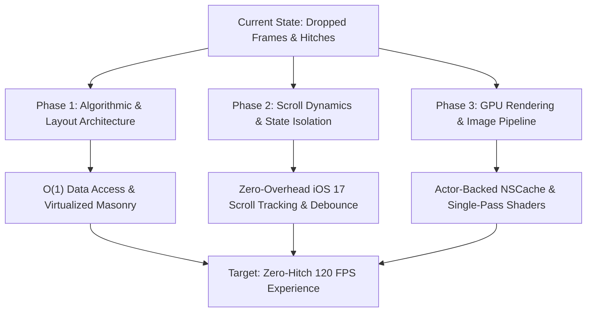

# SwiftUI Performance Optimization Plan

- **Status**: Proposed
- **Date**: 2026-10-20
- **Target OS**: iOS 17.0+, macOS 14.0+
- **Author**: Antigravity Assistant & Engineering Team
- **Scope**: Core SwiftUI screens, layout virtualization, scroll pipeline, rendering compositor, and image caching across `iosApp`.

---

## 1. Executive Summary & Objective

The `iosApp` leverages a modern stack combining SwiftUI, Swift Concurrency, Kotlin Multiplatform (`shared`), and Apple's `@Observable` macro. However, performance evaluation of the UI layer revealed dropped frames, scroll hitches during fast velocity gestures, redundant CPU work, and memory spikes.

This specification outlines the technical investigation and phased architecture plan to achieve a solid **120 FPS / 60 FPS hitch-free experience** across iPhone, iPad, and Mac platforms without introducing visual regressions.



---

## 2. Phase 1: Algorithmic & Layout Architecture

### 2.1 Detailed Technical Investigation

#### Finding 1.1: $O(N^2)$ Lookup Complexity During Scroll Rendering
* **Locations**:
  - [`SearchView.swift:151`](file:///Users/davidtiagoconceicao/Developer/image-feed-app/iosApp/iosApp/SearchView.swift#L151)
  - [`UserProfileView.swift:411`](file:///Users/davidtiagoconceicao/Developer/image-feed-app/iosApp/iosApp/UserProfileView.swift#L411)
  - [`CollectionDetailView.swift:214`](file:///Users/davidtiagoconceicao/Developer/image-feed-app/iosApp/iosApp/CollectionDetailView.swift#L214)
* **Mechanism**:
  Inside column `ForEach` loops, every item performs a linear scan to find its global flat index:
  ```swift
  let flatIndex = viewModel.photos.firstIndex(where: { $0.id == photo.id }) ?? 0
  SearchPhotoGridCard(...)
      .staggeredReveal(index: flatIndex)
  ```
  For a feed with $N = 100$ items, rendering triggers up to $10,000$ equality checks per body evaluation. During scrolling and pagination, this blocks the main thread.
* **Finding 1.2: Inefficient Pagination Boundary Check**:
  In [`CollectionsFeedView.swift:292`](file:///Users/davidtiagoconceicao/Developer/image-feed-app/iosApp/iosApp/CollectionsFeedView.swift#L292):
  ```swift
  if let index = viewModel.collections.lastIndex(where: { $0.id == collection.id }),
     index >= viewModel.collections.count - 2 { ... }
  ```
  Every visible card executes a backward search over the entire collection array whenever it appears.

#### Finding 1.3: Redundant Column Array Allocation in View `body`
* **Locations**:
  - [`AdaptiveLayoutHelper.swift:60-62`](file:///Users/davidtiagoconceicao/Developer/image-feed-app/iosApp/iosApp/AdaptiveLayoutHelper.swift#L60-L62)
  - Invoked in `ContentView.swift:284`, `CollectionsFeedView.swift:71`, `SearchView.swift:148`, `UserProfileView.swift:410`, `CollectionDetailView.swift:211`.
* **Mechanism**:
  ```swift
  public static func photosForColumn(index: Int, totalColumns: Int, from photos: [Photo]) -> [Photo] {
      photos.enumerated()
          .filter { $0.offset % totalColumns == index }
          .map { $0.element }
  }
  ```
  On every view update, for an iPad layout with 4 columns, `photosForColumn` filters and allocates 4 distinct array instances. This produces continuous ephemeral memory allocations on the heap and GC/ARC pressure.

#### Finding 1.4: Greedy Root `GeometryReader` Wrapping `ScrollView`
* **Location**: [`CollectionsFeedView.swift:22-26`](file:///Users/davidtiagoconceicao/Developer/image-feed-app/iosApp/iosApp/CollectionsFeedView.swift#L22-L26)
* **Mechanism**:
  The entire screen root is wrapped in `GeometryReader { geometry in ... }` solely to obtain `geometry.size.width` for calculating `cardWidth`. A root `GeometryReader` expands greedily, breaks default safe-area handling, and forces unnecessary parent/child layout passes on window and keyboard resize events.

#### Finding 1.5: Eager ViewModel Instantiation Inside View Initializers
* **Locations**:
  - [`PhotoDetailsView.swift:62`](file:///Users/davidtiagoconceicao/Developer/image-feed-app/iosApp/iosApp/PhotoDetailsView.swift#L62)
  - [`SearchView.swift:27`](file:///Users/davidtiagoconceicao/Developer/image-feed-app/iosApp/iosApp/SearchView.swift#L27)
  - [`UserProfileView.swift:17`](file:///Users/davidtiagoconceicao/Developer/image-feed-app/iosApp/iosApp/UserProfileView.swift#L17)
  - [`CollectionDetailView.swift:23`](file:///Users/davidtiagoconceicao/Developer/image-feed-app/iosApp/iosApp/CollectionDetailView.swift#L23)
* **Mechanism**:
  ```swift
  init(photoId: String, ...) {
      ...
      self._viewModel = State(initialValue: PhotoDetailsViewModel(photoId: photoId))
  }
  ```
  In SwiftUI, parent body re-renders cause child `init` methods to execute repeatedly. Passing `PhotoDetailsViewModel(photoId:)` directly into `State(initialValue:)` causes a new instance to be constructed on the heap on every pass, eagerly invoking `MetroHelper.shared.getPhotoDetailsViewModel(photoId:)` and subscribing to Kotlin Coroutine flows, before SwiftUI discards it.

---

### 2.2 Proposed Architecture & Implementation Plan for Phase 1

1. **Eliminate $O(N^2)$ Lookups with Pre-Indexed View Models**:
   - Introduce an indexed container struct in `AdaptiveLayoutHelper`:
     ```swift
     public struct IndexedItem<T>: Identifiable {
         public let index: Int
         public let item: T
         public var id: AnyHashable
     }
     ```
   - Partition items into pre-calculated column buckets `[[(index: Int, photo: Photo)]]` once whenever the backing data source changes in the `@Observable` ViewModel.
   - Replace linear scan in `CollectionsFeedView.onAppear` with direct suffix matching:
     ```swift
     if collection.id == viewModel.collections.suffix(2).first?.id {
         viewModel.loadNextPage()
     }
     ```

2. **Memoize Column Buckets in ViewModels**:
   - Add computed or stored properties in `FeedViewModel`, `CollectionsFeedViewModel`, and `SearchViewModel`:
     ```swift
     var columnBuckets: [[(index: Int, photo: Photo)]]
     ```
   - Update `columnBuckets` only when `photos` count or `columnCount` changes, eliminating array reallocation during scrolling.

3. **Remove Root `GeometryReader` in `CollectionsFeedView`**:
   - Remove outer `GeometryReader`.
   - Use SwiftUI iOS 17 `.containerRelativeFrame(.horizontal)` or extract width through `AdaptiveLayoutHelper.getScreenWidth()`.

4. **Lazy ViewModel Initialization Pattern**:
   - Avoid executing KMP factory initialization inside `View.init`.
   - Use an optional `@State private var viewModel: PhotoDetailsViewModel?` or initialize state lazily inside `.task(id: photoId)`:
     ```swift
     @State private var viewModel: PhotoDetailsViewModel?

     var body: some View {
         Group {
             if let viewModel {
                 PhotoDetailsContent(viewModel: viewModel)
             } else {
                 PhotoDetailsSkeleton()
             }
         }
         .task(id: photoId) {
             if viewModel == nil {
                 viewModel = PhotoDetailsViewModel(photoId: photoId)
             }
         }
     }
     ```

---

## 3. Phase 2: Scroll Dynamics & State Isolation

### 3.1 Detailed Technical Investigation

#### Finding 2.1: High-Frequency PreferenceKey Mutations Triggering Full Hierarchy Diffing
* **Locations**:
  - [`ContentView.swift:265-272`](file:///Users/davidtiagoconceicao/Developer/image-feed-app/iosApp/iosApp/ContentView.swift#L265-L272)
  - [`ContentView.swift:470-498`](file:///Users/davidtiagoconceicao/Developer/image-feed-app/iosApp/iosApp/ContentView.swift#L470-L498)
* **Mechanism**:
  ```swift
  GeometryReader { proxy in
      let offset = proxy.frame(in: .named("feedScroll")).minY
      Color.clear.preference(key: FeedScrollOffsetKey.self, value: offset)
  }
  .frame(height: 0)
  ```
  At 120Hz display refresh rates, `FeedScrollOffsetKey` propagates on every single frame. In `handleScroll(offset:)`:
  ```swift
  if delta > 15 {
      withAnimation(.spring(...)) { activeCapsuleMinimized = true }
  } else if delta < -15 {
      withAnimation(.spring(...)) { activeCapsuleMinimized = false }
  }
  ```
  Even when `activeCapsuleMinimized` is already `true`, scrolling continuously calls `withAnimation`. Because `activeCapsuleMinimized` is bound to `@State private var isCapsuleMinimized` at the root of `ContentView`, every state mutation triggers a diff pass for:
  - Root `TabView` / `NavigationStack`
  - Floating capsule layout
  - The entire `PhotosFeedTabView`
  - A background `Task.sleep` reset task is cancelled and rescheduled on every pixel scrolled.

#### Finding 2.2: Keystroke Flooding Without Debounce in Search
* **Location**: [`SearchView.swift:250-252`](file:///Users/davidtiagoconceicao/Developer/image-feed-app/iosApp/iosApp/SearchView.swift#L250-L252)
* **Mechanism**:
  ```swift
  .onChange(of: searchText) { _, newValue in
      viewModel.updateQuery(newQuery: newValue)
  }
  ```
  Every typed character immediately dispatches `UnifiedSearchIntentUpdateQuery` to Kotlin Multiplatform, kicking off queries and state updates without cancellation or delay.

#### Finding 2.3: Whole-Grid Spring Animation on Data Mutation
* **Location**: [`SearchView.swift:164`](file:///Users/davidtiagoconceicao/Developer/image-feed-app/iosApp/iosApp/SearchView.swift#L164)
* **Mechanism**:
  ```swift
  .animation(.spring(), value: viewModel.photos)
  ```
  When search pagination appends 20 new items to an existing 40 items, SwiftUI applies a spring transition physics solver to all 60 views simultaneously. This causes hitching during list append operations.

---

### 3.2 Proposed Architecture & Implementation Plan for Phase 2

1. **Migrate to iOS 17 Native `.onScrollGeometryChange`**:
   - Completely remove `FeedScrollOffsetKey`, the zero-height `GeometryReader`, and `.coordinateSpace(name: "feedScroll")`.
   - Use the native iOS 17 modifier on `ScrollView`:
     ```swift
     .onScrollGeometryChange(for: CGFloat.self) { geo in
         geo.contentOffset.y
     } action: { oldOffset, newOffset in
         handleScrollChange(from: oldOffset, to: newOffset)
     }
     ```
   - This executes within the render tree and avoids creating secondary layout passes.

2. **Add Strict State Guards and Localized Capsule State**:
   - Prevent redundant animations by guarding mutations:
     ```swift
     let delta = newOffset - oldOffset
     if delta > 15, !isMinimized {
         withAnimation(.spring(response: 0.35, dampingFraction: 0.75)) {
             isMinimized = true
         }
     } else if delta < -15, isMinimized {
         withAnimation(.spring(response: 0.35, dampingFraction: 0.75)) {
             isMinimized = false
         }
     }
     ```
   - Decouple the minimized state into an observable UI coordinator or pass it downwards without causing `ContentView` body re-evaluations.

3. **Debounce Search Keystrokes via Swift Concurrency**:
   - In `SearchView.swift`, manage query dispatch with structured concurrency:
     ```swift
     @State private var searchTask: Task<Void, Never>?

     .onChange(of: searchText) { _, newValue in
         searchTask?.cancel()
         searchTask = Task {
             try? await Task.sleep(nanoseconds: 300_000_000) // 300ms debounce
             guard !Task.isCancelled else { return }
             viewModel.updateQuery(newQuery: newValue)
         }
     }
     ```

4. **Eliminate Global Spring Animation on Pagination**:
   - Remove `.animation(.spring(), value: viewModel.photos)` from `SearchView.swift:164`.
   - Rely solely on `.staggeredReveal(index:)` for newly appeared items to preserve smooth entry animations without physics thrashing.

---

## 4. Phase 3: GPU Rendering & Image Caching Pipeline

### 4.1 Detailed Technical Investigation

#### Finding 4.1: Missing Decoded Image Cache in `KFImage`
* **Location**: [`KFImage.swift:34-69`](file:///Users/davidtiagoconceicao/Developer/image-feed-app/iosApp/iosApp/KFImage.swift#L34-L69)
* **Mechanism**:
  - `KFImage` wraps SwiftUI's `AsyncImage(url:)`.
  - `AsyncImage` caches compressed image bytes in `URLCache`, but **does not maintain an in-memory decoded `CGImage`/`UIImage` cache**.
  - When scrolling cells leave the screen in a `LazyVStack`, SwiftUI unmounts them. When scrolling back, `AsyncImage` must decompress and decode the image from raw bytes again on the CPU/GPU, causing micro-stutters and flashing placeholders.
  - `placeholderView` is wrapped in `AnyView`, breaking static layout diffing and causing per-card heap allocations.

#### Finding 4.2: Metal Offscreen Render Passes from Stacking Materials & Dynamic Shadows
* **Locations**:
  - [`GlassTheme.swift:122-165`](file:///Users/davidtiagoconceicao/Developer/image-feed-app/iosApp/iosApp/GlassTheme.swift#L122-L165)
  - [`ContentView.swift:686`](file:///Users/davidtiagoconceicao/Developer/image-feed-app/iosApp/iosApp/ContentView.swift#L686)
  - [`SearchPhotoGridCard` in SearchView.swift:322`](file:///Users/davidtiagoconceicao/Developer/image-feed-app/iosApp/iosApp/SearchView.swift#L322)
* **Mechanism**:
  In every single photo card:
  - The image placeholder renders `.ultraThinMaterial`.
  - The floating author capsule renders `.ultraThinMaterial` + specular gradient border + dynamic `.shadow(radius: 10)`.
  With 20 to 30 visible cards during scroll flings, the GPU compositor must perform dozens of offscreen blur passes and shadow calculations simultaneously, saturating the GPU fill rate on mobile chipsets.

#### Finding 4.3: Double-Pass Rendering in `ShimmerModifier`
* **Location**: [`AnimationPrimitives.swift:48-74`](file:///Users/davidtiagoconceicao/Developer/image-feed-app/iosApp/iosApp/AnimationPrimitives.swift#L48-L74)
* **Mechanism**:
  ```swift
  content
      .overlay(
          GeometryReader { geometry in
              LinearGradient(...)
                  ...
                  .mask(content)
          }
      )
  ```
  The modifier places `content`, then layers an overlay with a `GeometryReader`, and then uses `.mask(content)`, forcing SwiftUI to render `content` **twice** for every skeleton loader in every view hierarchy.

#### Finding 4.4: Expensive 60pt Blur in Detail Ambient Backdrop
* **Location**: [`PhotoDetailsView.swift:473-494`](file:///Users/davidtiagoconceicao/Developer/image-feed-app/iosApp/iosApp/PhotoDetailsView.swift#L473-L494)
* **Mechanism**:
  ```swift
  KFImage(URL(string: photo.urls.small))
      .scaleEffect(1.3)
      .blur(radius: 60)
  ```
  A 60pt Gaussian blur on a scaled bitmap continuously recalculates during modal sheet drags, interactive pans, and magnification gestures.

---

### 4.2 Proposed Architecture & Implementation Plan for Phase 3

1. **High-Performance Actor-Backed Image Pipeline (`ImageCacheService`)**:
   - Construct a lightweight in-memory cache using `NSCache<NSURL, UIImage>`:
     ```swift
     public final class ImageCacheService: @unchecked Sendable {
         public static let shared = ImageCacheService()
         private let memoryCache = NSCache<NSURL, UIImage>()

         private init() {
             memoryCache.countLimit = 200
             memoryCache.totalCostLimit = 100 * 1024 * 1024 // 100 MB
         }

         public func image(for url: URL) -> UIImage? {
             memoryCache.object(forKey: url as NSURL)
         }

         public func store(_ image: UIImage, for url: URL) {
             let cost = Int(image.size.width * image.size.height * 4)
             memoryCache.setObject(image, forKey: url as NSURL, cost: cost)
         }
     }
     ```
   - Refactor `KFImage` to check `ImageCacheService` before kicking off network requests, rendering decoded `Image(uiImage:)` instantaneously on cache hit.
   - Replace `AnyView` placeholder with a generic view type `<Placeholder: View>`.

2. **Streamline Glass Theme for High-Frequency Feed Elements**:
   - Create a `.lightweight` glass style for recurring feed cards that uses a solid or simple semi-transparent fill (`Color.black.opacity(0.4)`) without dynamic drop shadows (`hasShadow: false`).
   - Reserve `.ultraThinMaterial` and complex specular shadows for persistent navigation bars, floating tab capsules, and modal sheets.

3. **Single-Pass Skeleton Shimmer**:
   - Replace `.mask(content)` with a single-pass animated linear gradient overlay using `.blendMode(.sourceAtop)` or iOS 17 `PhaseAnimator`:
     ```swift
     content
         .overlay {
             LinearGradient(
                 colors: [.clear, .white.opacity(0.12), .clear],
                 startPoint: .leading,
                 endPoint: .trailing
             )
             .offset(x: phaseOffset)
             .blendMode(.sourceAtop)
         }
     ```
   - Halves the number of render passes for all skeleton placeholders.

4. **Optimize Detail Ambient Backdrop**:
   - Reduce the blur radius from 60 to 24 with a dark vignette tint overlay (`Color.black.opacity(0.5)`).
   - Alternatively, render the blurred backdrop into a static snapshot or apply `.drawingGroup()` to composite via Metal off the main render tree.

---

## 5. Technical Comparison: Before vs. After

| Metric / Behavior | Current Implementation | Optimized Implementation | Improvement |
| :--- | :--- | :--- | :--- |
| **Grid Cell Flat Index Calculation** | $O(N)$ per cell ($O(N^2)$ across feed) | $O(1)$ direct indexed tuple / bucket | Eliminates main thread lag during scroll |
| **Column Array Slicing** | 2–4 allocations per `body` pass | Computed once upon data mutation | Reduces memory churn and GC/ARC thrashing |
| **Scroll Offset Tracking** | `GeometryReader` + `PreferenceKey` at 120Hz | Native iOS 17 `.onScrollGeometryChange` | Zero layout tree passes; eliminates scroll hitches |
| **Search Keystroke Dispatch** | Dispatches to KMP on every character | 300ms Task-based debounce with cancellation | Reduces network & thread contention |
| **Image De-virtualization** | `AsyncImage` re-decodes bitmaps from disk/network | In-memory decoded `NSCache<NSURL, UIImage>` | Instant flicker-free cell recycling |
| **Placeholder Type Erasure** | `AnyView` wrapping placeholder views | Generic `<Placeholder: View>` | Static type layout tree optimizations |
| **Skeleton Shimmer Passes** | 2 passes per card (`.mask(content)`) | 1 pass per card (`.blendMode(.sourceAtop)`) | 50% GPU skeleton draw call reduction |
| **Attribution Pill Compositing** | Real-time material blur + multi-pixel shadow | Lightweight dark capsule, no shadow on fast cells | Drastic reduction in Metal offscreen buffers |

---

## 6. Implementation Milestones & Verification Plan

### Phase 1 Milestones (Layout & Virtualization)
- [ ] Task 1.1: Implement `IndexedItem` and column pre-chunking in `AdaptiveLayoutHelper` & ViewModels.
- [ ] Task 1.2: Remove $O(N^2)$ `firstIndex` calls across `SearchView`, `UserProfileView`, and `CollectionDetailView`.
- [ ] Task 1.3: Eliminate root `GeometryReader` in `CollectionsFeedView`.
- [ ] Task 1.4: Refactor `PhotoDetailsView`, `SearchView`, `UserProfileView`, and `CollectionDetailView` to defer ViewModel instantiation.

### Phase 2 Milestones (Scroll Dynamics & State)
- [ ] Task 2.1: Replace `FeedScrollOffsetKey` in `ContentView` with `.onScrollGeometryChange`.
- [ ] Task 2.2: Add state transition guards to prevent redundant `withAnimation` calls on capsule minimization.
- [ ] Task 2.3: Introduce 300ms structured debouncing in `SearchView`.
- [ ] Task 2.4: Remove collection-level spring animation in `SearchView:164`.

### Phase 3 Milestones (GPU Pipeline & Caching)
- [ ] Task 3.1: Build `ImageCacheService` with `NSCache<NSURL, UIImage>` in `KFImage.swift`.
- [ ] Task 3.2: Remove `AnyView` from `KFImage` and implement generic `<P: View>`.
- [ ] Task 3.3: Refactor `ShimmerModifier` to single-pass blend mode.
- [ ] Task 3.4: Introduce lightweight glass style for feed badges, eliminating shadows in lazy stacks.
- [ ] Task 3.5: Optimize `ambientBackdrop` blur in `PhotoDetailsView`.

### Verification & Profiling Strategy
1. **Instruments Core Animation Hitches**:
   - Profile `iosApp` on a physical ProMotion device (120Hz).
   - Target: **Hitch Time Ratio < 1.0 ms/s** during rapid flings in `PhotosFeedTabView` and `SearchView`.
2. **Instruments Time Profiler**:
   - Verify zero `firstIndex(where:)` or array filtering symbols during scroll traces.
   - Verify `ContentView.body` is not evaluated on scroll offset ticks.
3. **Instruments Allocations & Leaks**:
   - Verify `PhotoDetailsViewModel` is not created repeatedly during navigation or parent re-renders.
   - Verify `UIImage` decoded memory stays within reasonable cache budgets without memory leaks.
