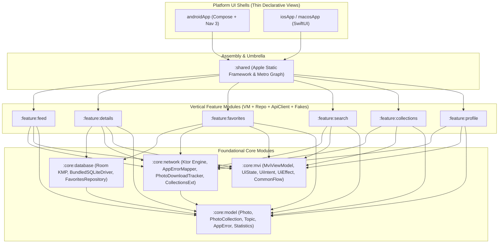

# Architecture & Modules

The codebase uses a **Vertical Feature Ownership** modularization layout backed by a `:shared` umbrella framework, **compile-time Metro DI**, and **Shared MVI / Unidirectional Data Flow (UDF)**.

---

## 1. Module Topology & Dependency Graph

Completed across Specs 46–49 (`specs/archive/46_*` through `49_*`), the project cleanly separates shared core primitives, vertical feature slices, the Apple umbrella framework, and thin native UI shells:

* **Foundational Core (`:core:*`)**:
  * `:core:model`: Pure `@Serializable` domain entities ([`Photo.kt`](../core/model/src/commonMain/kotlin/com/example/imagefeed/model/Photo.kt), [`AppError.kt`](../core/model/src/commonMain/kotlin/com/example/imagefeed/model/AppError.kt), `PhotoCollection`, `Topic`, `Statistics`), shared HSL/hex tonal swatch & accent engine ([`PhotoColorEngine.kt`](../core/model/src/commonMain/kotlin/com/example/imagefeed/model/color/PhotoColorEngine.kt)), and ephemeral Frame-0 metadata LRU cache ([`NavigationPreviewCache.kt`](../core/model/src/commonMain/kotlin/com/example/imagefeed/model/cache/NavigationPreviewCache.kt), `maxEntries = 16`).
  * `:core:mvi`: Shared MVI contracts and lifecycle base class ([`MviViewModel.kt`](../core/mvi/src/commonMain/kotlin/com/example/imagefeed/presentation/mvi/MviViewModel.kt), [`CommonFlow.kt`](../core/mvi/src/commonMain/kotlin/com/example/imagefeed/presentation/mvi/CommonFlow.kt)).
  * `:core:network`: Ktor client factory ([`HttpClientFactory.kt`](../core/network/src/commonMain/kotlin/com/example/imagefeed/core/network/HttpClientFactory.kt)), [`AppErrorMapper.kt`](../core/network/src/commonMain/kotlin/com/example/imagefeed/core/network/AppErrorMapper.kt), [`PhotoDownloadTracker.kt`](../core/network/src/commonMain/kotlin/com/example/imagefeed/core/network/PhotoDownloadTracker.kt), [`CollectionsExt.kt`](../core/network/src/commonMain/kotlin/com/example/imagefeed/core/network/CollectionsExt.kt), and [`AppScope.kt`](../core/network/src/commonMain/kotlin/com/example/imagefeed/core/network/di/AppScope.kt).
  * `:core:database`: Local Room KMP + `sqlite-bundled` storage ([`FavoritesDatabase.kt`](../core/database/src/commonMain/kotlin/com/example/imagefeed/core/database/FavoritesDatabase.kt), [`FavoritesRepository.kt`](../core/database/src/commonMain/kotlin/com/example/imagefeed/core/database/FavoritesRepository.kt)). KSP (`room-compiler`) runs exclusively inside `:core:database`; Android initializes context via [`SharedAndroidInitializer`](../shared/src/androidMain/kotlin/com/example/imagefeed/di/SharedAndroidInitializer.kt), and Apple scopes storage by bundle ID with an `InMemoryFavoritesRepository` fallback in bare Kotlin/Native test executables ([`FavoritesDatabase.apple.kt`](../core/database/src/appleMain/kotlin/com/example/imagefeed/core/database/FavoritesDatabase.apple.kt)).
* **Vertical Feature Modules (`:feature:*`)**:
  * `:feature:feed`, `:feature:details`, `:feature:favorites`, `:feature:search`, `:feature:collections`, `:feature:profile` each own their API clients, repositories/storage integrations, Metro `@BindingContainer` modules, ViewModels, feature-local models (`PhotoStats`, `UserStats`), and `commonTest` suites.
* **Umbrella Module (`:shared`)**:
  * [`shared/build.gradle.kts`](../shared/build.gradle.kts) builds the static Apple framework (`baseName = "shared"`) for `iosArm64`, `iosSimulatorArm64`, and `macosArm64`, selectively exporting `:core:model`, `:core:mvi`, and all six `:feature:*` modules while keeping `:core:network` and `:core:database` `implementation`-scoped to minimize ObjC/Swift bridging overhead and hide internal Room types.

---

## 2. Compile-Time Dependency Injection (Metro)

* **Root Graph**: [`ApplicationGraph`](../shared/src/commonMain/kotlin/com/example/imagefeed/di/Metro.kt) uses `@DependencyGraph(scope = AppScope::class, bindingContainers = [...])` combining `AppModule` with `DatabaseModule`, `FeedModule`, `PhotoDetailsModule`, `SearchModule`, `CollectionsModule`, and `ProfileModule`.
* **Singleton Scoping**: Core `HttpClient`, `PhotoDownloadTracker`, `FavoritesRepository`, `NavigationPreviewCache` (`maxEntries = 16`, accessed via `MetroHelper` preview seed/read helpers), and feature repositories are annotated `@SingleIn(AppScope::class)` using [`AppScope`](../core/network/src/commonMain/kotlin/com/example/imagefeed/core/network/di/AppScope.kt) (`@HiddenFromObjC`).
* **Factory & Direct ViewModel Provision**: Unparameterized ViewModels (`FeedViewModel`, `FavoritesViewModel`, `UnifiedSearchViewModel`, `CollectionsFeedViewModel`) use `@Inject`. Parameterized ViewModels (`PhotoDetailsViewModel`, `CollectionDetailViewModel`, `UserProfileViewModel`, and `RandomPhotoViewModel` with `@Assisted autoFetchOnInit: Boolean = true`) use `@AssistedInject` with `@AssistedFactory` exposed through `MetroHelper` (`MetroHelper.getRandomPhotoViewModel()` defaults `autoFetchOnInit = true`, while `getRandomPhotoViewModel(autoFetchOnInit: Boolean)` exposes explicit control).

---

## 3. Shared MVI / UDF & Coroutine Lifecycle

* **Base Class**: [`MviViewModel<S : UiState, I : UiIntent, E : UiEffect>`](../core/mvi/src/commonMain/kotlin/com/example/imagefeed/presentation/mvi/MviViewModel.kt) extends `androidx.lifecycle.ViewModel`.
* **Streams**:
  * `state: StateFlow<S>` (Android) and `iosState: CommonFlow<S>` (lazy `by lazy(PUBLICATION)` for Apple).
  * `effects: Flow<E>` and `iosEffects: CommonFlow<E>` backed by a `Channel<E>(Channel.BUFFERED)` for one-off navigation/haptic/toast events.
  * `dispatch(intent: I)` processes all UI events and mutates state atomically via `updateState { ... }`.
* **Lifecycle & Deterministic Teardown**:
  * All async coroutines launch in `viewModelScope` and rethrow `CancellationException` cleanly.
  * **Android**: Navigation 3 entries scope ViewModels via `viewModel(key = ...) { MetroHelper.get...() }` inside `rememberViewModelStoreNavEntryDecorator()`, automatically invoking `onCleared()`.
  * **Apple (`iosApp` / `macosApp`)**: Views defer KMP ViewModel instantiation out of `View.init` using lazy `@State` initialization (Spec 68); all 7 Swift wrappers (`FeedViewModel`, `CollectionsFeedViewModel`, `CollectionDetailViewModel`, `FavoritesViewModel`, `SearchViewModel`, `UserProfileViewModel`, `PhotoDetailsViewModel`) conform to `@MainActor @Observable final class` with `MainActor.assumeIsolated` inside KMP `watch` closures and `@ObservationIgnored private nonisolated(unsafe) var ...Closeable: Closeable?`, cancelling watchers and invoking `viewModel.clear()` in `deinit` (calling `viewModelScope.cancel()`, `_effects.close()`, and `teardown()`).

---

## 4. Apple Swift Interop Invariants

* `iosApp` and `macosApp` targets in [`iosApp/project.yml`](../iosApp/project.yml) share the same `iosApp/iosApp` Swift source tree.
* Kotlin declarations invoked only from Swift require `@Suppress("unused") // Invoked on Swift code`.
* Kotlin properties colliding with Objective-C/Swift protocols (e.g., `Photo.description`) map to `description_` in Swift.

---

## 5. Build Infrastructure (`build-logic` Convention Plugins)

* **Included Build**: [`build-logic/convention`](../build-logic/convention/build.gradle.kts) is included via `pluginManagement.includeBuild("build-logic")` in [`settings.gradle.kts`](../settings.gradle.kts) and shares [`gradle/libs.versions.toml`](../gradle/libs.versions.toml) through [`build-logic/settings.gradle.kts`](../build-logic/settings.gradle.kts). It compiles with `java-gradle-plugin` + `kotlin.jvm` (Java `21` target, required by Metro `1.6.0`) without `kotlin-dsl`.
* **Single-Classloader Contract**: External plugin artifacts are declared `compileOnly(...)` in `build-logic:convention`, while root [`build.gradle.kts`](../build.gradle.kts) retains `apply false` plugin declarations (and zero `subprojects {}` blocks) so all 13 modules resolve AGP, KGP, and third-party Gradle plugins through one shared root classloader.
* **Convention Plugins**:
  * `imagefeed.quality` ([`QualityConventionPlugin.kt`](../build-logic/convention/src/main/kotlin/com/example/imagefeed/buildlogic/QualityConventionPlugin.kt)): Applies and configures `ktlint` and `detekt` strictly on concrete modules (skipping empty `:core` and `:feature` containers).
  * `imagefeed.kmp.library` ([`KmpLibraryConventionPlugin.kt`](../build-logic/convention/src/main/kotlin/com/example/imagefeed/buildlogic/KmpLibraryConventionPlugin.kt)): Applies KMP, AGP KMP Library, and `imagefeed.quality`, configures `jvmToolchain(17)`, `"android"` target (`compileSdk`, `minSdk`, `withHostTest {}`), `iosArm64()`, `iosSimulatorArm64()`, and `macosArm64()`.
  * `imagefeed.metro` ([`MetroConventionPlugin.kt`](../build-logic/convention/src/main/kotlin/com/example/imagefeed/buildlogic/MetroConventionPlugin.kt)): Applies `dev.zacsweers.metro` with `enabled = true`, `debug = false`.
  * `imagefeed.android.application` ([`AndroidApplicationConventionPlugin.kt`](../build-logic/convention/src/main/kotlin/com/example/imagefeed/buildlogic/AndroidApplicationConventionPlugin.kt)): Applies `com.android.application` and `imagefeed.quality` with catalog SDKs, Java `17` `compileOptions`, and `jvmToolchain(17)`.
  * `imagefeed.android.test` ([`AndroidTestConventionPlugin.kt`](../build-logic/convention/src/main/kotlin/com/example/imagefeed/buildlogic/AndroidTestConventionPlugin.kt)): Applies `com.android.test` and `imagefeed.quality` with catalog SDKs and `jvmToolchain(17)`.
* **Isolated `local.properties` Access**: [`AndroidSdkConfig.kt`](../build-logic/convention/src/main/kotlin/com/example/imagefeed/buildlogic/AndroidSdkConfig.kt) provides `Project.readLocalProperty(key)` backed by `providers.fileContents(isolated.rootProject.projectDirectory.file("local.properties"))`.
